# 5. CRM 客户销售

CRM 用于维护客户档案、记录客户沟通过程，并通过每日计划和每周计划安排销售工作。本章只说明当前可以独立使用的客户与计划功能。

> **销售订单暂缓使用**：CRM“销售订单”和“销售订单审核”暂不编写操作步骤，也不作为当前培训内容。待 ERP 的商品、库存、出库等能力完善并完成联动后，再统一补充订单全流程。

## 5.1 先了解 CRM 的使用顺序

新用户建议按“建档 → 跟进 → 每日计划 → 每周计划”的顺序使用。计划项尽量关联客户，后续回顾时才能看出工作对应哪个客户。

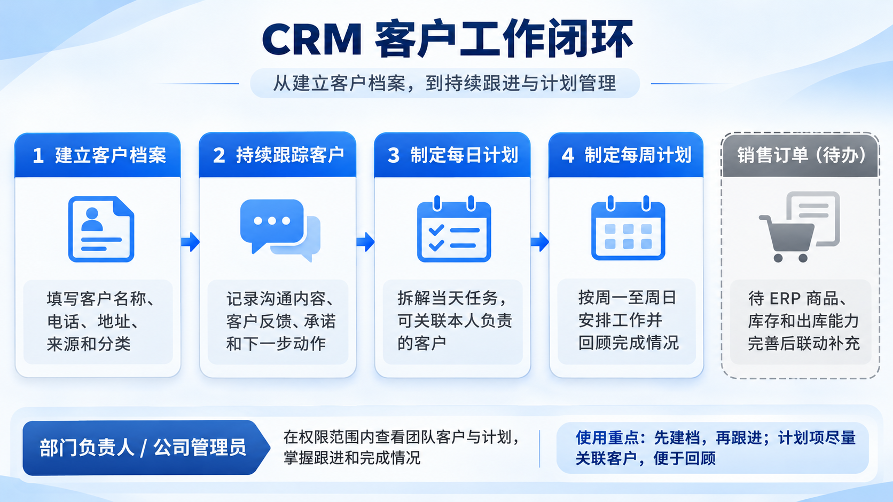

当前 CRM 菜单包括“客户管理”“每日计划”和“每周计划”。页面上能够看到的数据、筛选项和操作按钮由账号权限决定：普通销售人员主要维护本人负责的客户和计划；具有团队查看权限的负责人或管理员，可在授权范围内查看其他人员的数据。

## 5.2 客户管理

### 5.2.1 查看和查询客户

进入“CRM 客户销售 → 客户管理”。列表展示客户编号、客户名称、联系电话、负责人、分类和相关操作。

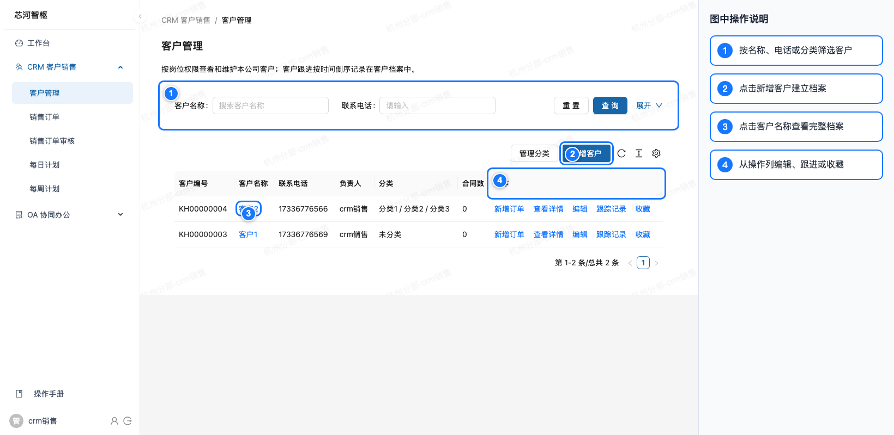

查询时可以组合使用以下条件：

- 客户名称：输入名称关键字。
- 联系电话：输入完整号码或可识别的号码片段。
- 负责人：只有具备团队查看权限的用户才会显示此筛选项。
- 分类：按已维护的客户分类筛选。
- 是否收藏：只查看已收藏或未收藏客户。

设置条件后点击“查询”；需要重新开始时点击“重置”。点击客户名称或“查看详情”可打开客户档案。点击“收藏”后，客户名称前会显示星标，便于优先查找。

> 列表中的“新增订单”属于后续销售订单联动能力，本阶段不作为操作入口。

### 5.2.2 新增客户

1. 点击客户列表右上角“新增客户”。
2. 填写客户名称、联系电话和详细地址。
3. 选择来源渠道和客户分类。
4. 根据需要选择协作人并填写备注；没有相应权限时，页面不会显示协作人设置。
5. 核对后点击“保存”。

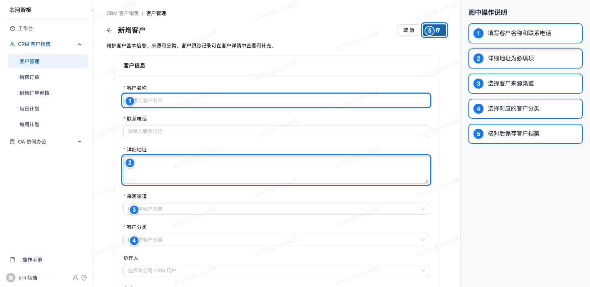

必填项包括客户名称、联系电话、详细地址、来源渠道和客户分类。新建客户的负责人由系统按当前登录用户和权限规则确定；负责人调整在编辑客户时进行，并且只有具有相应权限的用户才能操作。

### 5.2.3 管理客户分类

有权限的用户可在客户列表点击“管理分类”，维护供客户档案使用的分类。分类支持上下级结构，新增客户时从分类树中选择具体分类。

使用建议：

- 分类名称应能被销售团队共同理解，避免同义分类重复创建。
- 先建立稳定的一级分类，再按需要增加二级或三级分类。
- 修改分类前先确认是否会影响已有客户的查询和统计习惯。

### 5.2.4 查看客户详情

客户详情集中展示客户编号、名称、电话、负责人、地址、来源渠道、客户分类、协作人和备注。

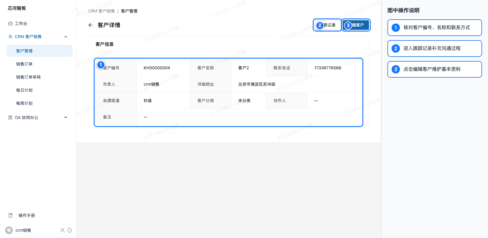

- 点击“跟踪记录”：进入该客户的沟通过程页面。
- 点击“编辑客户”：维护客户基本资料。
- 点击左上角返回：回到客户列表。

### 5.2.5 编辑客户

1. 在客户列表点击“编辑”，或从客户详情点击“编辑客户”。
2. 修改客户名称、电话、地址、来源、分类或备注。
3. 有权限时可以调整负责人和协作人；无权限时负责人只读或不显示编辑入口。
4. 点击“保存”。

如原负责人已离职，系统会保留历史负责人标识，具备负责人调整权限的用户应及时将客户改派给有效用户。

## 5.3 客户跟踪记录

### 5.3.1 新增跟踪记录

在客户列表点击“跟踪记录”，或从客户详情进入“跟踪记录”。页面上方填写本次记录，下方按发生时间倒序展示历史记录。

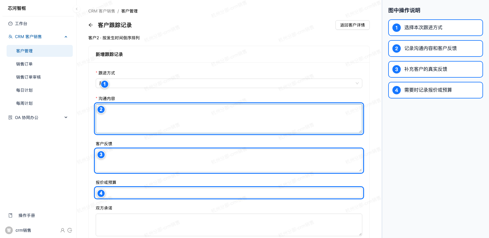

1. 选择跟进方式：拜访、线上或其他。
2. 填写“沟通内容”，这是必填项。
3. 根据实际情况填写客户反馈、报价或预算、双方承诺。
4. 填写下一步跟进动作和下一步跟进时间。
5. 需要时上传附件。
6. 点击“保存跟踪记录”。

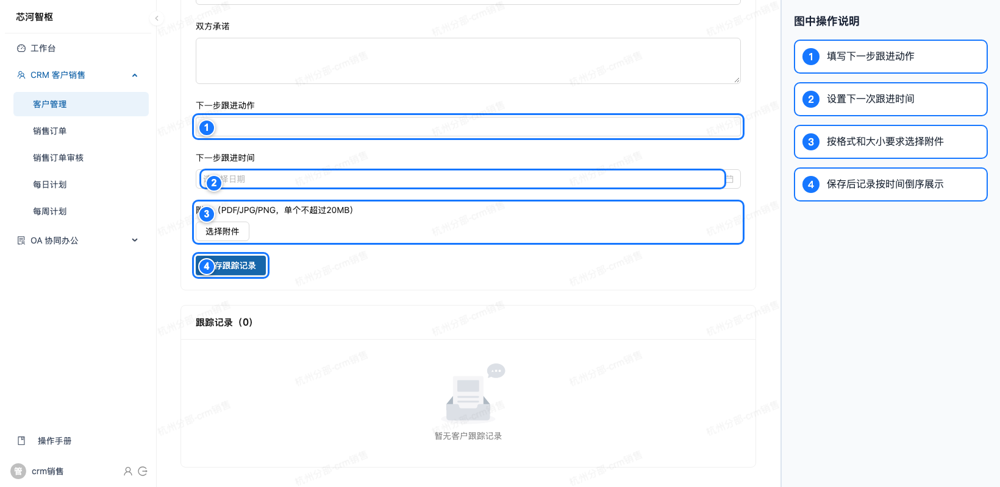

跟踪记录应描述事实和下一步安排，避免只写“已联系”“继续跟进”等无法复盘的内容。推荐写清楚：本次沟通结论、客户关注点、双方承诺、下一次动作和时间。

### 5.3.2 上传和查看附件

跟踪附件仅支持 PDF、JPG、JPEG 和 PNG，单个文件不超过 20 MB。保存记录后，附件显示在对应跟踪记录内；点击附件名称可以下载查看。

如果上传附件时发生失败，先检查格式和大小，再重新选择文件。页面提示上传失败时，已经成功保存的跟踪记录不会丢失。

### 5.3.3 查看历史记录

历史记录按发生时间倒序排列，每条记录显示记录人、跟进方式、沟通内容以及已填写的反馈、报价、承诺、下一步安排和附件。查看时重点确认最近一次沟通结论和下一步时间，避免重复联系或遗漏承诺。

## 5.4 每日计划

### 5.4.1 查看每日计划

进入“CRM 客户销售 → 每日计划”。页面可按月份查看计划；具备相应数据权限时，还可按归属人员筛选。

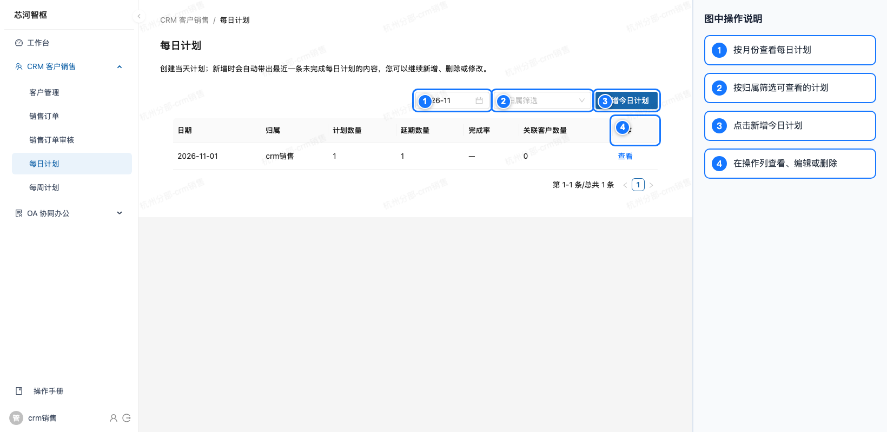

列表中的“计划数量”“延期数量”“完成率”和“关联客户数量”用于快速判断当日工作情况。点击“查看”进入只读详情；本人当天或未来可编辑的计划会显示“编辑”和“删除”。过去日期的计划自动只读。

### 5.4.2 新增今日计划

1. 点击“新增今日计划”。
2. 系统自动确定计划日期和归属人员。
3. 填写计划内容。
4. 可从本人负责的客户中选择关联客户。
5. 如需共同跟进，在“协作人”中选择人员。下拉列表只显示具有计划管理权限的用户。
6. 根据需要填写备注。
7. 需要多项任务时点击“新增计划项”。
8. 点击“保存计划”。

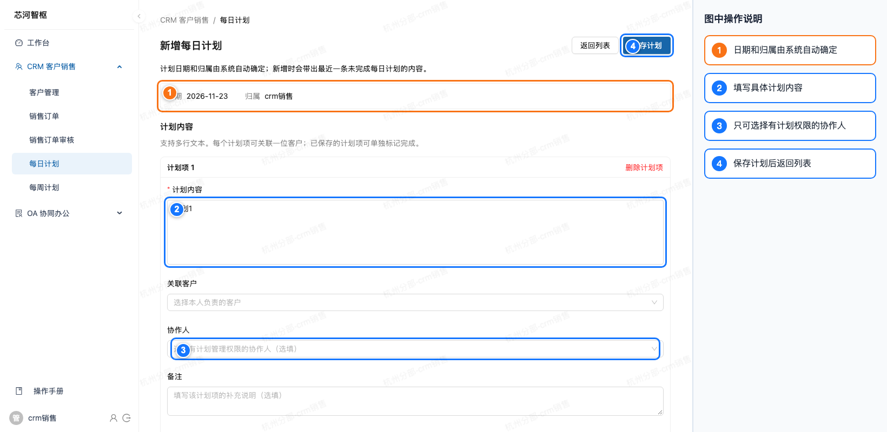

图：每个计划项都可填写内容、关联客户并选择协作人。“协作人”下拉列表只返回具有计划管理权限的用户。

每位用户每天只有一张每日计划。今天已经创建计划时，再点击“新增今日计划”，系统会提示是否继续编辑当天计划。新建时会自动带出最近一张每日计划中尚未完成的内容，用户可继续修改、删除或新增计划项。

### 5.4.3 协作计划项如何显示

将某人加为计划项协作人后，该计划项会同时出现在协作人对应日期的每日计划中。如果协作人当天还没有计划，系统会自动创建，并按现有规则带入上一张计划的未完成项。

- 只有添加该协作项的计划归属人可以修改、完成或删除该项。
- 协作人只读，页面会显示协作来源，不提供编辑和删除操作。
- 协作人下拉列表只包含有计划查看与管理权限的用户；找不到某人时，请管理员检查其岗位或用户权限。

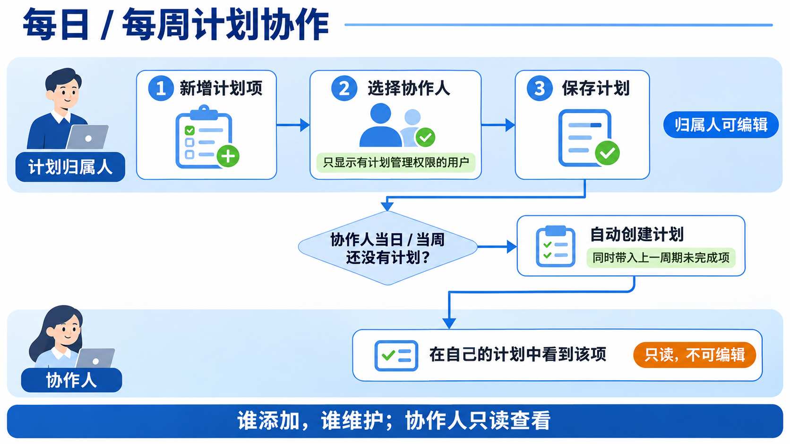

业务图：归属人在计划项中选择有计划权限的协作人，保存后系统为协作人补齐对应周期的计划；归属人可编辑，协作人只读查看。

### 5.4.4 更新完成状态和维护计划项

- 已保存的计划项可单独切换“完成/未完成”。
- 编辑计划时可修改内容、关联客户和备注。
- 删除单个计划项时，系统会再次确认。
- 删除整张每日计划后，该计划及全部计划项会永久删除。
- 只能操作本人可编辑日期范围内的计划；历史计划用于查看和复盘。

## 5.5 每周计划

### 5.5.1 查看每周计划

进入“CRM 客户销售 → 每周计划”。每周周期固定为周一至周日，页面可按月份和授权范围内的归属人员筛选。

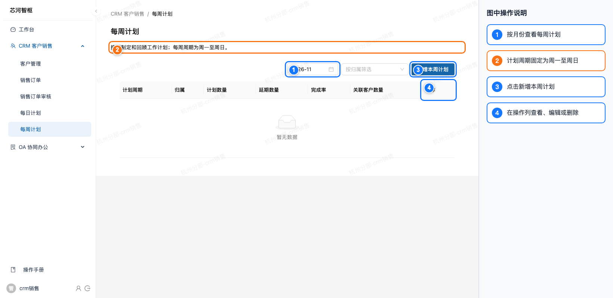

列表展示计划周期、归属人员、计划数量、延期数量、完成率和关联客户数量。点击“查看”进入详情；本人当前周或尚未结束的计划可编辑，已结束的历史周计划只读。

### 5.5.2 新增本周计划

1. 点击“新增本周计划”。
2. 系统自动显示本周起止日期和归属人员。
3. 填写本周计划内容。
4. 可关联本人负责的客户，并选择协作人。协作人下拉列表只展示具有计划管理权限的用户。
5. 根据需要填写备注，需要多项任务时点击“新增计划项”。
6. 点击“保存计划”。

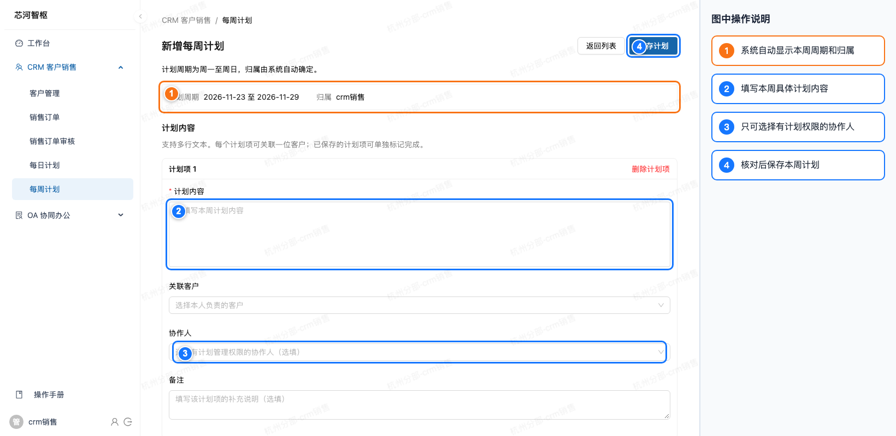

图：每周计划项与每日计划使用同一套协作人选择和只读规则。

每位用户每周只有一张每周计划。本周已经创建计划时，系统会提示是否继续编辑。新建时会带出最近一张每周计划中尚未完成的内容，便于延续未完成事项。

每周计划的协作规则与每日计划相同：协作项会出现在协作人当周计划中；当周无计划时自动创建并带入上一周未完成项；添加人可编辑，协作人只读。

### 5.5.3 完成、编辑和删除

每周计划项的完成状态、关联客户、备注和删除方式与每日计划一致。删除整张每周计划会同时删除其中的计划项，应在确认不再需要保留时操作。

## 5.6 CRM 销售订单（待办）

> 本节暂时留空。待 ERP 系统的商品资料、库存、出库及相关业务规则完善，并与 CRM 销售订单完成联动后，再补充订单创建、审核、状态流转、库存影响和异常处理等完整操作说明及截图。

当前手册不建议用户依据现有页面自行培训或执行销售订单流程。

## 5.7 常见问题

### 5.7.1 为什么看不到其他销售人员的客户或计划？

客户和计划受岗位权限及数据范围控制。普通销售人员通常只处理本人负责的数据；需要查看团队数据时，请由管理员核对岗位权限。

### 5.7.2 为什么新增客户时不能选择负责人？

新建客户由系统按当前用户和权限规则确定负责人。保存后，如账号具有负责人调整权限，可在“编辑客户”中改派。

### 5.7.3 为什么历史计划不能编辑？

过去日期的每日计划、已经结束的每周计划用于留痕和复盘，系统会自动以只读方式打开。

### 5.7.4 为什么新增计划时出现已有计划提示？

系统限制每人每天一张每日计划、每人每周一张每周计划。已有计划时，应选择继续编辑原计划，而不是重复创建。

### 5.7.5 为什么销售订单没有操作说明？

销售订单需要与 ERP 商品、库存和出库流程联动。当前先保留入口和待办章节，待 ERP 完善后统一补充，避免用户按不完整流程操作。
