# 4. OA 协同办公

本章介绍系统中所有员工都会用到的日常办公功能：查看自己的考勤、上下班定位打卡、补打卡、请假申请与审批、个人档案维护和费用报销。审批按有效组织负责人及各业务规则流转，申请人不能审批自己。

> 截图说明：本次新增和替换截图来自实际前端页面，使用隔离的脱敏演示数据，不代表真实员工申请。旧章节保留未受影响的原有截图。移动端截图视口宽度为 390 CSS 像素。

## 4.1 OA 菜单与角色范围

### 4.1.1 进入 OA 协同办公

1. 登录系统后，在左侧导航找到“OA 协同办公”。
2. 点击“OA 协同办公”展开菜单。
3. 普通员工通常可以看到：
   - “我的考勤”；
   - “我的报销”；
   - “个人档案”；
   - “审批中心 > 补打卡申请”；
   - “审批中心 > 请假申请”。
4. 部门负责人如果拥有补打卡审批范围，还会看到“审批中心 > 补打卡审批”；请假审批人使用“审批中心 > 请假审批”处理当前轮到自己的节点。
5. 公司管理员或具有相应范围的账号，还可以看到“全部考勤”；公司管理员还可以看到“考勤规则”和“审批中心 > 人员档案审批”。

菜单是否显示由账号角色、岗位权限和组织关系共同决定。没有看到某个菜单时，不要直接认为系统故障，应先确认当前账号身份和所属公司。

### 4.1.2 OA 功能与角色对照

| 功能 | 普通员工 | 部门负责人 | 公司管理员 |
| --- | --- | --- | --- |
| 我的考勤 | 查看本人 | 查看本人 | 查看本人 |
| 打卡 | 支持 | 支持 | 支持 |
| 申请补打卡 | 支持 | 支持 | 支持 |
| 补打卡申请 | 查看本人申请 | 查看本人申请 | 查看本人申请 |
| 补打卡审批 | 不支持 | 审批下属及下级组织人员 | 可按管理员规则处理 |
| 全部考勤 | 不支持 | 查看负责组织树内人员 | 查看公司全部人员 |
| 请假申请 | 提交及查看本人申请 | 同左 | 同左 |
| 请假审批 | 不审批本人 | 处理当前分配节点 | 处理分配的初审或终审节点 |
| 考勤规则 | 不支持 | 不支持 | 按年配置并发布 |
| 管理员补录打卡 | 不支持 | 按页面权限决定 | 支持 |
| 个人档案 | 查看本人、修改姓名/手机号/邮箱、提交其他档案变更审批 | 同左 | 查看本人；公司管理员还可审批人员档案变更 |
| 人员档案审批 | 不支持 | 需配置 相应的审批权限 | 支持，无需额外配置 |
| 我的报销 | 查看、新建、提交本人报销 | 查看、新建、提交本人报销 | 查看、新建、提交本人报销 |
| 报销初审 | 不支持 | 作为申请人的直属部门负责人自动获得 | 按直属部门负责人关系决定 |
| 报销终审 | 需授予“报销最终审批” | 需授予“报销最终审批” | 默认拥有 |

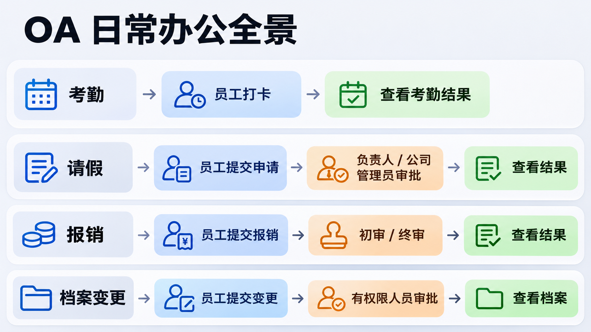

业务图：按角色查看考勤、请假、报销和档案变更的入口及交接。蓝色表示员工操作，橙色表示审批，绿色表示结果。

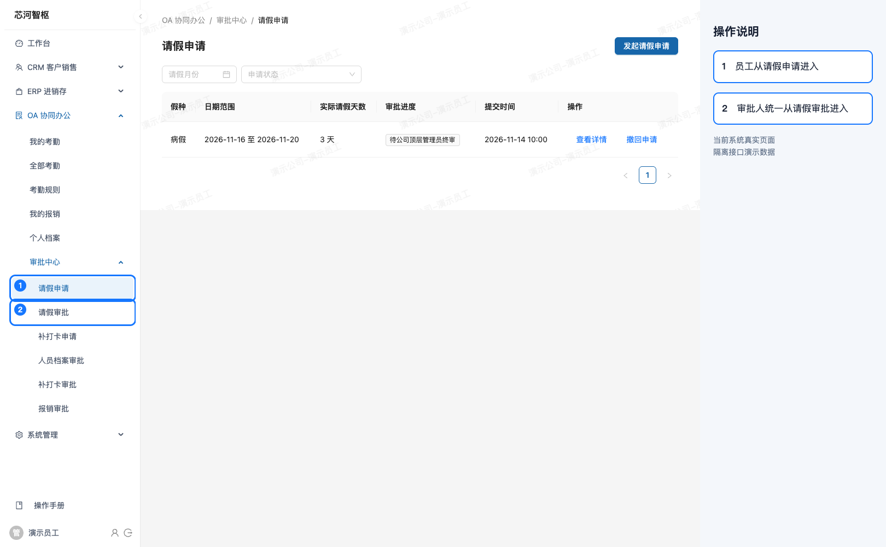

图：演示账号展开 OA 菜单。实际菜单由当前公司、角色及权限决定。

## 4.2 考勤打卡

### 4.2.1 公司管理员配置年度考勤规则

考勤规则每年单独配置。进入“OA 协同办公 > 考勤规则”，页面按“1. 考勤时间”“2. 公司放假”“3. 员工个人放假”排列。时间和假期保存为草稿后，还需发布才正式生效。

1. 选择年份，确认状态为“未配置”“草稿待发布”或“已发布”。
2. 打开“1. 考勤时间”，选择“全年使用同一时间”，或点击“新增日期范围”分段配置。
3. 每段填写开始日期、结束日期、上班时间、下班时间及“弹性时间（分钟）”。例如上半年 09:00—18:00，下半年 08:30—17:30。
4. 弹性默认为 30 分钟，可设置为 0 至 1439 的整数；下班时间必须晚于上班时间，不支持跨午夜时间段。
5. 核对全年覆盖数量和缺失日期，点击“保存考勤时间”。各段不得重叠，需覆盖全年仍有员工应出勤的日期，包括闰年的 2 月 29 日；系统已判定为无需出勤的休假日期可免配时间。
6. 打开“2. 公司放假”，选中未来放假日期，点击“保存公司放假”。公司假只配置日期，不填写具体时段。
7. 打开“3. 员工个人放假”，选择员工并设置日期；可使用“批量添加”“批量取消”按星期设置未来日期，核对“未来已选 / 剩余应选”后点击“保存个人放假”。个人假也只配置日期。
8. 如假期调整改变了应出勤日期，回到考勤时间页补齐缺口。核对时间覆盖、个人假数量和公司假冲突后，点击“发布年度规则”。
9. 看到年度规则已发布的提示后，确认状态为“已发布”。已有发布版本时，修改后的草稿在再次发布前不替代原生效版本。

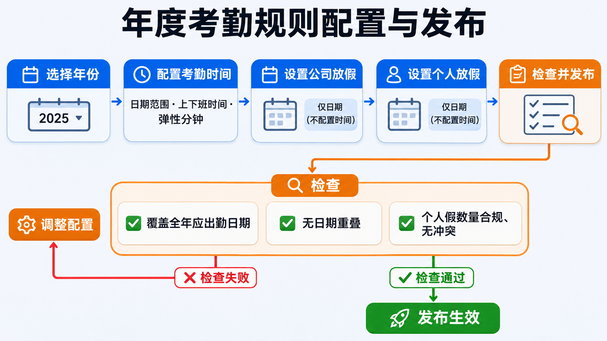

业务图：配置考勤时间、公司假及个人假，再检查覆盖、天数与冲突后发布；发现问题回到对应页调整。

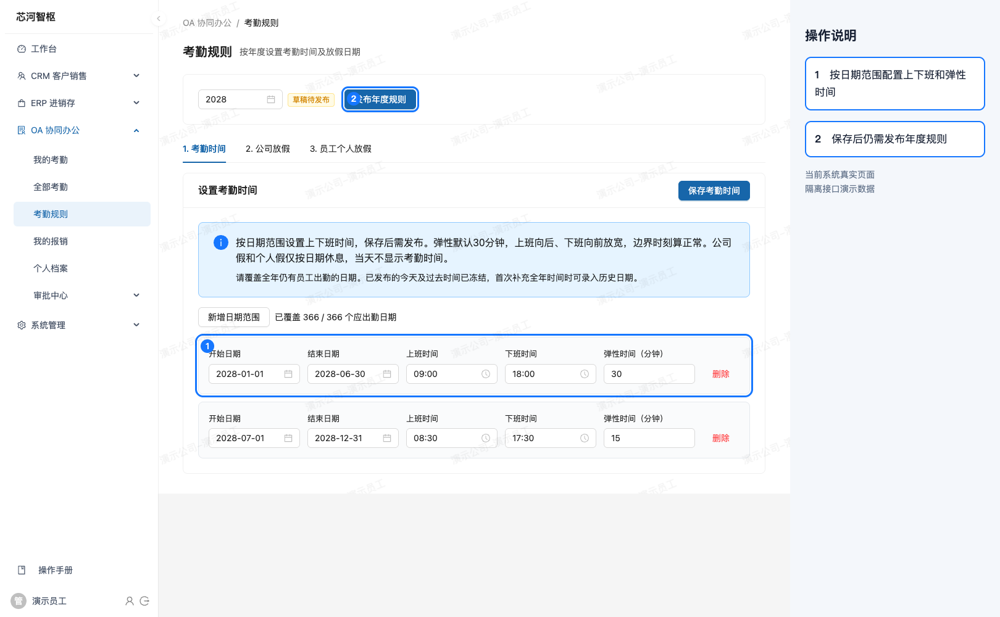

图：演示多个日期范围。保存前核对范围、上下班时间、弹性分钟和覆盖数量。

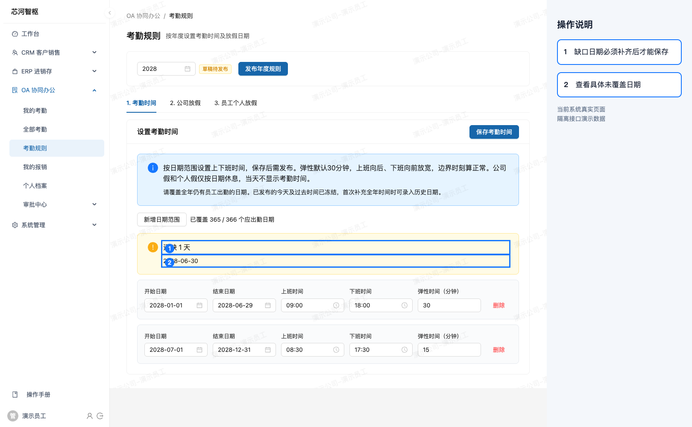

图：缺少应出勤日期时，页面列出缺口，保存被阻止。补齐日期后重新保存。

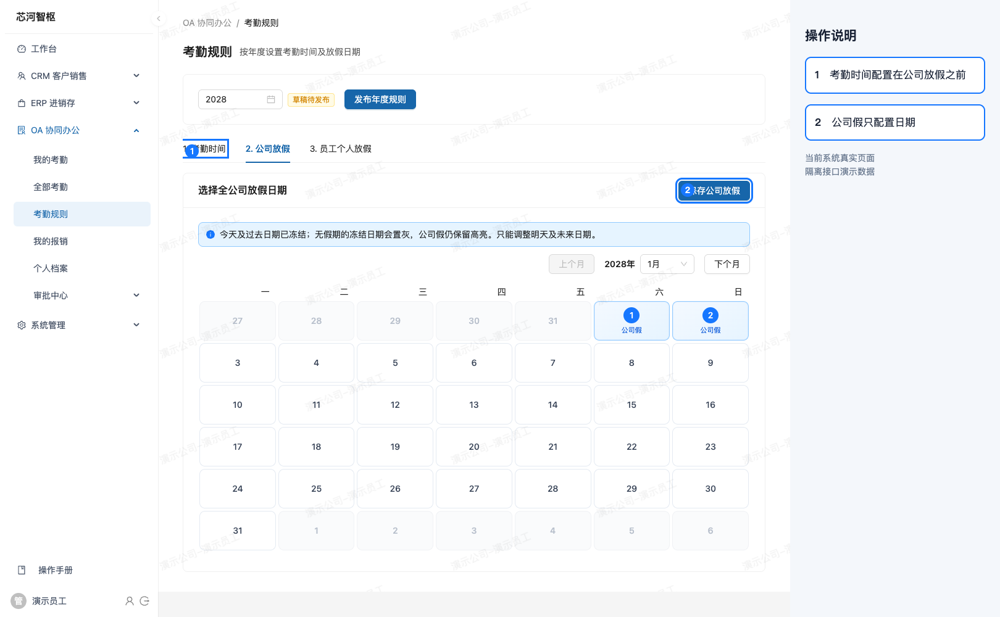

图：公司假仅按日期设置，位于第二个 Tab。

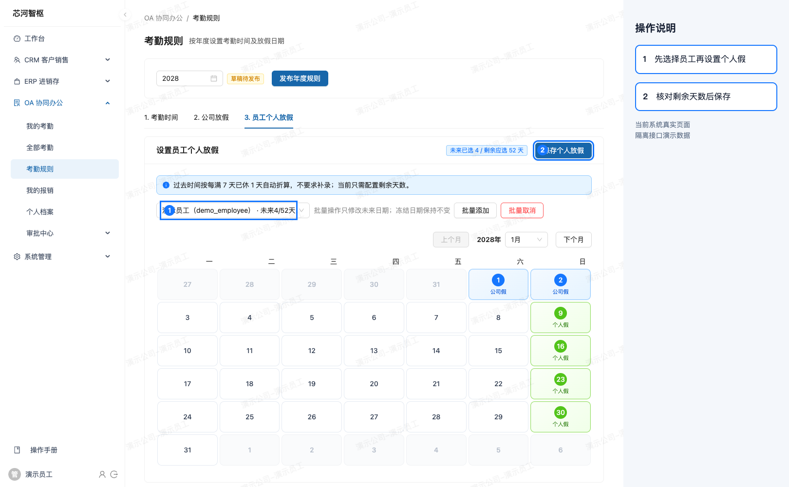

图：个人放假位于第三个 Tab，核对员工、剩余应选天数及冲突日期后保存。

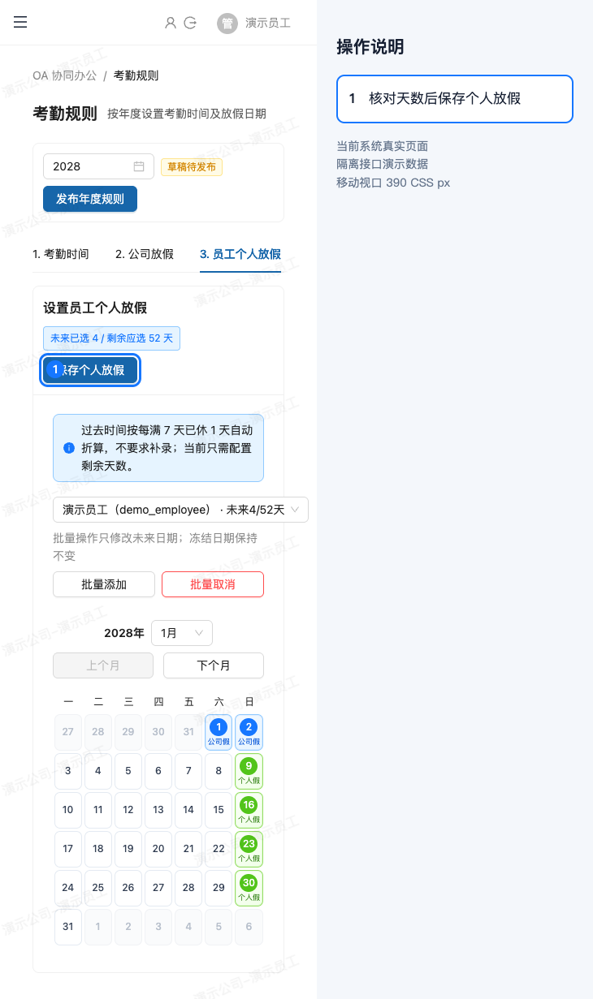

图：390 像素移动端视口下，选择员工、核对数量并使用批量操作。

#### 冻结、天数和冲突规则

- 公司假和个人假今天及过去日期不可再改；无假期的过去日期置灰，已存在的公司假或个人假仍保留高亮以便识别。
- 个人假全年标准数按“当年天数 ÷ 7 向下取整”计算。如果在年中首次使用，过去时间按每满 7 天已休 1 天自动折算，不要求回填；当前只需配置页面显示的“剩余应选”天数。
- 保存个人假和发布年度规则时都会检查数量。数量不等于要求时，根据提示增删日期后重试。
- 公司假后续调整如果与已保存的个人假重合，保存后会弹出冲突人员和日期。点击“去调整第一位员工”会跳到对应个人日历；未清理所有冲突时不能发布。

已发布的今天及过去考勤时间被冻结；首次补充全年考勤时间时可录入历史日期。冻结限制和全年覆盖提示以当前页面为准。

#### 弹性时间如何判断

以 09:00—18:00、弹性 30 分钟为例：

| 打卡 | 正常范围 | 异常范围 |
| --- | --- | --- |
| 上班 | 09:30 及以前，包含 09:30 | 超过 09:30 标记迟到 |
| 下班 | 17:30 及以后，包含 17:30 | 早于 17:30 标记早退 |

弹性时间按当天所属日期范围计算，仅标记迟到或早退，不计算迟到、早退分钟数，也不关联扣款。打卡明细仍保留实际打卡时间。

### 4.2.2 打卡前准备

“上班打卡”和“下班打卡”都会调用浏览器定位。第一次使用前请确认：

1. 当前账号已成功登录，且属于有效公司。
2. 浏览器允许当前系统访问定位。
3. 电脑或手机的系统定位服务已开启。
4. 网络连接正常。
5. 不要使用会阻止定位的隐私模式、浏览器扩展或系统权限设置。

如果浏览器拒绝定位，点击“上班打卡”或“下班打卡”不会成功；需要先在浏览器地址栏的定位权限中改为允许，再重新操作。

### 4.2.3 上班、下班打卡

1. 进入“OA 协同办公 > 我的考勤”，查看当天考勤时间和弹性分钟。
2. 上班时点击“上班打卡”，下班时点击“下班打卡”，确认使用正确的打卡类型。
3. 浏览器请求定位时选择允许，等待定位和提交完成。
4. 看到“打卡成功”后查看当日记录，刷新确认记录保留。
5. 漏打或打卡类型有误时，按补打卡流程申请，不要把多次上班打卡当成已完成下班打卡。

当天记录会结合上下班类型、考勤时间和弹性分钟判断。只有上班记录时，可能显示“待下班打卡”或“下班缺卡”；不能仅凭打卡次数判断正常。公司假和个人假当天不显示考勤时间。

### 4.2.4 查看我的考勤

1. 进入“OA 协同办公 > 我的考勤”。
2. 使用月份选择器切换要查看的月份。
3. 在列表中查看：
   - 日期；
   - 最早打卡时间；
   - 最晚打卡时间；
   - 打卡次数；
   - 系统计算的状态。
4. 点击某一天右侧的“查看”，进入“日期 打卡明细”页面。
5. 在明细中查看每条打卡的时间、类型、来源、定位坐标和备注。
6. 点击“返回我的考勤”回到月度汇总。

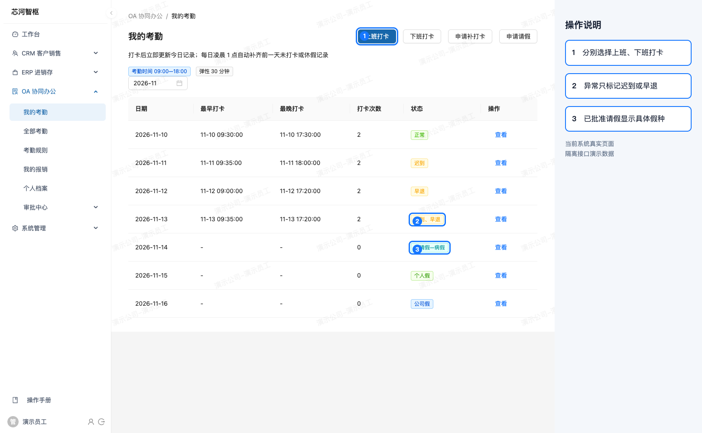

图：脱敏演示考勤记录。核对上班、下班入口、当日考勤时间和状态，使用“查看”进入明细。

考勤状态与颜色说明：

| 状态 | 含义 | 颜色 |
| --- | --- | --- |
| 正常 | 上下班打卡符合当天规则和弹性边界 | 绿色 |
| 迟到／早退／迟到、早退 | 超出对应弹性边界；同时发生时显示“迟到、早退” | 黄色 |
| 待上班打卡、待下班打卡 | 当天相应类型尚未完成 | 蓝色 |
| 上班缺卡、下班缺卡 | 相应打卡缺失；可同时带迟到或早退说明 | 红色或黄色 |
| 已请假—病假／调休假／事假／其他 | 当天应出勤，且有已通过的对应假种申请 | 青色 |
| 个人假 | 当天是员工个人假，即使涵盖在请假范围内也保留此状态 | 绿色 |
| 公司假 | 当天是公司假，即使涵盖在请假范围内也保留此状态 | 蓝色 |
| 单次打卡 | 历史或适用规则下仅有单次记录 | 黄色 |
| 缺勤 | 应出勤且没有有效打卡或已批准请假 | 红色 |
| 规则未配置 | 当天缺少可用考勤规则 | 红色 |

请假范围覆盖个人假或公司假时，休假日期不计入请假天数，考勤仍显示“个人假”或“公司假”；其余已批准请假日期显示具体假种。休假或请假无打卡时，打卡时间为“-”，不会因此记缺勤。

### 4.2.5 无打卡日的记录生成

系统每日 1:00 正常处理前一天：如果员工全天没有打卡，系统会根据当日规则、公司假、个人假和已批准请假补齐日记录。如果之前结算失败或汇总缺失，系统还会自动补处理未完成日期，并修复打卡数不一致或“规则未配置”后需要重算的记录。打卡、补打卡审批通过或管理员补录时，对应日汇总立即重新计算；请假终审通过后，已到结算范围的日期同步重算，未来日期按日期推进形成考勤结果。

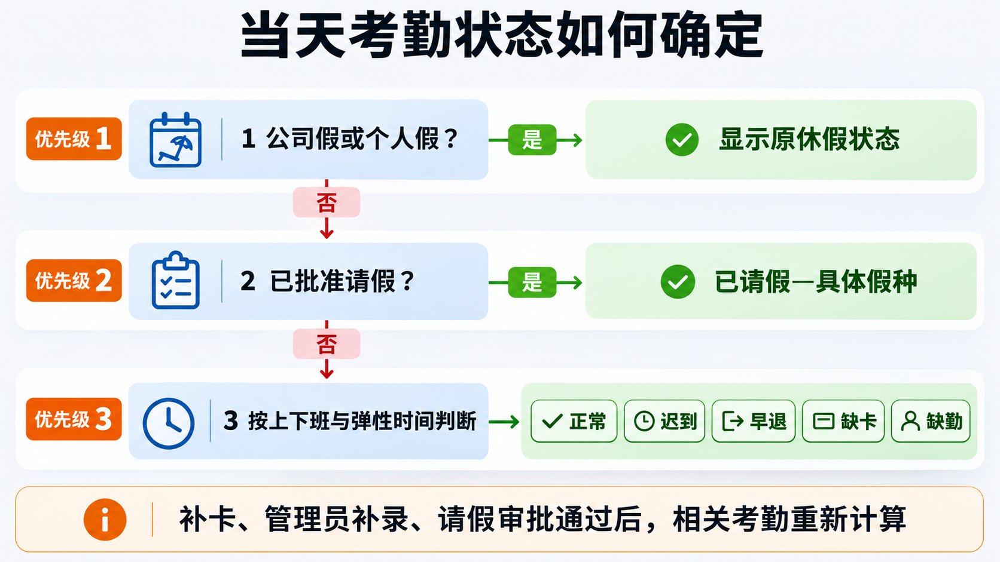

业务图：先区分休假和已批准请假，再按上下班时间和弹性边界判断考勤；补录及审批通过后按适用日期重算。

### 4.2.6 打卡失败处理

| 页面现象 | 处理方法 |
| --- | --- |
| 请允许定位后再操作 | 点击地址栏定位图标，允许当前站点定位后重试 |
| 当前浏览器不支持定位 | 更换支持定位的浏览器或设备 |
| 打卡失败 | 检查网络、定位权限和账号状态，稍后重试 |
| 页面没有新增记录 | 先确认是否出现“打卡成功”提示；成功后记录应立即显示且刷新不丢失，若仍异常请联系管理员 |
| 定位精度不稳定 | 到开阔区域重新定位，或检查设备系统定位服务 |
| 账号无效或已停用 | 联系公司管理员确认账号状态 |

不要为了“补齐记录”连续重复点击“上班打卡”或“下班打卡”。如果已经出现成功提示但列表尚未刷新，先刷新页面确认记录，避免产生重复打卡。

## 4.3 补打卡申请

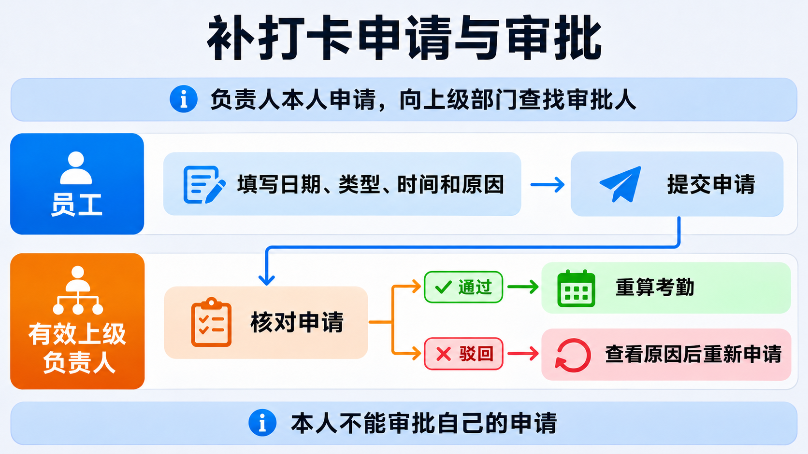

业务图：员工填写日期、打卡类型、时间、位置和原因，由有效上级负责人核对。通过后生成补打卡记录并立即更新日汇总；驳回后查看理由并修改重提。管理员补录是独立协助路径，也会立即更新日汇总，但不进入员工补打卡审批流程。

### 4.3.1 发起补打卡申请

适用场景：忘记打卡、设备临时故障或因网络原因没有形成有效记录时，员工可以提交补打卡申请，由有权限的负责人审核。

1. 进入“OA 协同办公 > 我的考勤”。
2. 点击右上角“申请补打卡”。
3. 在“补打卡时间”中选择实际需要补录的日期和时间。
4. 在“打卡类型”中选择“上班打卡”或“下班打卡”，与需要补录的实际记录对应。
5. 在“补打卡位置”中选择一种定位方式：
   - 点击“当前位置”，使用浏览器当前定位；
   - 在地址框输入地址，点击“地址定位”。
6. 确认页面显示已选位置、经纬度和地图预览。
7. 在“申请原因”中写明未正常打卡的原因。
8. 点击弹窗底部“确定”提交。
9. 看到“补打卡申请已提交，请在审批中心查看进度”提示后，关闭弹窗。

“补打卡时间”“打卡类型”和“申请原因”是必填项；没有选定补打卡位置时，即使其他内容填写完整也不能提交。

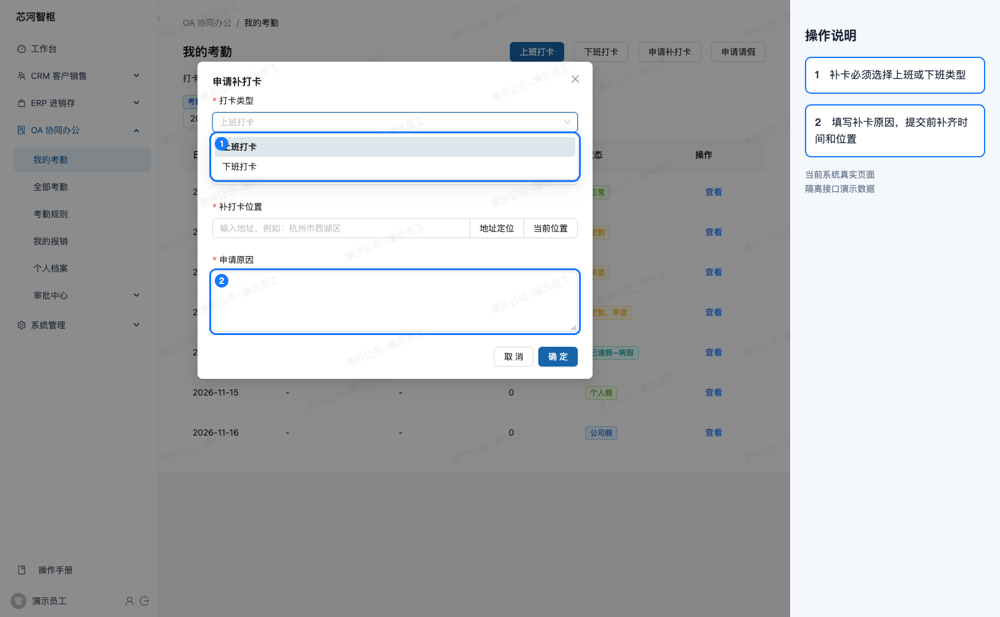

图：脱敏演示身份打开“申请补打卡”弹窗。按实际需要选择“上班打卡”或“下班打卡”，并填写时间、位置和原因；确认前核对打卡类型。

### 4.3.2 查看补打卡申请进度

1. 展开左侧“OA 协同办公”。
2. 点击“审批中心”。
3. 点击“补打卡申请”。
4. 在列表中查看补打卡日期、补打卡时间、类型、申请原因、申请位置和状态。
5. 查看“审批意见”了解负责人通过或驳回的原因。

状态会以业务描述展示：

- “待审批”：已提交，等待负责人处理；
- “已通过”：负责人已同意补打卡；
- “已驳回”：负责人不同意本次申请。

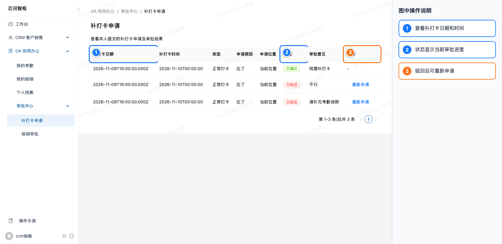

图：申请进度页按列展示补打卡日期、状态、审批意见和后续操作。被驳回的记录可从“操作”列重新申请。

### 4.3.3 被驳回后重新申请

1. 在“审批中心 > 补打卡申请”找到状态为“已驳回”的记录。
2. 点击该记录右侧的“重新申请”。
3. 修改“补打卡时间”。
4. 根据审批意见修改“申请原因”。
5. 确认原申请位置仍然正确；如果原申请没有定位信息，返回“我的考勤”重新发起申请。
6. 点击“确定”重新提交。
7. 看到“补打卡已重新提交”提示后，回到申请列表查看新记录。

## 4.4 部门负责人审批补打卡

补打卡申请按有效组织负责人及补卡审批资格匹配。申请人就是本部门负责人时，跳过本人并向上级部门查找；停用、已删除或无对应审批资格的负责人不会被选中。审批入口仍禁止本人处理自己的历史申请。

### 4.4.1 进入待审批列表

1. 使用部门负责人账号登录。
2. 进入“OA 协同办公 > 审批中心 > 补打卡审批”。
3. 查看待审批列表中的员工、补打卡日期、补打卡时间、类型、申请原因和申请位置。
4. 部门负责人只能处理自己负责组织范围内的申请，包括本部门下属和下级部门人员。

### 4.4.2 通过申请

1. 在待审批列表中找到需要处理的申请。
2. 核对员工姓名、补打卡时间、申请原因和定位信息。
3. 点击右侧“通过”。
4. 看到“已通过申请”提示后，确认该记录从待审批列表中移除。
5. 告知申请人到“审批中心 > 补打卡申请”查看“已通过”状态。

通过后，系统会按补打卡申请生成对应的考勤明细，并立即重新计算该日汇总状态。申请人刷新“我的考勤”后即可查看，无需等待次日定时任务。

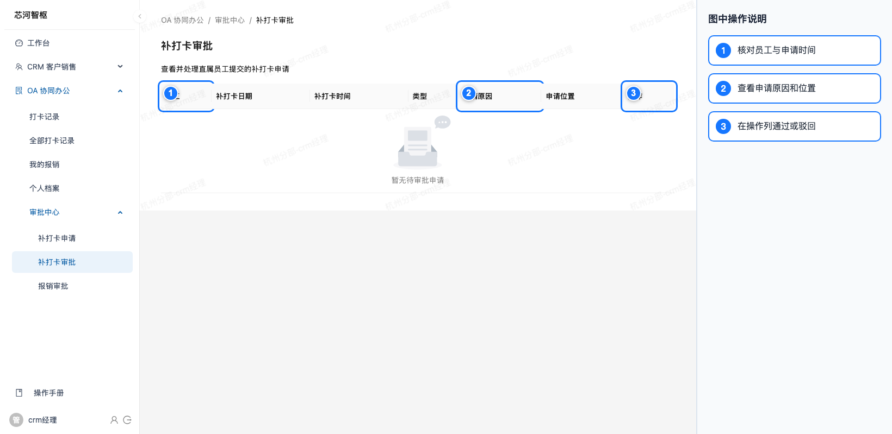

图：使用 `crm_owner` 登录后的“补打卡审批”空状态页面。当前没有待审批记录；有申请时，记录会显示在列表区域，审核人再核对员工、时间、原因和位置并执行“通过”或“驳回”。

### 4.4.3 驳回申请

1. 在待审批列表中找到需要退回的申请。
2. 点击右侧“驳回”。
3. 在“驳回补打卡申请”弹窗中填写具体的“驳回理由”。
4. 点击“确定”提交审批结果。
5. 看到“已驳回申请”提示后，确认申请从待审批列表中移除。

驳回理由为必填项。建议写明缺少的证明、时间不合理或定位信息不足等具体原因，方便员工修改后重新申请。

## 4.5 全部考勤与管理员补录

### 4.5.1 查看全部考勤

该功能面向公司管理员或按内置规则具有查看范围的负责人。部门负责人看到的是自己负责的组织树，公司管理员看到的是本公司人员。

1. 进入“OA 协同办公 > 全部考勤”。
2. 选择月份。
3. 如页面提供公司选择器，先选择目标公司；普通公司管理员不需要跨公司选择。
4. 使用“筛选用户”按人员筛选。
5. 使用“姓名或用户名”输入关键字并搜索。
6. 查看列表中的用户、组织、日期、最早打卡、最晚打卡、打卡次数和状态。
7. 点击某行右侧“查看”，查看该员工当天的打卡明细。

页面使用服务端分页，底部页码用于继续查看结果。负责人不能通过修改筛选条件绕过组织数据范围。

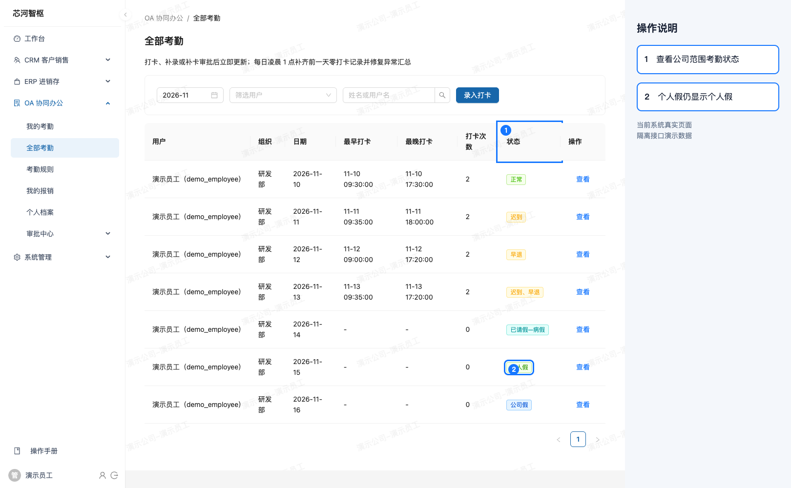

图：脱敏演示身份查看“全部考勤”。页面提供月份、人员和姓名/用户名筛选，并显示组织、打卡次数和状态；实际账号只能查看授权数据范围。

### 4.5.2 管理员补录打卡

1. 进入“OA 协同办公 > 全部考勤”。
2. 点击“录入打卡”。
3. 选择要补录的人员。
4. 选择“打卡时间”。
5. 在“打卡类型”中选择“上班打卡”或“下班打卡”。
6. 在“打卡位置”中点击“当前位置”，或输入地址后点击“地址定位”。
7. 确认已选位置和地图坐标。
8. 在“备注”中填写补录原因或依据。
9. 点击弹窗底部“确定”。
10. 看到“已录入打卡记录”提示后，返回列表核对记录。

管理员补录不是员工补打卡申请，不会进入负责人审批队列。补录时必须选择人员、时间、打卡类型和位置；没有选择位置时不能提交。

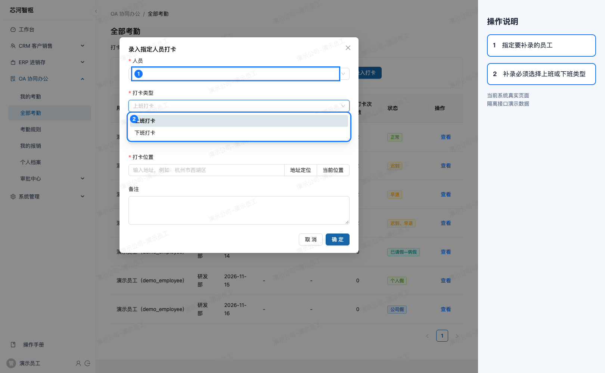

图：脱敏演示。管理员补录弹窗中的人员和“打卡类型”需明确选择；填写时间和定位信息，核对上班或下班类型后再确认。

## 4.6 请假申请与审批

员工需要请假时，在系统中明确日期和原因，提交给相应负责人审批。负责人在统一的“请假审批”列表处理任务，申请人可查看每个审批人的处理进度。

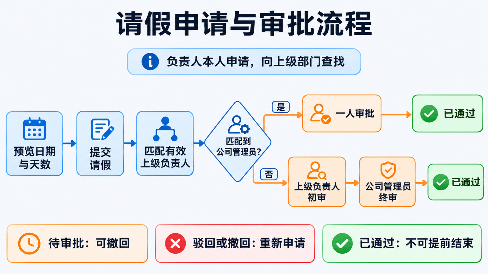

业务图：先预览日期再提交；匹配到公司管理员时只需一人审批，其余申请先经有效上级初审，再由公司顶层管理员终审。待审批可撤回，通过后不能提前结束。

### 4.6.1 查看请假申请列表

1. 进入“OA 协同办公 > 审批中心 > 请假申请”。
2. 按“请假月份”“申请状态”筛选本人申请。
3. 核对假种、起止日期、实际请假天数和当前状态。
4. 点击“查看详情”查看原因、附件、日期明细及审核流转。

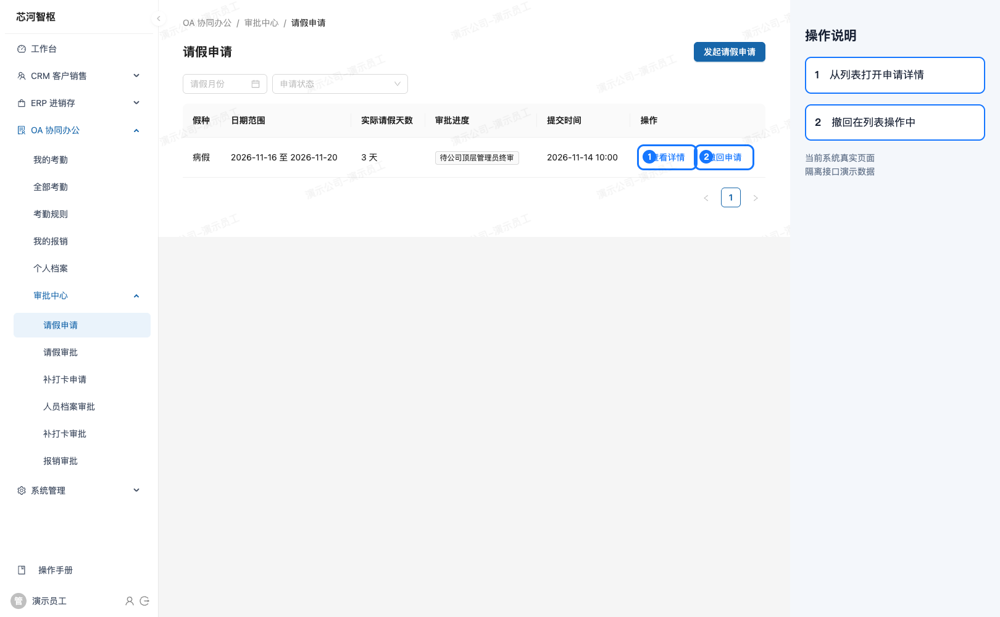

图：Web 保持表格列表，操作栏提供“查看详情”和符合条件时的“撤回申请”。

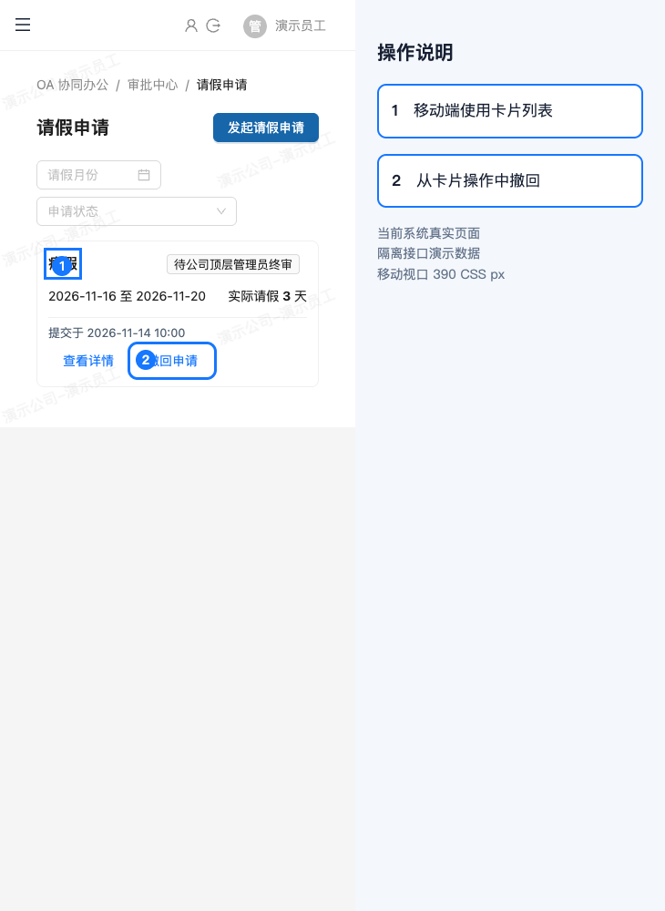

图：390 像素视口下，本人请假申请按卡片展示，操作仍位于各条记录中。

### 4.6.2 发起请假与预览日期

也可从“OA 协同办公 > 我的考勤”点击“申请请假”，快速打开申请表单。

1. 点击“发起请假申请”，打开“新建请假申请”。
2. 选择“假种”：病假、调休假、事假、其他。
3. 选择开始日期和结束日期，按整天申请；当前不提供小时或半天请假。
4. 等待日期预览，核对“申请范围”和“实际请假”天数，逐日查看是否为应出勤日、个人假或公司假。
5. 填写“请假原因”。需要证明时点击“选择附件”，可上传一份 PDF、JPG 或 PNG，单个文件不超过 5 MB。
6. 核对已匹配的初审人，以及需要时的终审人。
7. 点击“提交申请”。提交成功后在列表查看状态，并打开详情核对进度。

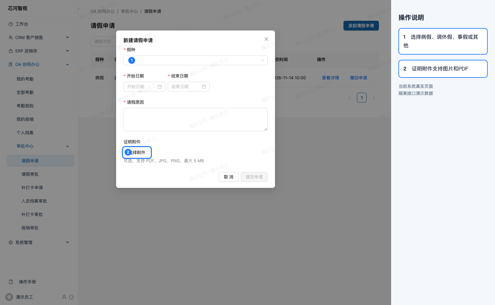

图：新建申请的初始表单，展示假种、起止日期、原因及可选证明附件。尚未选择日期，因此本图不展示日期预览或审批人匹配结果；填写日期后继续核对下图。

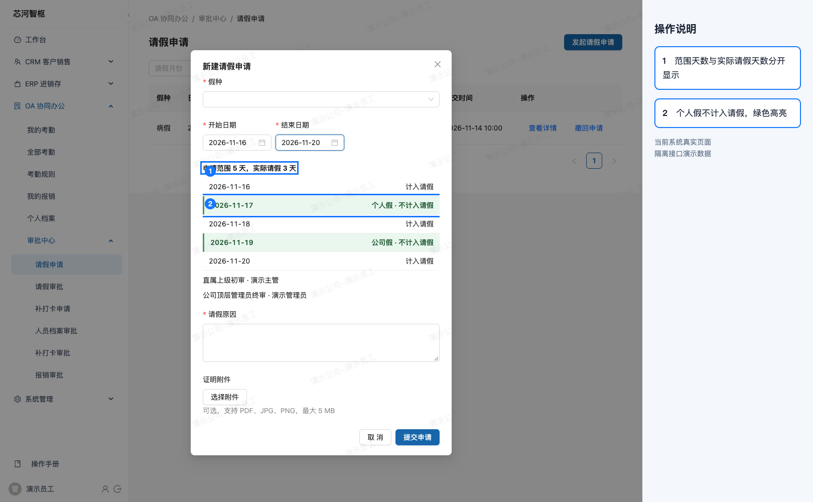

图：个人假和公司假使用绿色突出显示，并注明不计入请假天数。

日期校验与处理：

| 提示或情况 | 处理方式 |
| --- | --- |
| 待审或已通过请假占用了同一应出勤日 | 核对已有申请，调整日期；可撤回的旧申请需先撤回 |
| 所选日期均为休息日 | 无实际请假天数，调整为含应出勤日的范围 |
| 考勤规则未覆盖申请员工 | 请公司管理员完善对应年度规则后再试 |
| 日期早于入职日期 | 调整起始日期，不得早于本人入职日期 |
| 日期范围无效或超过 366 天 | 调整起止日期，单次最多覆盖 366 天 |
| 本部门及上级均无有效负责人 | 联系公司管理员检查组织层级、负责人岗位和有效账号 |
| 缺少公司顶层管理员终审 | 由管理员检查终审人配置；初审人已是公司管理员时无需再增加一人 |

### 4.6.3 实际天数与考勤显示

请假按应出勤日期计算，申请范围内的公司假、个人假不计入实际天数。例如连续申请五天，其中一天是个人假、一天是公司假，实际请假三天。

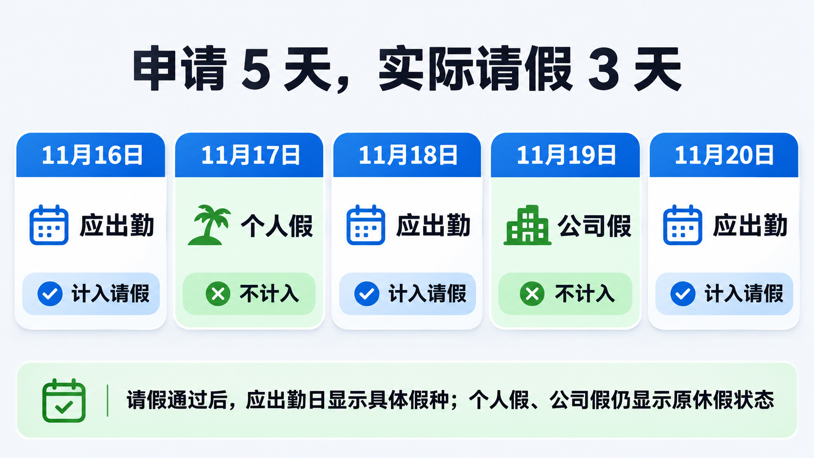

业务图：绿色休息日不计入请假，其他三天按所选假种提交。

| 日期情况 | 是否计入请假 | 考勤结果 |
| --- | --- | --- |
| 应出勤且请假已通过 | 是 | 已请假—病假／调休假／事假／其他 |
| 员工个人假 | 否 | 个人假 |
| 公司假 | 否 | 公司假 |
| 申请尚未通过 | 暂不生效 | 仍按原有考勤规则判断 |

公司假、个人假只表示该日休息，不设置上下班时间。申请通过后不允许提前结束，也不提供销假或自动补回天数的入口；后续需要调休时，另行提交“调休假”申请。

### 4.6.4 审批路线与详情

通常先由有效直属上级初审，再由公司顶层管理员终审。申请人就是本部门负责人时，跳过本人负责的部门，沿上级部门寻找有效负责人。停用、已删除或无效组织关系的负责人不参与匹配，任何人都不能审批本人申请。

如果匹配的上级已经是公司管理员，仅由他一人审批，不继续要求另一位管理员终审。请假的终审身份与报销不同，报销的额外终审权限不能替代请假的公司管理员身份。

1. 在申请列表点击“查看详情”。
2. 顶部查看假种、状态、申请人、部门、日期范围和实际天数。
3. 在“日期明细”核对逐日类型，绿色日期注明不计入请假。
4. 在“审核流转”查看具体审批人、节点状态、处理时间和审批意见。

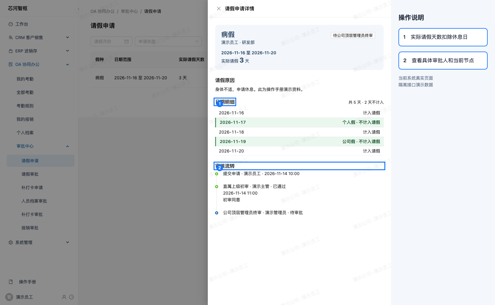

图：初审已通过、正在等待公司顶层管理员终审的演示申请。

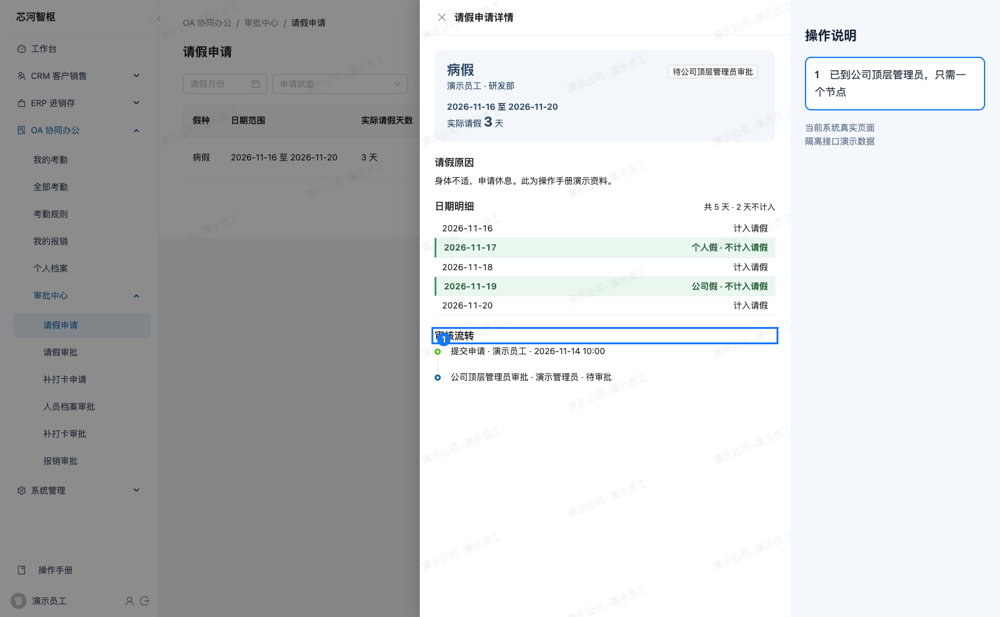

图：匹配到的上级已是公司管理员，仅展示实际需要的一个审批节点。

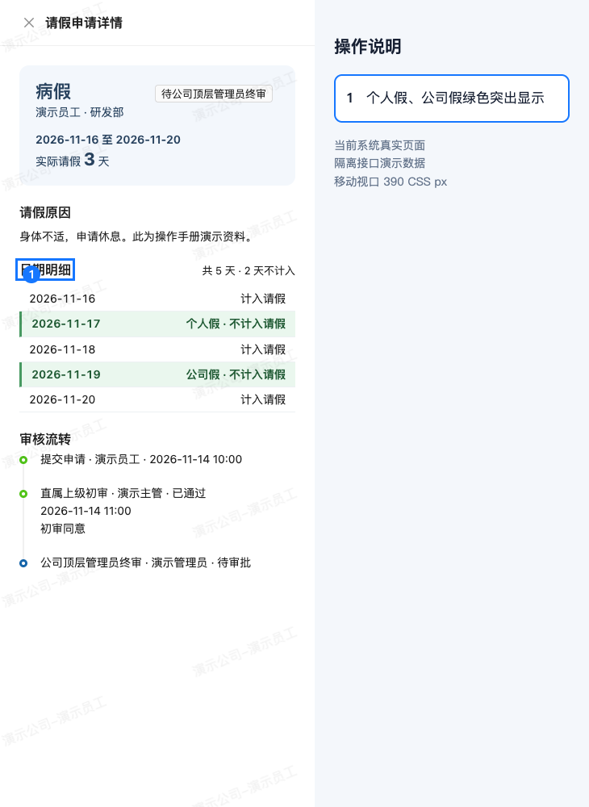

图：移动端同样显示日期明细和审核流转，绿色表示不计入请假的休息日。

### 4.6.5 撤回与修改后重新提交

1. 在本人申请列表找到待审批记录，点击该条记录的“撤回申请”。Web 位于操作栏，移动端位于卡片操作区。
2. 阅读确认提示后确认，列表状态变为“已撤回”，释放占用的请假日期。
3. 撤回入口不放在详情中。待首轮审批或待公司顶层管理员终审时均可撤回，已通过、已驳回或已撤回的申请不能再次撤回。
4. 被驳回或已撤回时，打开详情点击“修改后重新提交”，核对日期、假种、原因和附件后重新提交。新申请不会覆盖原申请的审批记录。

重新申请时需检查证明附件是否已重新选择，不要默认旧附件会自动带入。

### 4.6.6 统一列表审批请假

1. 进入“OA 协同办公 > 审批中心 > 请假审批”。页面只有一个审批列表，不拆成初审列表、终审列表。
2. 按月份或状态筛选，找到当前轮到本人处理的申请，点击“查看详情”。
3. 核对申请人、假种、日期、实际天数、绿色休息日、原因、附件和审核流转。
4. 点击“通过”，可填写审批意见；在确认框核对提示后点击“确认通过”。最终通过时，确认框列出将更新考勤的日期。
5. 不同意时点击“驳回”，填写必填的驳回原因，再点击“确认驳回”。
6. 处理后核对节点状态。初审通过后流转终审；单节点或终审通过后为“已通过”，驳回后为“已驳回”。

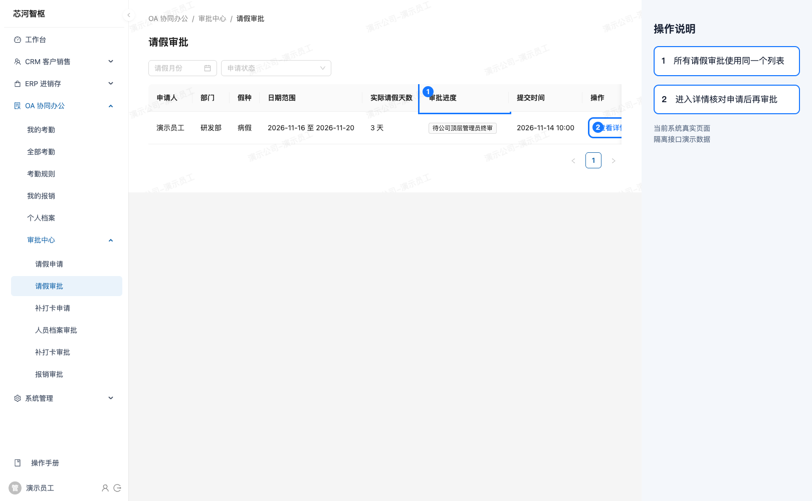

图：初审和终审使用同一个页面，仅当前节点指定审批人能够操作。

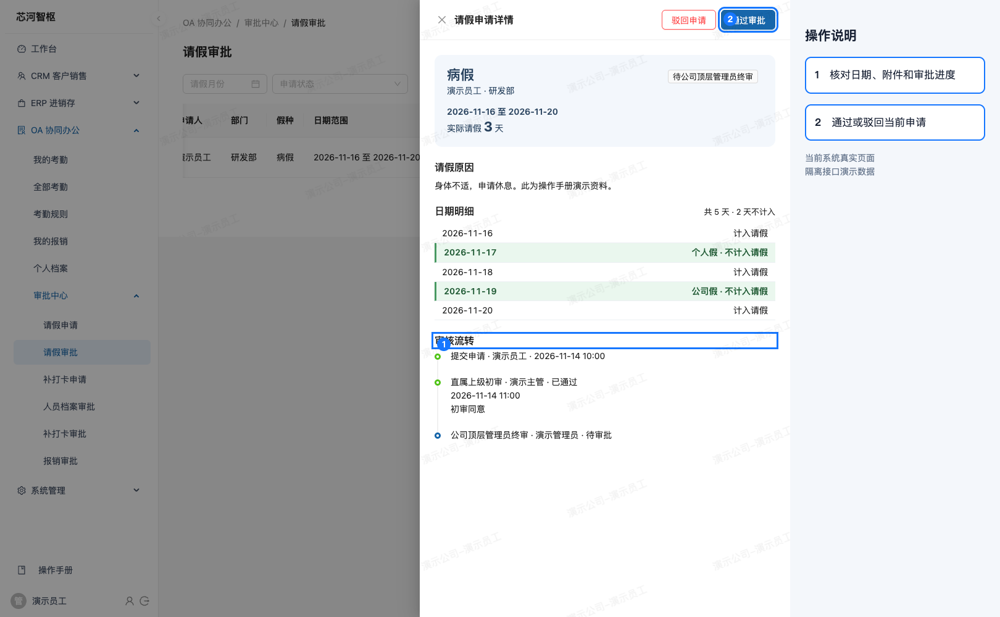

图：先核对日期和附件，再在详情操作区作出决定。

如果最终审批时提示考勤规则已变化，不能直接按旧日期明细通过。应驳回并说明原因，请申请人重新预览日期、核对天数后提交。

### 4.6.7 图片与 PDF 证明预览

在详情“请假原因”下点击证明附件名称，打开页面内预览窗口。图片在窗口显示，支持进一步查看；PDF 在窗口内阅读，关闭窗口返回原申请。手册示例附件均为测试内容。

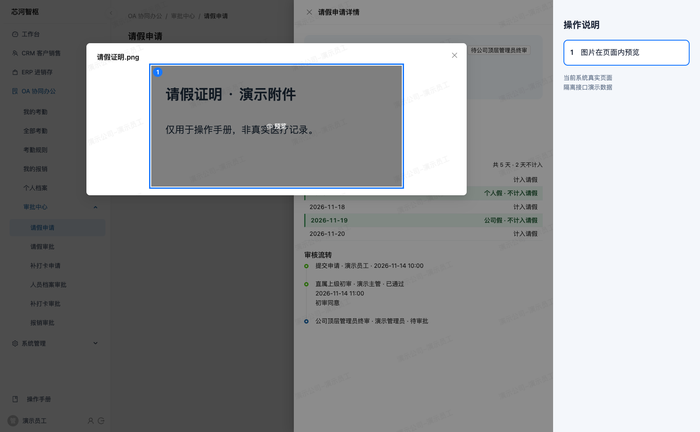

图：点击附件名称后直接打开图片预览，无需先下载。

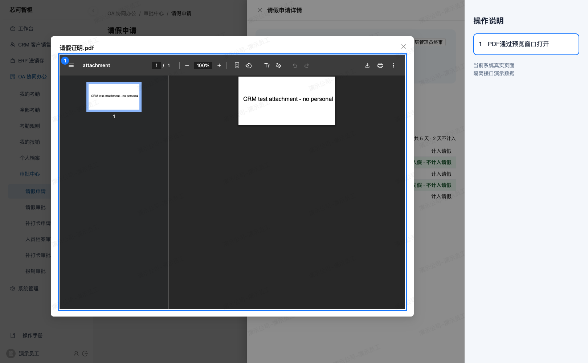

图：PDF 在预览窗口内阅读；实际工具栏随浏览器的 PDF 阅读能力而异。

### 4.6.8 请假常见问题

**为什么五天只算三天？** 先看日期明细，个人假和公司假不计入实际请假天数，使用绿色标记。

**为什么部门负责人申请时找不到上级？** 负责人本人不能审批自己；系统向上查找，需由管理员检查上级组织及有效负责人。上级已是公司管理员时只审批一次。

**为什么请假通过了还显示个人假或公司假？** 当天本来就是休息日，应保留对应假期状态；应出勤日才显示“已请假—具体假种”。

**为什么详情没有撤回？** 撤回入口在本人申请列表操作栏或移动端卡片，且只在待审批状态显示。

**请假通过后能提前结束吗？** 不能。后续如需调休，可另行提交调休假申请。

## 4.7 我的报销

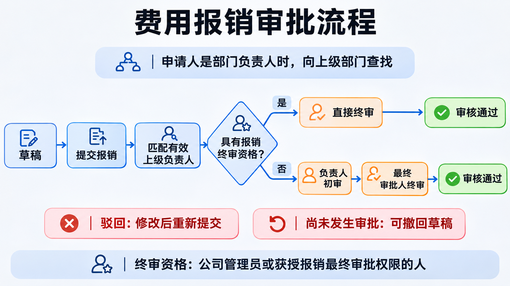

业务图：报销提交后匹配有效上级负责人；他已具备报销终审资格时由一人直接终审，否则先初审、再由最终审批人终审。尚未发生审批时可以撤回到草稿；任一审批节点驳回后，员工查看原因、修改并重新提交。申请人不能审批自己的报销。

### 4.7.1 查看报销列表

1. 进入“OA 协同办公 > 我的报销”。
2. 查看本人报销单的报销单号、总金额、状态和更新时间。
3. 草稿或已驳回的报销单，操作栏显示“编辑”和“删除”。
4. 已提交的报销单，操作栏显示“查看”。
5. 点击报销单号对应的操作进入详情页，查看费用明细、附件和审核流转。

报销状态会显示为“草稿”“待直属负责人审批”“待最终审批”“审核通过”或“已驳回”。系统不会把内部状态编码直接展示给用户。普通两级流程仅在初审尚未处理时显示“撤回”；单节点终审即使显示“待最终审批”，指定审批人尚未处理时也显示“撤回”。两级流程已进入第二个终审节点，或单节点已被处理后，不能撤回。

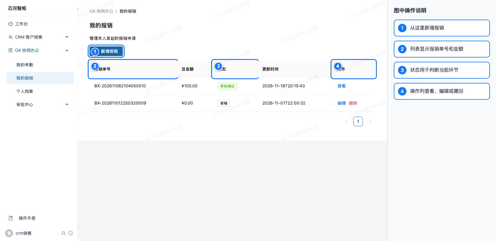

图：`crm_xiaoshou` 登录后的“我的报销”页面。列表使用中文状态展示草稿和已完成单据；普通员工可以新增报销、继续编辑草稿或查看已提交单据。

### 4.7.2 新建费用报销

1. 进入“OA 协同办公 > 我的报销”。
2. 点击“新增报销”。系统创建一张新的报销单并进入详情页。
3. 点击“新增条目”。每个费用条目都要单独选择报销类型：
   - 住宿费用；
   - 餐饮费用；
   - 交通费用；
   - 其他费用。
4. 填写费用日期。
5. 填写费用地点。
6. 填写费用金额。
7. 根据费用类型上传对应的发票或其他附件。
8. 如有多笔费用，继续点击“新增条目”，不要按费用类型拆成多张报销单。
9. 核对页面顶部的“总金额”和各类型金额汇总。
10. 点击“暂存”保存草稿，或点击“提交”发起审核。

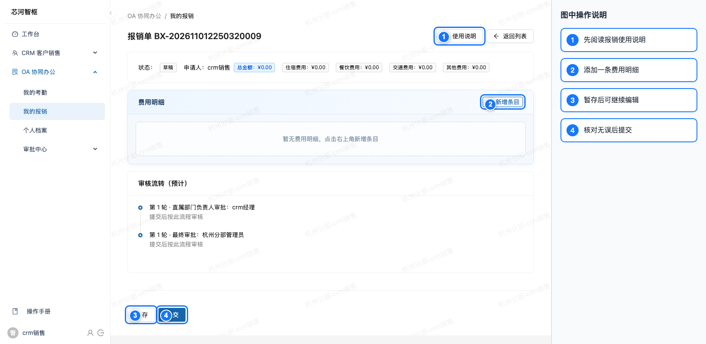

图：`crm_xiaoshou` 打开草稿报销单后的详情页。顶部显示草稿状态、总金额、各类金额汇总和预计审核流转；费用明细为空时点击右上角“新增条目”。

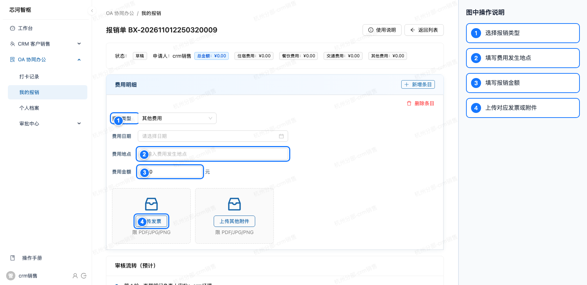

图：点击“新增条目”后出现的费用明细区域。每条明细独立选择“报销类型”，再填写费用日期、费用地点和费用金额，并按条目上传发票或其他附件。

### 4.7.3 费用明细和附件

- 点击“删除条目”前，系统会弹出确认框；确认后未保存的条目内容会被移除。
- 发票和其他附件均支持 PDF、JPG、JPEG、PNG，单个文件不能超过 20 MB。
- 新增条目尚未获得条目编号时，首次上传附件会先自动暂存费用条目。
- 上传成功后，点击附件名称可以打开预览。
- 已提交或审核中的报销单不能继续编辑费用明细。

附件应与当前费用条目对应上传，不要把多笔费用的发票全部放到同一个条目下，否则审核人难以核对。

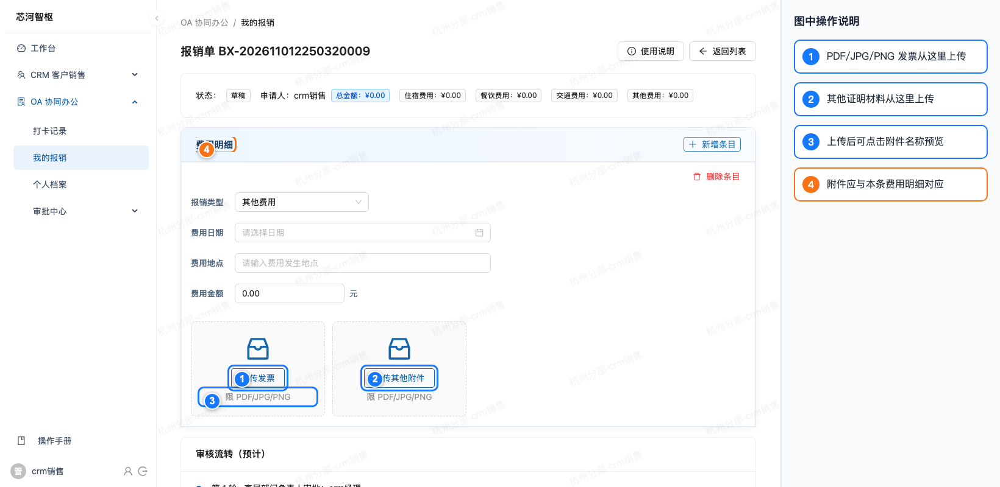

图：费用条目中的附件操作区。发票与其他证明材料分别上传，支持 PDF/JPG/PNG；上传成功后点击附件名称进入系统内预览。

### 4.7.4 暂存报销草稿

1. 填写部分费用信息后，点击“暂存”。
2. 看到“已暂存”提示后，可以点击“返回列表”。
3. 以后从“我的报销”中找到状态为“草稿”的单据，点击“编辑”继续填写。
4. 暂存不会进入审核流程。
5. 草稿只有申请人本人可以修改；重复暂存时以最后一次保存的内容为准。
6. 如果确认不再使用草稿，点击列表中的“删除”。
7. 在删除确认框中核对报销单号，再点击“删除报销单”。

### 4.7.5 提交报销

提交前请依次核对：

1. 每条费用明细都选择了正确的报销类型。
2. 费用日期、费用地点和金额填写完整。
3. 发票和其他附件已上传到正确的费用条目。
4. 总金额和住宿、餐饮、交通、其他各类金额汇总正确。
5. 审核流转区域显示了预计的审核顺序和负责人。
6. 点击“提交”。
7. 看到“提交成功”提示后，页面会刷新报销单状态和审核流转。

报销通常按“有效直属负责人初审 → 最终审批人终审”流转。最终审批人包括公司管理员，以及被授予“报销最终审批”权限的人。申请人是部门负责人时，跳过本人负责的部门，沿上级部门寻找有效负责人。

如果匹配的负责人已经具有报销终审资格，只生成一个终审节点，由他直接审批完成，不再要求另一位终审人。单节点任务仅分配给该审批人；其他具有终审权限的人不会因此接到这个指定任务。普通两级流程在初审通过后进入终审候选范围。

系统禁止申请人审批自己的报销。如果本部门及上级部门均没有有效负责人，或两级流程缺少可用终审人，提交会失败，应由公司管理员检查组织负责人、账号状态和终审权限。

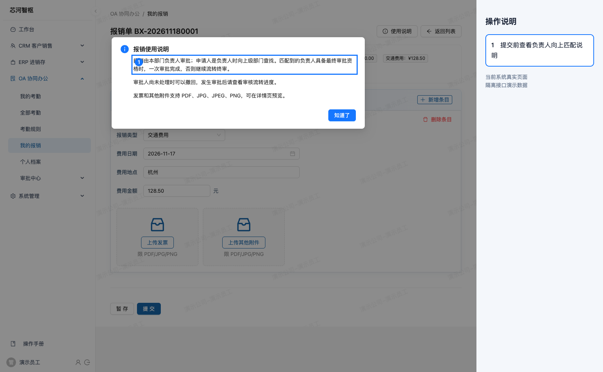

图：点击报销详情右上角“使用说明”后，弹窗解释负责人向上匹配、单节点终审及撤回规则。本图是规则说明，具体审批人和节点数量请在实际审核流转中核对。

### 4.7.6 撤回报销

1. 在“我的报销”列表找到尚未发生审批的单据。
2. 普通两级流程应处于“待直属负责人审批”；只有一个终审节点时，即使显示“待最终审批”，未处理前也可以撤回。
3. 点击列表中的“撤回”，阅读恢复草稿提示后确认。
4. 确认状态恢复“草稿”，再点击“编辑”继续修改。

普通两级流程的初审一旦已通过或驳回，就不能撤回；进入第二个终审节点后也不能撤回。单节点终审由指定审批人处理前可撤回，处理后不能撤回。

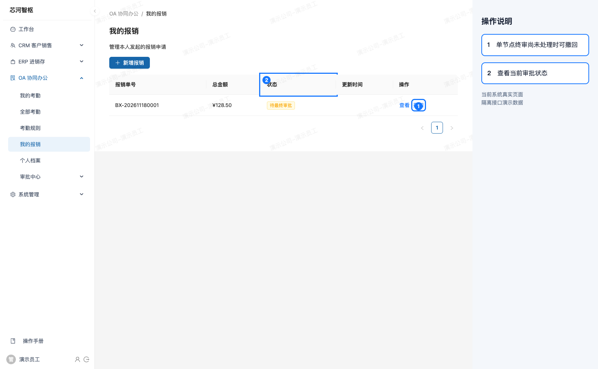

图：脱敏演示。只有一个终审节点且尚未处理时，列表仍提供“撤回”。

### 4.7.7 查看审批结果与节点快照

1. 在“我的报销”中点击已提交单据的“查看”。
2. 在详情顶部查看申请人、部门、总金额和分类金额。
3. 在“审核流转”中查看审批轮次、节点类型、审批人、节点状态和处理时间。
4. 点击发票或附件名称预览原始凭证。

审批节点保存的是提交当时的部门、岗位和审批人快照。后续即使组织负责人或权限发生调整，历史记录仍按当时信息展示；被驳回后重新提交会生成新的审批轮次，不覆盖上一轮记录。

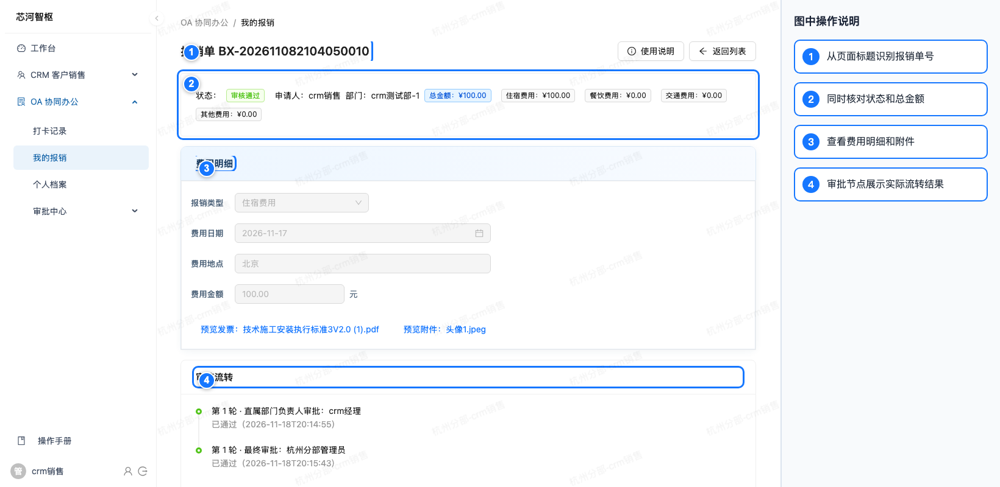

图：普通两级报销的历史示例，详情展示两个节点。当前也支持以下单节点流程。

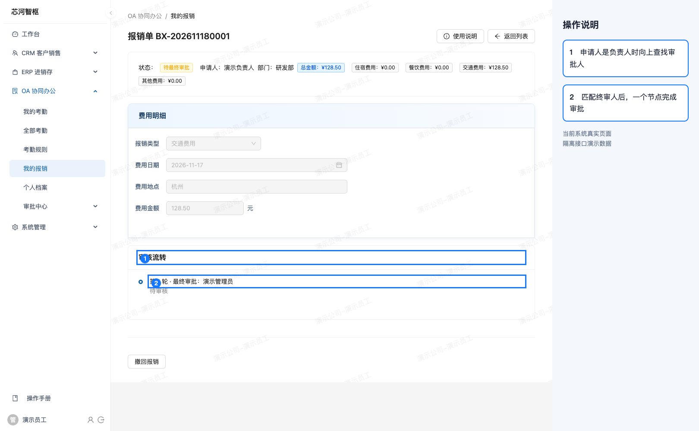

图：申请人是部门负责人，匹配到的上级具有终审资格，详情只显示一个终审节点。单据驳回或完成后，后续无需处理的节点显示“已结束”。

## 4.8 报销审核

### 4.8.1 我的待审批入口

1. 使用直属部门负责人、公司管理员或被授予终审权限的账号登录。
2. 进入“OA 协同办公 > 审批中心 > 报销审批”。
3. 列表只展示当前账号可以处理的报销单。
4. 操作栏只有“去审核”，不在列表中直接通过或驳回。
5. 点击“去审核”进入详情页，核对申请人、费用明细、金额、附件和审核流转。

直属部门负责人根据组织关系自动获得本人部门员工的初审任务，不需要额外配置终审权限。公司管理员默认拥有终审资格；财务或其他人员必须由管理员在权限配置中授予“报销最终审批”。

若没有看到待审批记录或详情按钮，先确认：

- 当前账号是否为提交时匹配的有效直属或上级负责人；
- 终审人员是否配置了“报销最终审批”权限；
- 报销单是否仍处于待本人处理的节点；
- 报销单是否已被其他审核人处理。

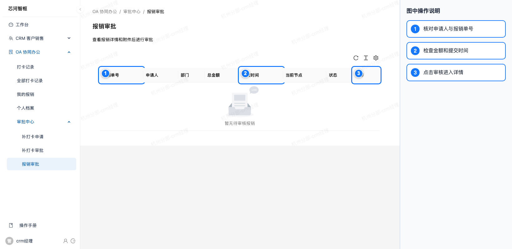

图：报销审批列表用于核对报销单号、申请人、金额和提交时间；点击“去审核”后再查看明细、附件及审批流，不在列表中直接作出决定。

### 4.8.2 审核通过

1. 打开待处理的报销详情。
2. 查看申请人、费用明细、金额汇总和附件。
3. 查看“审核流转”区域，确认当前节点和后续节点。
4. 点击页面底部“通过”。
5. 看到“审核通过”提示后，刷新页面确认节点状态。
6. 如果还有后续审核人，报销单继续进入下一节点；全部节点通过后，状态变为“审核通过”。

### 4.8.3 驳回报销

1. 打开待处理的报销详情。
2. 核对需要退回修改的费用或附件。
3. 点击“驳回”。
4. 在“驳回报销单”弹窗中填写具体原因。
5. 点击“确认驳回”提交。
6. 看到“已驳回”提示后，确认报销单状态变为“已驳回”。

驳回原因不能为空。申请人修改后可以回到报销详情重新编辑并再次提交；重新提交会生成新一轮审批节点。

## 4.9 个人档案

### 4.9.1 查看个人档案

1. 展开左侧“OA 协同办公”。
2. 点击“个人档案”。
3. 在“档案信息”区域查看姓名、用户名、部门、岗位、性别、出生日期、证件类型、证件号码、联系方式、紧急联系人和教育经历。
4. 本人查看证件号码时显示完整号码；不要将证件号码复制到无权限的外部位置。
5. 部门和岗位由组织架构统一维护，个人档案页面不提供修改入口。

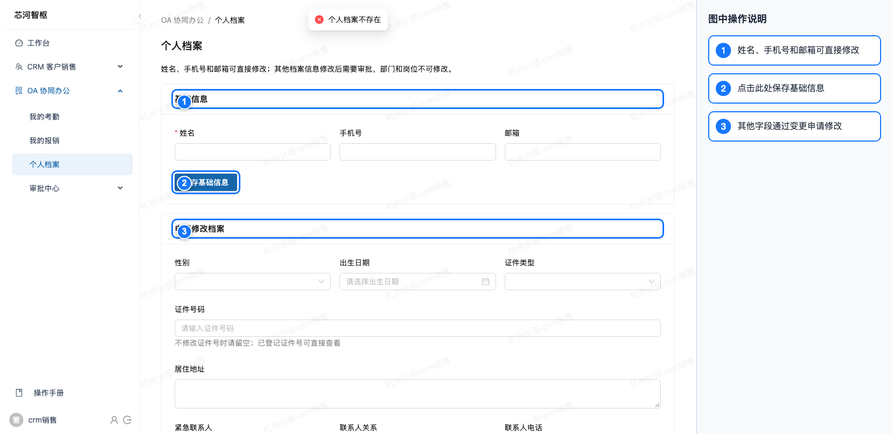

图：个人档案页区分“基础信息”“申请修改档案”和“我的变更申请”。基础信息直接保存，其他档案字段按审批流程变更。

### 4.9.2 直接修改基础信息

姓名、手机号和邮箱可以直接修改，不需要审批：

1. 在“基础信息”区域修改姓名、手机号或邮箱。
2. 点击“保存基础信息”。
3. 看到成功提示后，个人档案、左下角用户姓名和页面水印会立即刷新。
4. 重新打开左下角“个人信息”弹窗，确认姓名、手机号和邮箱已同步。

手机号也可用于密码登录，需填写 11 位大陆手机号，保存时必须唯一。遇到号码被使用的提示，先核对账号归属再修改。档案变更审批禁止本人审批自己的申请，停用或已删除的管理员不会成为新申请的有效审批人。

### 4.9.3 提交需要审批的档案变更

性别、出生日期、证件类型、证件号码、居住地址、紧急联系人和教育经历需要提交审批；部门和岗位不能由个人修改。

1. 在“申请修改档案”区域填写需要修改的字段。
2. 出生日期使用日期选择器选择日期，不要手工输入内部日期格式。
3. 修改证件类型时，可以在“证件号码”输入新的证件号；不修改证件号时留空。
4. 教育经历点击“新增教育经历”，每条经历在独立卡片中填写开始月份、结束月份、学历和学校；点击该条右侧“删除”移除一条未提交经历。
5. 点击单独操作区中的“提交审批”。新增教育经历和提交审批不是并列按钮。
6. 看到“档案变更已提交审批”后，在“我的变更申请”查看状态。

空字段不会覆盖原档案内容；例如只修改性别时，其他空字段不会进入申请，也不会清空已有教育经历或联系方式。

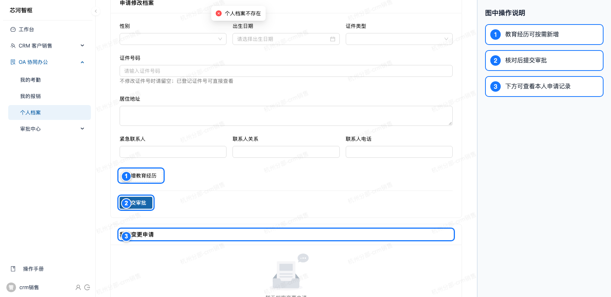

图：档案变更表单、教育经历入口、提交审批按钮和申请记录区。只填写本次确实需要变更的字段，提交前再次检查内容。

### 4.9.4 查看变更申请详情

1. 在“我的变更申请”列表找到目标申请。
2. 点击“查看详情”。
3. 弹窗按“字段、修改前、修改后”展示实际发生变化的字段。
4. 未修改的字段、空教育经历不会展示。

### 4.9.5 审批人员档案变更

公司管理员或配置了审批权限的审批人：

1. 进入“OA 协同办公 > 审批中心 > 人员档案审批”。
2. 点击申请右侧“去审核”。
3. 在结构化 Diff 弹窗中核对字段、修改前和修改后内容。
4. 点击“通过”完成审批，或点击“驳回”并填写必填驳回理由。
5. 审批完成后，申请从待审批列表移除；通过后档案刷新为新值。

平台管理员不展示 OA 和 CRM 菜单，也不承担公司人员档案查看或审批操作。

## 4.10 OA 常见问题与检查清单

### 4.10.1 常见问题

**问：为什么点击打卡没有结果？**

答：先检查浏览器定位权限、设备定位服务和网络。确认页面是否出现错误提示；如果已经提示成功，刷新月度记录再确认。

**问：补打卡申请为什么不能提交？**

答：补打卡时间、打卡类型、申请原因和补打卡位置都必须有值。打卡类型选择“上班打卡”或“下班打卡”，再点击“当前位置”或完成地址定位。

**问：为什么看不到补打卡审批？**

答：该入口只对部门负责人或配置了补打卡审批权限的账号显示。普通员工只能查看自己的申请。

**问：为什么看不到某位员工的全部打卡？**

答：部门负责人只能看到自己负责组织树内的人员；公司管理员才能查看本公司全部人员。数据范围不是通过页面筛选条件绕过的。

**问：为什么报销提交后不能修改？**

答：草稿和已驳回状态可以编辑；待直属负责人审批、待最终审批和审核通过状态不能直接编辑。普通两级流程在初审尚未处理时可撤回到草稿；单节点终审未处理时也可撤回。已驳回单据需要根据驳回原因修改后重新提交。

**问：为什么报销附件上传失败？**

答：发票和其他附件支持 PDF、JPG、JPEG、PNG，单个文件不能超过 20 MB。还要确认当前报销单处于可编辑状态。

**问：为什么报销单没有“撤回”？**

答：普通两级流程只允许在初审未处理时撤回；单节点终审未处理时也允许撤回。已发生审批的单据不能撤回，是否显示入口以实际流程为准。

**问：为什么财务人员看不到报销终审任务？**

答：公司管理员需要在“系统管理 > 权限配置”的岗位或用户模式中授予“报销最终审批”。直属部门负责人初审由组织关系自动确定，不等于拥有最终审批权限。

**问：为什么提交档案后其他空字段没有清空原值？**

答：这是系统的保护规则。空字段会被过滤，不会覆盖已有档案；如需修改某字段，应填写新的有效内容并重新提交审批。

**问：为什么平台管理员看不到 OA、CRM 或人员档案？**

答：平台管理员用于平台级公司和账号基础管理，OA、CRM 和公司人员档案属于公司业务范围，平台管理员端默认隐藏这些菜单和入口。

### 4.10.2 普通员工检查清单

- [ ] 已允许浏览器访问定位。
- [ ] 已按上班、下班类型打卡，并核对考勤时间、弹性分钟及当天状态。
- [ ] 请假提交前已核对绿色休息日、实际天数和审批人。
- [ ] 已在请假详情查看具体审核流转，知道通过后不能提前结束。
- [ ] 补打卡申请已填写时间、上班或下班类型、位置和原因。
- [ ] 已在“补打卡申请”中查看审批状态。
- [ ] 报销每条费用都选择了报销类型。
- [ ] 报销总金额和各类型金额汇总已核对。
- [ ] 发票和其他附件已上传到对应费用条目。
- [ ] 提交报销前已查看预计审核流转。
- [ ] 撤回报销前已确认尚未发生审批，并区分单节点与两级流程。
- [ ] 已在个人档案中确认姓名、联系方式和证件信息。
- [ ] 需要变更档案时已区分直接修改字段和需审批字段。
- [ ] 已在变更申请详情中核对实际 Diff，而不是只看申请状态。

### 4.10.3 部门负责人检查清单

- [ ] 已确认当前账号属于杭州分部对应负责人岗位。
- [ ] 已在补打卡审批中核对申请人、时间、上班或下班类型、位置和原因。
- [ ] 驳回时已填写具体驳回理由。
- [ ] 已确认通过或驳回后的记录从待审批列表移除。
- [ ] 已从“报销审批”点击“去审核”，并在详情页核对明细和附件后操作。
- [ ] 驳回报销时已填写具体原因。
- [ ] 未通过修改筛选条件查看不属于负责组织树的人员。
- [ ] 人员档案审批已核对结构化 Diff。
- [ ] 驳回人员档案变更时已填写具体理由。
- [ ] 已从统一请假审批列表进入详情，核对假种、天数、休息日和附件。
- [ ] 已确认当前节点轮到本人，且申请人不是本人。

### 公司管理员补充检查清单

- [ ] 年度上下班时间和弹性分钟已覆盖全年应出勤日期，草稿已发布。
- [ ] 公司假和个人假只配置日期，数量和冲突已处理。
- [ ] 部门负责人本人申请时可向上找到有效审批人。
- [ ] 请假与报销终审资格分别配置，未将权限混用。
