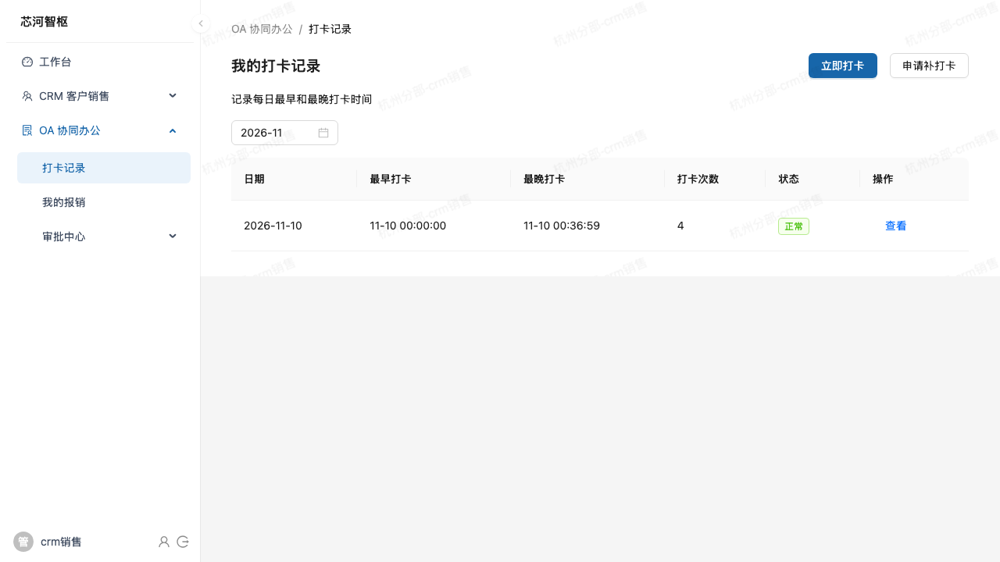
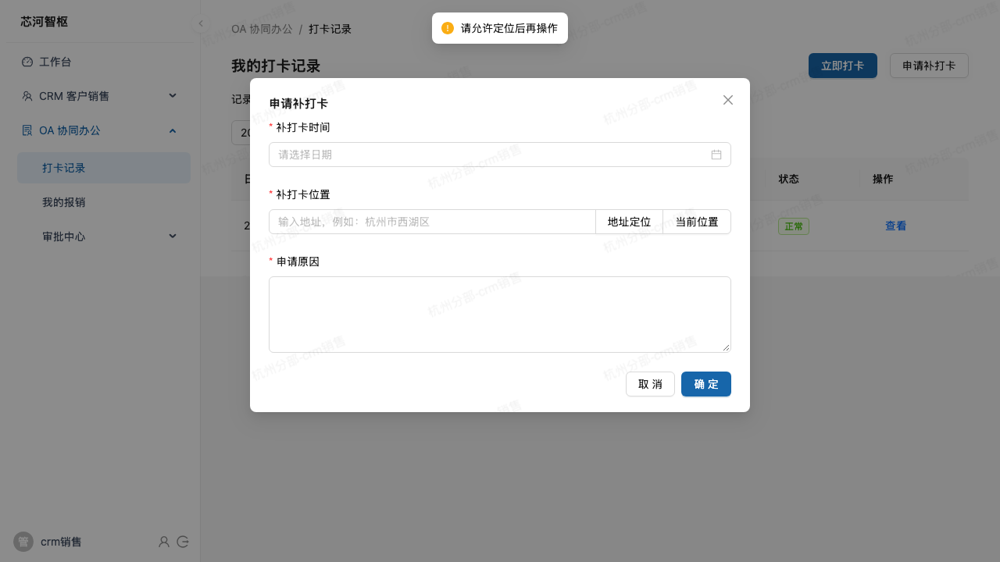
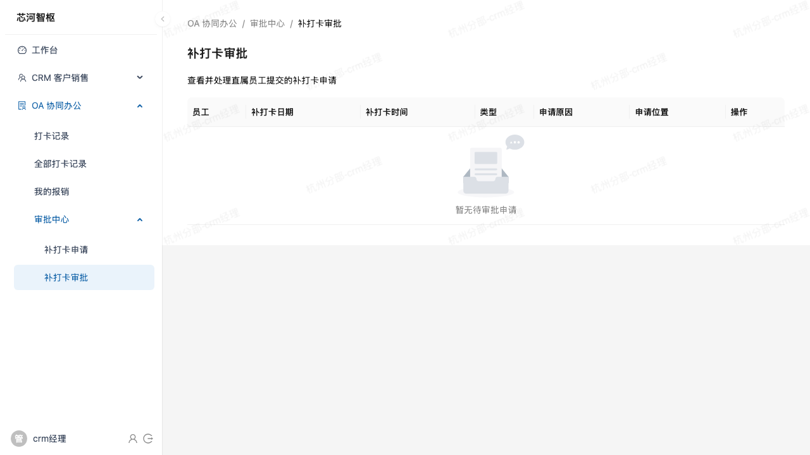
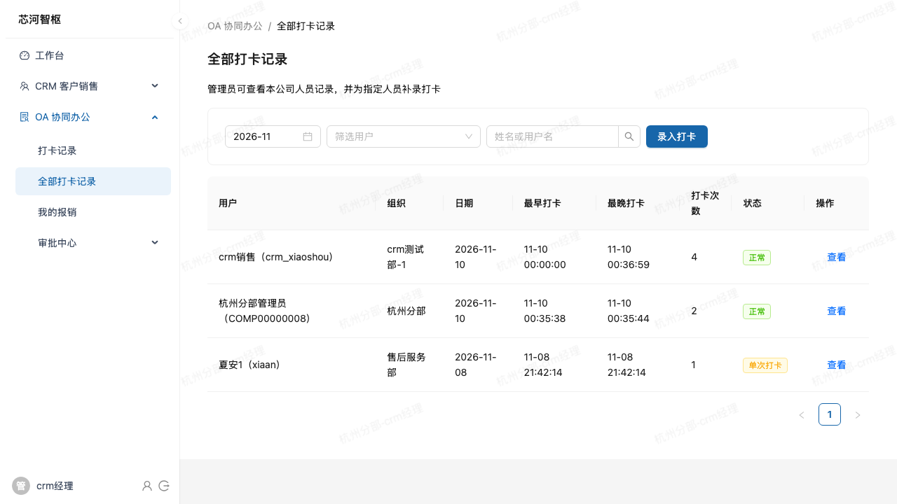
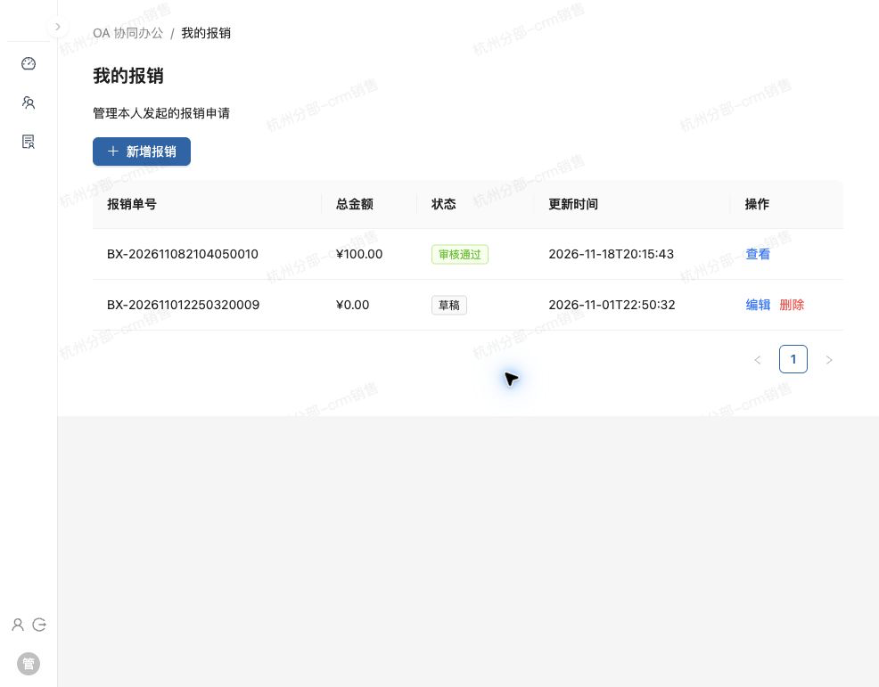
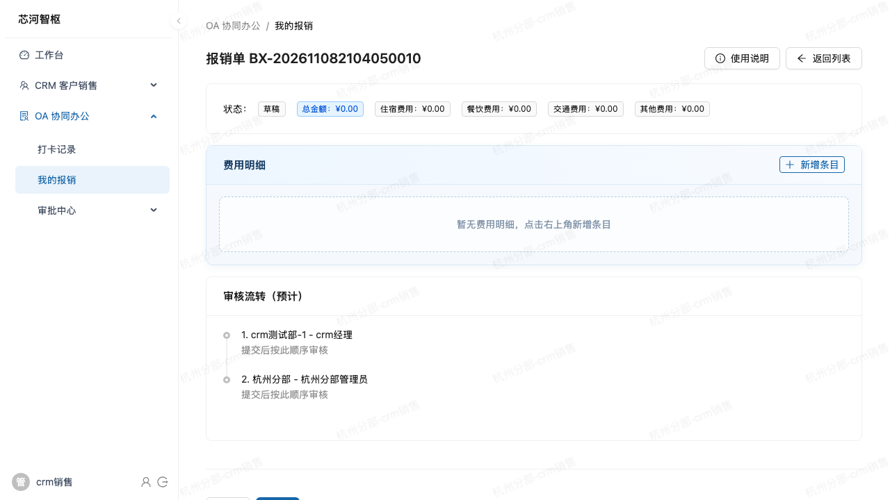
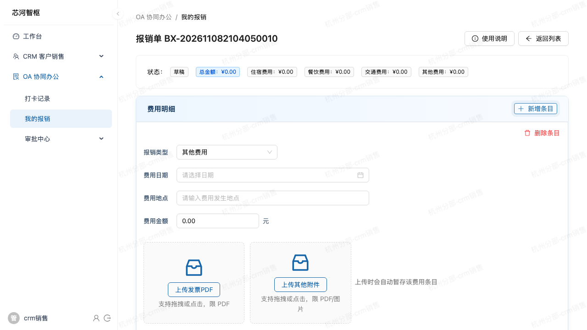
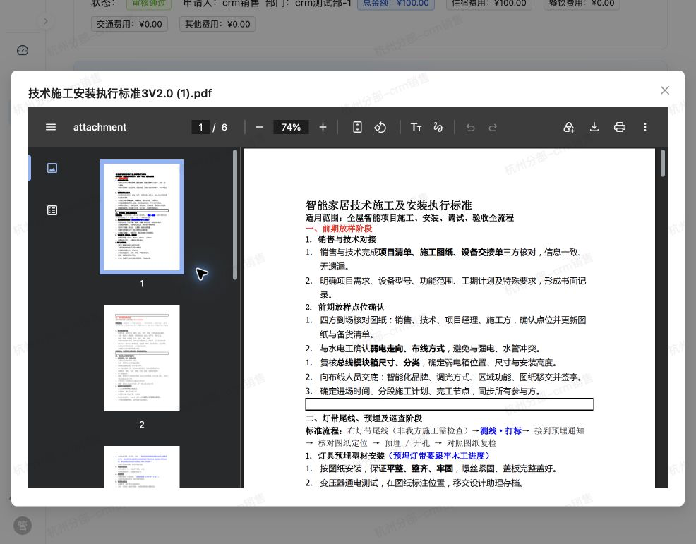
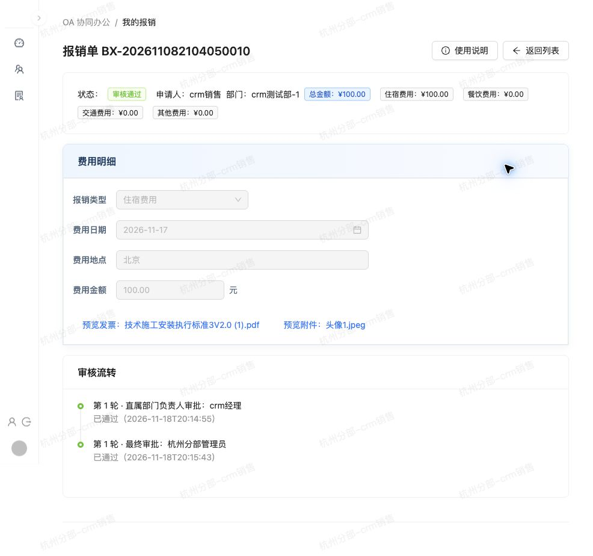

# 4. OA 协同办公

本章介绍系统中所有员工都会用到的日常办公功能：查看自己的考勤、定位打卡、申请补打卡、查看申请进度、查看和维护个人档案，以及填写和提交报销。直属部门负责人负责报销初审；公司管理员或被授予“报销最终审批”权限的人员负责终审。

> 账号与截图说明：普通员工截图使用杭州分部普通员工账号 `crm_xiaoshou`，补打卡审批和全部打卡截图使用杭州分部部门负责人账号 `crm_owner`；终审权限配置截图使用公司管理员账号。截图中的敏感信息仅用于本地操作手册，不要将账号密码写入手册或公开传播。

## 4.1 OA 菜单与角色范围

### 4.1.1 进入 OA 协同办公

1. 登录系统后，在左侧导航找到“OA 协同办公”。
2. 点击“OA 协同办公”展开菜单。
3. 普通员工通常可以看到：
   - “打卡记录”；
   - “我的报销”；
   - “个人档案”；
   - “审批中心 > 补打卡申请”。
4. 部门负责人如果拥有补打卡审批范围，还会看到“审批中心 > 补打卡审批”。
5. 公司管理员或具有全部考勤查看权限的账号，还可以看到“全部打卡记录”和“审批中心 > 人员档案审批”。

菜单是否显示由账号角色、岗位权限和组织关系共同决定。没有看到某个菜单时，不要直接认为系统故障，应先确认当前账号身份和所属公司。

### 4.1.2 OA 功能与角色对照

| 功能 | 普通员工 | 部门负责人 | 公司管理员 |
| --- | --- | --- | --- |
| 我的打卡记录 | 查看本人 | 查看本人 | 查看本人 |
| 立即打卡 | 支持 | 支持 | 支持 |
| 申请补打卡 | 支持 | 支持 | 支持 |
| 补打卡申请 | 查看本人申请 | 查看本人申请 | 查看本人申请 |
| 补打卡审批 | 不支持 | 审批下属及下级组织人员 | 可按管理员规则处理 |
| 全部打卡记录 | 不支持 | 查看负责组织树内人员 | 查看公司全部人员 |
| 管理员补录打卡 | 不支持 | 按页面权限决定 | 支持 |
| 个人档案 | 查看本人、修改姓名/手机号/邮箱、提交其他档案变更审批 | 同左 | 查看本人；公司管理员还可审批人员档案变更 |
| 人员档案审批 | 不支持 | 需配置 相应的审批权限 | 支持，无需额外配置 |
| 我的报销 | 查看、新建、提交本人报销 | 查看、新建、提交本人报销 | 查看、新建、提交本人报销 |
| 报销初审 | 不支持 | 作为申请人的直属部门负责人自动获得 | 按直属部门负责人关系决定 |
| 报销终审 | 需授予“报销最终审批” | 需授予“报销最终审批” | 默认拥有 |

## 4.2 考勤打卡

### 4.2.1 打卡前准备

系统的“立即打卡”会调用浏览器定位。第一次使用前请确认：

1. 当前账号已成功登录，且属于有效公司。
2. 浏览器允许当前系统访问定位。
3. 电脑或手机的系统定位服务已开启。
4. 网络连接正常。
5. 不要使用会阻止定位的隐私模式、浏览器扩展或系统权限设置。

如果浏览器拒绝定位，点击“立即打卡”不会成功；需要先在浏览器地址栏的定位权限中改为允许，再重新操作。

### 4.2.2 立即打卡

1. 进入“OA 协同办公 > 打卡记录”。
2. 确认页面标题为“我的打卡记录”。
3. 点击右上角“立即打卡”。
4. 如果浏览器弹出定位授权，请选择允许。
5. 等待系统完成定位并提交打卡请求。
6. 看到“打卡成功”提示后，重新查看当月列表。

完成后，当天记录会显示日期、最早打卡、最晚打卡、打卡次数和状态。首次当天只有一次记录时，状态会显示为“单次打卡”；同一天存在正常的多次记录时，页面会显示“正常”。

### 4.2.3 查看我的打卡记录

1. 进入“OA 协同办公 > 打卡记录”。
2. 使用月份选择器切换要查看的月份。
3. 在列表中查看：
   - 日期；
   - 最早打卡时间；
   - 最晚打卡时间；
   - 打卡次数；
   - 系统计算的状态。
4. 点击某一天右侧的“查看”，进入“日期 打卡明细”页面。
5. 在明细中查看每条打卡的时间、类型、来源、定位坐标和备注。
6. 点击“返回打卡记录”回到月度汇总。

图 1：使用 `crm_xiaoshou` 登录后的“我的打卡记录”页面。重点观察左侧 OA 菜单、月份筛选、当天汇总记录和“查看”入口；页面底部显示当前登录用户为“crm销售”。

### 4.2.4 打卡失败处理

| 页面现象 | 处理方法 |
| --- | --- |
| 请允许定位后再操作 | 点击地址栏定位图标，允许当前站点定位后重试 |
| 当前浏览器不支持定位 | 更换支持定位的浏览器或设备 |
| 打卡失败 | 检查网络、定位权限和账号状态，稍后重试 |
| 页面没有新增记录 | 先确认是否出现“打卡成功”提示，再刷新页面或切换月份 |
| 定位精度不稳定 | 到开阔区域重新定位，或检查设备系统定位服务 |
| 账号无效或已停用 | 联系公司管理员确认账号状态 |

不要为了“补齐记录”连续重复点击“立即打卡”。如果已经出现成功提示但列表尚未刷新，先刷新页面确认记录，避免产生重复打卡。

## 4.3 补打卡申请

### 4.3.1 发起补打卡申请

适用场景：忘记打卡、设备临时故障或因网络原因没有形成有效记录时，员工可以提交补打卡申请，由有权限的负责人审核。

1. 进入“OA 协同办公 > 打卡记录”。
2. 点击右上角“申请补打卡”。
3. 在“补打卡时间”中选择实际需要补录的日期和时间。
4. 在“补打卡位置”中选择一种定位方式：
   - 点击“当前位置”，使用浏览器当前定位；
   - 在地址框输入地址，点击“地址定位”。
5. 确认页面显示已选位置、经纬度和地图预览。
6. 在“申请原因”中写明未正常打卡的原因。
7. 点击弹窗底部“确定”提交。
8. 看到“补打卡申请已提交，请在审批中心查看进度”提示后，关闭弹窗。

“补打卡时间”和“申请原因”是必填项；没有选定补打卡位置时，即使其他内容填写完整也不能提交。

图 2：`crm_xiaoshou` 点击“申请补打卡”后的弹窗。红色星号表示必填项；需要填写时间、选择当前位置或完成地址定位、填写申请原因后，再点击“确定”。

### 4.3.2 查看补打卡申请进度

1. 展开左侧“OA 协同办公”。
2. 点击“审批中心”。
3. 点击“补打卡申请”。
4. 在列表中查看补打卡日期、补打卡时间、类型、申请原因、申请位置和状态。
5. 查看“审批意见”了解负责人通过或驳回的原因。

状态会以业务描述展示：

- “待审批”：已提交，等待负责人处理；
- “已通过”：负责人已同意补打卡；
- “已驳回”：负责人不同意本次申请。

### 4.3.3 被驳回后重新申请

1. 在“审批中心 > 补打卡申请”找到状态为“已驳回”的记录。
2. 点击该记录右侧的“重新申请”。
3. 修改“补打卡时间”。
4. 根据审批意见修改“申请原因”。
5. 确认原申请位置仍然正确；如果原申请没有定位信息，返回“打卡记录”重新发起申请。
6. 点击“确定”重新提交。
7. 看到“补打卡已重新提交”提示后，回到申请列表查看新记录。

## 4.4 部门负责人审批补打卡

### 4.4.1 进入待审批列表

1. 使用部门负责人账号登录。
2. 进入“OA 协同办公 > 审批中心 > 补打卡审批”。
3. 查看待审批列表中的员工、补打卡日期、补打卡时间、类型、申请原因和申请位置。
4. 部门负责人只能处理自己负责组织范围内的申请，包括本部门下属和下级部门人员。

### 4.4.2 通过申请

1. 在待审批列表中找到需要处理的申请。
2. 核对员工姓名、补打卡时间、申请原因和定位信息。
3. 点击右侧“通过”。
4. 看到“已通过申请”提示后，确认该记录从待审批列表中移除。
5. 告知申请人到“审批中心 > 补打卡申请”查看“已通过”状态。

通过后，系统会按补打卡申请记录生成对应的考勤明细，申请人可以在自己的打卡明细中查看来源为“补打卡审批”的记录。

图 3：使用 `crm_owner` 登录后的“补打卡审批”页面。审核人应从员工、日期、时间、申请原因和申请位置几个字段核对申请，再执行“通过”或“驳回”。

### 4.4.3 驳回申请

1. 在待审批列表中找到需要退回的申请。
2. 点击右侧“驳回”。
3. 在“驳回补打卡申请”弹窗中填写具体的“驳回理由”。
4. 点击“确定”提交审批结果。
5. 看到“已驳回申请”提示后，确认申请从待审批列表中移除。

驳回理由为必填项。建议写明缺少的证明、时间不合理或定位信息不足等具体原因，方便员工修改后重新申请。

## 4.5 全部打卡记录与管理员补录

### 4.5.1 查看全部打卡记录

该功能面向公司管理员或拥有“查看全部打卡记录”权限的负责人。部门负责人看到的是自己负责的组织树，公司管理员看到的是本公司人员。

1. 进入“OA 协同办公 > 全部打卡记录”。
2. 选择月份。
3. 如页面提供公司选择器，先选择目标公司；普通公司管理员不需要跨公司选择。
4. 使用“筛选用户”按人员筛选。
5. 使用“姓名或用户名”输入关键字并搜索。
6. 查看列表中的用户、组织、日期、最早打卡、最晚打卡、打卡次数和状态。
7. 点击某行右侧“查看”，查看该员工当天的打卡明细。

页面使用服务端分页，底部页码用于继续查看结果。负责人不能通过修改筛选条件绕过组织数据范围。

图 4：`crm_owner` 登录后的“全部打卡记录”页面。页面提供月份、人员和姓名/用户名筛选，并显示组织、打卡次数和状态；负责人只能查看接口返回的授权数据范围。

### 4.5.2 管理员补录打卡

1. 进入“OA 协同办公 > 全部打卡记录”。
2. 点击“录入打卡”。
3. 选择要补录的人员。
4. 选择“打卡时间”。
5. 在“打卡位置”中点击“当前位置”，或输入地址后点击“地址定位”。
6. 确认已选位置和地图坐标。
7. 在“备注”中填写补录原因或依据。
8. 点击弹窗底部“确定”。
9. 看到“已录入打卡记录”提示后，返回列表核对记录。

管理员补录不是员工补打卡申请，不会进入负责人审批队列。补录时仍然要求选择人员、时间和位置；没有选择位置时不能提交。

## 4.6 我的报销

### 4.6.1 查看报销列表

1. 进入“OA 协同办公 > 我的报销”。
2. 查看本人报销单的报销单号、总金额、状态和更新时间。
3. 草稿或已驳回的报销单，操作栏显示“编辑”和“删除”。
4. 已提交的报销单，操作栏显示“查看”。
5. 点击报销单号对应的操作进入详情页，查看费用明细、附件和审核流转。

报销状态会显示为“草稿”“待直属负责人审批”“待最终审批”“审核通过”或“已驳回”。系统不会把内部状态编码直接展示给用户。只有“待直属负责人审批”且尚未发生任何审批的报销单显示“撤回”；进入“待最终审批”后不能撤回。

图 5：`crm_xiaoshou` 登录后的“我的报销”页面。列表使用中文状态展示草稿和已完成单据；普通员工可以新增报销、继续编辑草稿或查看已提交单据。

### 4.6.2 新建费用报销

1. 进入“OA 协同办公 > 我的报销”。
2. 点击“新增报销”。系统创建一张新的报销单并进入详情页。
3. 点击“新增条目”。每个费用条目都要单独选择报销类型：
   - 住宿费用；
   - 餐饮费用；
   - 交通费用；
   - 其他费用。
4. 填写费用日期。
5. 填写费用地点。
6. 填写费用金额。
7. 根据费用类型上传对应的发票或其他附件。
8. 如有多笔费用，继续点击“新增条目”，不要按费用类型拆成多张报销单。
9. 核对页面顶部的“总金额”和各类型金额汇总。
10. 点击“暂存”保存草稿，或点击“提交”发起审核。

图 6：`crm_xiaoshou` 打开草稿报销单后的详情页。顶部显示草稿状态、总金额、各类金额汇总和预计审核流转；费用明细为空时点击右上角“新增条目”。

图 7：点击“新增条目”后出现的费用明细区域。每条明细独立选择“报销类型”，再填写费用日期、费用地点和费用金额，并按条目上传发票或其他附件。

### 4.6.3 费用明细和附件

- 点击“删除条目”前，系统会弹出确认框；确认后未保存的条目内容会被移除。
- 发票和其他附件均支持 PDF、JPG、JPEG、PNG，单个文件不能超过 20 MB。
- 新增条目尚未获得条目编号时，首次上传附件会先自动暂存费用条目。
- 上传成功后，点击附件名称可以打开预览。
- 已提交或审核中的报销单不能继续编辑费用明细。

附件应与当前费用条目对应上传，不要把多笔费用的发票全部放到同一个条目下，否则审核人难以核对。

图 8：报销详情中的 PDF 发票预览。PNG、JPG 和 JPEG 图片会在同一预览弹窗中直接显示，审核人不需要下载文件即可核对。

### 4.6.4 暂存报销草稿

1. 填写部分费用信息后，点击“暂存”。
2. 看到“已暂存”提示后，可以点击“返回列表”。
3. 以后从“我的报销”中找到状态为“草稿”的单据，点击“编辑”继续填写。
4. 暂存不会进入审核流程。
5. 草稿只有申请人本人可以修改；重复暂存时以最后一次保存的内容为准。
6. 如果确认不再使用草稿，点击列表中的“删除”。
7. 在删除确认框中核对报销单号，再点击“删除报销单”。

### 4.6.5 提交报销

提交前请依次核对：

1. 每条费用明细都选择了正确的报销类型。
2. 费用日期、费用地点和金额填写完整。
3. 发票和其他附件已上传到正确的费用条目。
4. 总金额和住宿、餐饮、交通、其他各类金额汇总正确。
5. 审核流转区域显示了预计的审核顺序和负责人。
6. 点击“提交”。
7. 看到“提交成功”提示后，页面会刷新报销单状态和审核流转。

报销提交后的固定默认路径为：**直属部门负责人初审 → 最终审批人终审**。最终审批人包括公司管理员，以及在“系统管理 > 权限配置”中被授予“报销最终审批”的岗位或用户。财务人员需要管理员授予该权限后，才能处理其他人的报销终审。

系统提交时会禁止申请人审批自己的报销。若直属部门没有配置有效负责人，负责人就是申请人本人，或公司内没有可用最终审批人，提交会失败；此时应联系公司管理员调整组织负责人或终审权限。

### 4.6.6 撤回报销

1. 在“我的报销”中找到状态为“待直属负责人审批”的报销单。
2. 确认该单尚未被直属负责人处理，点击“撤回”。
3. 在确认框中阅读“撤回后将恢复为草稿”的提示。
4. 点击“确认撤回”。
5. 看到“报销单已撤回”后，确认状态恢复为“草稿”，再点击“编辑”继续修改。

只有尚未发生任何审批的报销单可以撤回。一旦直属负责人已经通过或驳回，报销单就不能撤回；进入“待最终审批”后同样不能撤回。

### 4.6.7 查看审批结果与节点快照

1. 在“我的报销”中点击已提交单据的“查看”。
2. 在详情顶部查看申请人、部门、总金额和分类金额。
3. 在“审核流转”中查看审批轮次、节点类型、审批人、节点状态和处理时间。
4. 点击发票或附件名称预览原始凭证。

审批节点保存的是提交当时的部门、岗位和审批人快照。后续即使组织负责人或权限发生调整，历史记录仍按当时信息展示；被驳回后重新提交会生成新的审批轮次，不覆盖上一轮记录。

图 9：`crm_xiaoshou` 查看已完成报销单。详情展示直属部门负责人和最终审批人两个节点，以及每个节点的处理状态和时间。

## 4.7 报销审核

### 4.7.1 我的待审批入口

1. 使用直属部门负责人、公司管理员或被授予终审权限的账号登录。
2. 进入“OA 协同办公 > 审批中心 > 报销审批”。
3. 列表只展示当前账号可以处理的报销单。
4. 操作栏只有“去审核”，不在列表中直接通过或驳回。
5. 点击“去审核”进入详情页，核对申请人、费用明细、金额、附件和审核流转。

直属部门负责人根据组织关系自动获得本人部门员工的初审任务，不需要额外配置终审权限。公司管理员默认拥有终审资格；财务或其他人员必须由管理员在权限配置中授予“报销最终审批”。

若没有看到待审批记录或详情按钮，先确认：

- 当前账号是否是申请人的直属部门负责人；
- 终审人员是否配置了“报销最终审批”权限；
- 报销单是否仍处于待本人处理的节点；
- 报销单是否已被其他审核人处理。

### 4.7.2 审核通过

1. 打开待处理的报销详情。
2. 查看申请人、费用明细、金额汇总和附件。
3. 查看“审核流转”区域，确认当前节点和后续节点。
4. 点击页面底部“通过”。
5. 看到“审核通过”提示后，刷新页面确认节点状态。
6. 如果还有后续审核人，报销单继续进入下一节点；全部节点通过后，状态变为“审核通过”。

### 4.7.3 驳回报销

1. 打开待处理的报销详情。
2. 核对需要退回修改的费用或附件。
3. 点击“驳回”。
4. 在“驳回报销单”弹窗中填写具体原因。
5. 点击“确认驳回”提交。
6. 看到“已驳回”提示后，确认报销单状态变为“已驳回”。

驳回原因不能为空。申请人修改后可以回到报销详情重新编辑并再次提交；重新提交会生成新一轮审批节点。

## 4.8 个人档案

### 4.8.1 查看个人档案

1. 展开左侧“OA 协同办公”。
2. 点击“个人档案”。
3. 在“档案信息”区域查看姓名、用户名、部门、岗位、性别、出生日期、证件类型、证件号码、联系方式、紧急联系人和教育经历。
4. 本人查看证件号码时显示完整号码；不要将证件号码复制到无权限的外部位置。
5. 部门和岗位由组织架构统一维护，个人档案页面不提供修改入口。

### 4.8.2 直接修改基础信息

姓名、手机号和邮箱可以直接修改，不需要审批：

1. 在“基础信息”区域修改姓名、手机号或邮箱。
2. 点击“保存基础信息”。
3. 看到成功提示后，个人档案、左下角用户姓名和页面水印会立即刷新。
4. 重新打开左下角“个人信息”弹窗，确认姓名、手机号和邮箱已同步。

### 4.8.3 提交需要审批的档案变更

性别、出生日期、证件类型、证件号码、居住地址、紧急联系人和教育经历需要提交审批；部门和岗位不能由个人修改。

1. 在“申请修改档案”区域填写需要修改的字段。
2. 出生日期使用日期选择器选择日期，不要手工输入内部日期格式。
3. 修改证件类型时，可以在“证件号码”输入新的证件号；不修改证件号时留空。
4. 教育经历点击“新增教育经历”，每条经历在独立卡片中填写开始月份、结束月份、学历和学校；点击该条右侧“删除”移除一条未提交经历。
5. 点击单独操作区中的“提交审批”。新增教育经历和提交审批不是并列按钮。
6. 看到“档案变更已提交审批”后，在“我的变更申请”查看状态。

空字段不会覆盖原档案内容；例如只修改性别时，其他空字段不会进入申请，也不会清空已有教育经历或联系方式。

### 4.8.4 查看变更申请详情

1. 在“我的变更申请”列表找到目标申请。
2. 点击“查看详情”。
3. 弹窗按“字段、修改前、修改后”展示实际发生变化的字段。
4. 未修改的字段、空教育经历不会展示。

### 4.8.5 审批人员档案变更

公司管理员或配置了审批权限的审批人：

1. 进入“OA 协同办公 > 审批中心 > 人员档案审批”。
2. 点击申请右侧“去审核”。
3. 在结构化 Diff 弹窗中核对字段、修改前和修改后内容。
4. 点击“通过”完成审批，或点击“驳回”并填写必填驳回理由。
5. 审批完成后，申请从待审批列表移除；通过后档案刷新为新值。

平台管理员不展示 OA 和 CRM 菜单，也不承担公司人员档案查看或审批操作。

## 4.9 OA 常见问题与检查清单

### 4.9.1 常见问题

**问：为什么点击立即打卡没有结果？**

答：先检查浏览器定位权限、设备定位服务和网络。确认页面是否出现错误提示；如果已经提示成功，刷新月度记录再确认。

**问：补打卡申请为什么不能提交？**

答：补打卡时间、申请原因和补打卡位置都必须有值。请先点击“当前位置”或完成地址定位。

**问：为什么看不到补打卡审批？**

答：该入口只对部门负责人或配置了补打卡审批权限的账号显示。普通员工只能查看自己的申请。

**问：为什么看不到某位员工的全部打卡？**

答：部门负责人只能看到自己负责组织树内的人员；公司管理员才能查看本公司全部人员。数据范围不是通过页面筛选条件绕过的。

**问：为什么报销提交后不能修改？**

答：草稿和已驳回状态可以编辑；待直属负责人审批、待最终审批和审核通过状态不能直接编辑。直属负责人尚未处理时可以先撤回到草稿；进入最终审批后不能撤回。已驳回单据需要根据驳回原因修改后重新提交。

**问：为什么报销附件上传失败？**

答：发票和其他附件支持 PDF、JPG、JPEG、PNG，单个文件不能超过 20 MB。还要确认当前报销单处于可编辑状态。

**问：为什么报销单没有“撤回”？**

答：只有直属负责人尚未处理的“待直属负责人审批”单据可以撤回。直属负责人一旦通过或驳回，或者单据已经进入最终审批，就不再显示撤回入口。

**问：为什么财务人员看不到报销终审任务？**

答：公司管理员需要在“系统管理 > 权限配置”的岗位或用户模式中授予“报销最终审批”。直属部门负责人初审由组织关系自动确定，不等于拥有最终审批权限。

**问：为什么提交档案后其他空字段没有清空原值？**

答：这是系统的保护规则。空字段会被过滤，不会覆盖已有档案；如需修改某字段，应填写新的有效内容并重新提交审批。

**问：为什么平台管理员看不到 OA、CRM 或人员档案？**

答：平台管理员用于平台级公司和账号基础管理，OA、CRM 和公司人员档案属于公司业务范围，平台管理员端默认隐藏这些菜单和入口。

### 4.9.2 普通员工检查清单

- [ ] 已允许浏览器访问定位。
- [ ] 已确认打卡成功提示和当天打卡记录。
- [ ] 补打卡申请已填写时间、位置和原因。
- [ ] 已在“补打卡申请”中查看审批状态。
- [ ] 报销每条费用都选择了报销类型。
- [ ] 报销总金额和各类型金额汇总已核对。
- [ ] 发票和其他附件已上传到对应费用条目。
- [ ] 提交报销前已查看预计审核流转。
- [ ] 需要撤回时已确认直属负责人尚未处理。
- [ ] 已在个人档案中确认姓名、联系方式和证件信息。
- [ ] 需要变更档案时已区分直接修改字段和需审批字段。
- [ ] 已在变更申请详情中核对实际 Diff，而不是只看申请状态。

### 4.9.3 部门负责人检查清单

- [ ] 已确认当前账号属于杭州分部对应负责人岗位。
- [ ] 已在补打卡审批中核对申请人、时间、位置和原因。
- [ ] 驳回时已填写具体驳回理由。
- [ ] 已确认通过或驳回后的记录从待审批列表移除。
- [ ] 已从“报销审批”点击“去审核”，并在详情页核对明细和附件后操作。
- [ ] 驳回报销时已填写具体原因。
- [ ] 未通过修改筛选条件查看不属于负责组织树的人员。
- [ ] 人员档案审批已核对结构化 Diff。
- [ ] 驳回人员档案变更时已填写具体理由。

