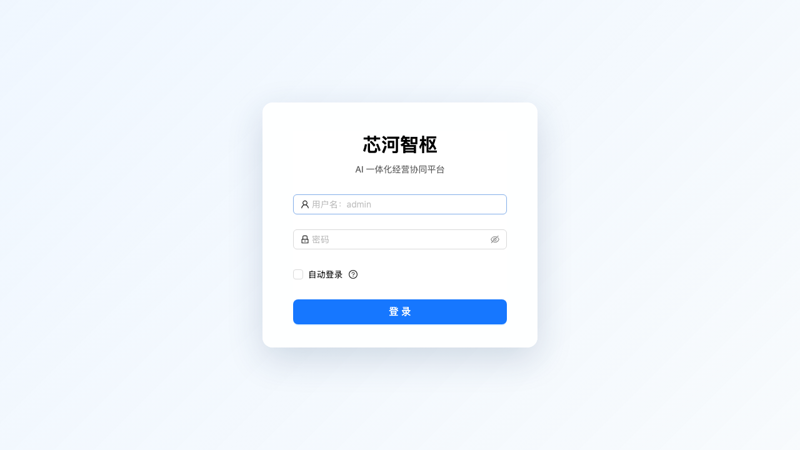
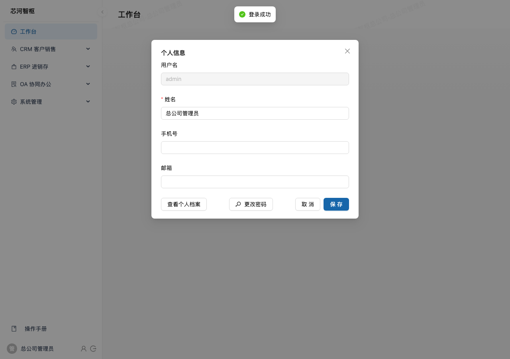
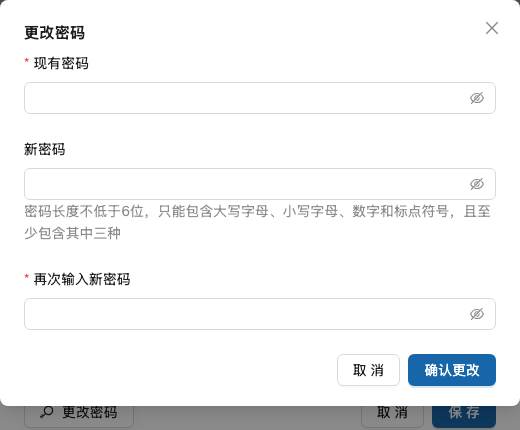

# 2. 登录与账号基础操作

本章介绍普通员工和管理员每天都会用到的账号操作：登录、首次使用、登录失败排查、修改个人资料、修改密码和退出登录。

## 2.1 登录系统

### 业务场景

员工需要进入系统打卡、提交报销、查看客户或处理审批时，先使用自己的系统账号登录。正式员工一般使用入职信息采集时自己设置的用户名和密码；临时账号、测试账号或特殊账号可能由管理员直接创建并提供临时初始密码。

### 登录前需要准备什么

- 正式员工：入职表单提交成功时设置的登录用户名和密码。
- 临时账号：管理员提供的用户名和初始密码。
- 系统访问地址：由公司管理员或系统负责人提供。
- 如果账号刚刚创建或刚完成入职资料提交，先确认管理员已经完成账号开通。

### 操作步骤

1. 打开系统访问地址，进入“芯河智枢”登录页。
2. 在“用户名”输入框填写用户名。输入框提示为“用户名：admin”，其中 `admin` 只是输入示例，不代表所有用户都使用这个账号。
3. 在“密码”输入框填写密码。点击输入框右侧的眼睛图标，可以临时显示或隐藏密码，便于检查是否输入正确。
4. 根据使用环境决定是否勾选“自动登录”。
5. 点击“登 录”。
6. 等待页面跳转到系统内部页面，确认左侧菜单已经出现。

图 1：系统登录页。用户名和密码为必填项；“自动登录”旁的问号用于查看保持登录时间说明。

### 自动登录怎么选

点击“自动登录”旁边的问号图标，可以查看系统当前说明：

- 勾选后，下次打开系统通常不用重新登录，最长保持 30 天。
- 未勾选时，登录状态最长保持 12 小时。
- 公用电脑、会议室电脑或他人可以使用的设备不要勾选“自动登录”。

### 登录成功的判断标准

登录成功后通常会同时出现以下现象：

- 页面跳转到“工作台”或上次可访问的系统内部页面。
- 页面出现左侧导航菜单。
- 右上或页面内容区域出现“登录成功”提示后自动消失。
- 左侧底部出现当前用户的头像和姓名。
- 菜单内容与当前账号的公司、岗位和权限相匹配。

如果只看到登录页，没有进入系统内部页面，不能认为已经登录成功。

## 2.2 首次使用账号

正式员工和临时账号的首次使用入口不同，不能混用。

### 2.2.1 正式员工：通过入职链接设置账号

正式员工不是由管理员直接分配一组固定密码，而是由公司管理员在“系统管理 > 人员档案”的“入职信息采集”页面创建人员记录。

#### 管理员侧流程

1. 进入“系统管理 > 人员档案”。
2. 在“入职信息采集”页面点击“新建入职人员”。
3. 填写新员工姓名。
4. 选择所属部门。
5. 根据部门选择岗位。没有先选择部门时，岗位选择框不可用。
6. 设置“链接有效期（天）”，可填写 1 至 30 天，默认 7 天。
7. 点击“生成表单”。
8. 系统创建一条“待填写”的入职记录，并弹出“入职表单链接”窗口；列表中会显示对应的截止时间。
9. 点击“复制链接”，通过安全方式发送给新员工。

#### 员工侧流程

1. 打开管理员发送的入职链接。
2. 入职链接是公开填写入口，不需要先登录系统；打开后先确认页面显示的截止时间和剩余有效时间。
3. 核对页面显示的公司、姓名、部门和岗位是否正确。
4. 填写性别、出生日期、证件类型、证件号码、手机号、邮箱、居住地址、紧急联系人、紧急联系人关系和紧急联系人电话。
5. 在“账号设置”中填写“登录用户名”“登录密码”和“确认密码”。
6. 登录用户名须以字母开头，长度为 3 至 64 位，只能使用字母、数字、下划线、点和短横线。
7. 教育背景填写：开始月份、结束月份、学历和院校需要完整填写。
8. 点击“确认提交并锁定”。
9. 看到“资料已提交”后，使用刚刚设置的用户名和密码进入系统登录页。

提交后有两个重要结果：

- 入职表单会被锁定，不能再次编辑。
- 系统会自动创建人员档案和登录账号，管理员列表中的采集状态变为“已提交”，账号状态变为“已开通”。
- 链接超过截止时间后会变为“已过期”；管理员撤销后会变为“已撤销”，这两种状态都不会再展示填写表单。

> 只打开链接但没有点击“确认提交并锁定”，不能直接使用其中填写的用户名登录系统。

### 2.2.2 临时账号：管理员直接创建

临时账号适用于测试、短期协作或特殊账号开通，不等同于正式员工的入职档案流程。

管理员操作：

1. 进入“系统管理 > 用户管理”。
2. 点击“新建用户”。
3. 填写用户名、用户姓名、手机号和邮箱。
4. 按需要选择岗位。
5. 如确需开通公司管理员身份，由有权限的管理员打开“公司管理员”开关；普通用户不要随意开启。
6. 保存用户。
7. 在新建用户弹窗中查看系统显示的初始密码，并通过安全方式提供给使用者。

当前系统新建用户页面显示的初始密码为 `xinhe123.`。它只是临时登录入口，管理员和使用者都不应把它当作长期密码；首次登录后应立即通过“更改密码”设置个人密码。

使用者操作：

1. 使用管理员提供的用户名和初始密码登录。
2. 登录后点击左下角头像或姓名。
3. 点击“更改密码”，输入现有密码和新密码。
4. 修改成功后使用新密码重新登录。
5. 向管理员确认自己所属公司、岗位和可见菜单是否正确。

## 2.3 首次登录后的账号检查

首次进入系统后，不要立即开始处理重要业务，建议先做一次账号核对。

### 普通员工检查清单

- [ ] 左下角显示的姓名是本人。
- [ ] 能看到自己需要使用的业务菜单，例如 OA 协同办公或 CRM 客户销售。
- [ ] 能进入“OA 协同办公 > 打卡记录”。
- [ ] 如果需要报销，能看到“我的报销”。
- [ ] 如果是销售人员，能看到客户管理、计划或销售订单入口。
- [ ] 已向管理员确认所属公司、部门和岗位。
- [ ] 已确认自己不应看到的管理菜单没有被错误开放。

### 公司管理员检查清单

- [ ] 能进入“系统管理 > 组织与岗位”。
- [ ] 能进入“系统管理 > 用户管理”。
- [ ] 能进入“系统管理 > 人员档案”。
- [ ] 组织、岗位和用户数据属于当前公司。
- [ ] 配置权限时只开放岗位实际需要的业务权限。
- [ ] 没有把平台管理员专属的公司管理能力误分配给普通账号。

### 不要用个人信息弹窗判断的内容

左下角“个人信息”弹窗维护基础账号资料，并提供进入个人档案的入口：

- 用户名是只读字段，不能在这里修改。
- 姓名、手机号和邮箱可以修改。
- “查看个人档案”可以进入 OA 的个人档案页面。
- 公司、部门、岗位和数据范围不是在这个弹窗中维护的。
- 如果公司、部门或岗位不正确，应联系公司管理员检查组织和岗位关系。

## 2.4 登录失败和账号不可用

### 用户名或密码错误

处理顺序：

1. 检查用户名前后是否误输入空格。
2. 检查大小写、数字和特殊字符。
3. 确认正式员工使用的是入职表单中自己设置的用户名，而不是姓名、手机号或入职链接。
4. 确认临时账号使用的是管理员提供的用户名，而不是显示姓名。
5. 确认是否已经修改过密码；如果修改过，应使用新密码。
6. 仍然失败时联系管理员重置密码，不要连续猜测密码。

### 账号被停用或无法进入系统

管理员应在“系统管理 > 用户管理”检查：

- 用户状态是否为“启用”。
- 用户是否属于正确的公司。
- 用户是否关联了正确的岗位。
- 用户是否被误删或已经离职。
- 用户是否有权访问当前模块。

用户管理页面中，管理员还可以编辑用户、分配岗位和重置密码。重置密码后，原账号的已有登录会话会失效，用户需要使用新密码重新登录。

### 看不到菜单或按钮

这不一定是登录失败，常见原因包括：

- 当前账号没有该功能权限。
- 当前账号没有关联岗位。
- 该功能只对平台管理员、公司管理员或部门负责人开放。
- 该功能使用内置规则，不会出现在岗位权限配置页。

应让管理员检查账号、公司、岗位、权限和数据范围。

## 2.5 修改个人资料

### 业务场景

员工姓名、手机号或邮箱发生变化时，可以自行维护个人资料。用户名属于登录标识，不能通过个人资料弹窗修改。

### 操作步骤

1. 登录系统后，找到左侧导航底部的头像和当前姓名。
2. 点击头像或姓名，打开“个人信息”弹窗。
3. 核对“用户名”字段。该字段为灰色只读状态。
4. 修改“姓名”“手机号”或“邮箱”。姓名为必填项，邮箱需要符合邮箱格式。
5. 点击“保存”。
6. 看到“个人信息已更新”提示后关闭弹窗。

图 2：个人信息弹窗。用户名不能修改，姓名、手机号和邮箱可以维护；弹窗同时提供“查看个人档案”入口，“更改密码”位于弹窗左下角。

### 修改后如何确认

- 左下角用户姓名更新为新名称。
- 页面水印同步刷新为新姓名。
- 重新打开个人信息，确认手机号和邮箱仍然显示正确。
- 如果修改的是组织、岗位或数据范围，不要在这里反复修改，应联系管理员处理。

### 2.5.1 查看和修改个人档案

1. 在个人信息弹窗中点击“查看个人档案”，或进入“OA 协同办公 > 个人档案”。
2. 查看姓名、用户名、部门、岗位、性别、出生日期、证件类型、证件号码、联系方式、紧急联系人和教育经历。
3. 本人查看证件号码时显示完整号码；部门和岗位不可修改。
4. 姓名、手机号和邮箱在基础信息区域直接保存，不需要审批。
5. 性别、出生日期、证件类型、证件号码、居住地址、紧急联系人和教育经历通过“提交审批”发起变更。
6. “我的变更申请”中点击“查看详情”，只查看实际修改字段；枚举字段显示中文，空字段和未变化字段不展示。

空字段会被过滤，不会覆盖已有档案信息。只修改性别时，其他空字段不会进入申请。

## 2.6 修改密码

### 密码要求

当前系统密码要求为：密码长度为 6 至 72 位，只能包含大写字母、小写字母、数字和标点符号，并且至少包含其中三种类型。

建议使用不易猜测、且不与其他系统重复的密码。不要使用姓名、手机号、生日或公司名称作为完整密码。

### 操作步骤

1. 点击左侧导航底部的头像或姓名，打开“个人信息”。
2. 点击左下角“更改密码”。
3. 在“现有密码”中填写当前密码。
4. 在“新密码”中填写符合要求的新密码。
5. 在“再次输入新密码”中重复输入新密码。
6. 点击“确认更改”。
7. 看到“密码修改成功，请使用新密码重新登录”后，使用新密码重新登录。

图 3：修改密码弹窗。修改密码成功后当前登录会话会结束，系统会返回登录页。

### 常见校验失败

- 现有密码错误：确认使用的是当前有效密码。
- 两次新密码不一致：重新输入并确保两个字段完全一致。
- 新密码不符合规则：确保长度为 6 至 72 位，并同时使用大写字母、小写字母、数字或标点符号中的至少三类。
- 新密码超过 72 位：缩短密码长度至 72 位以内。
- 修改成功后旧密码无法登录：这是正常现象，应改用新密码。

## 2.7 退出登录

### 正常退出

1. 先保存正在编辑的业务表单。
2. 点击左侧导航底部头像和姓名右侧的退出图标区域。
3. 系统调用退出接口并返回登录页。
4. 如需再次使用，重新输入用户名和密码登录。

图 4：左侧导航底部用户操作区。头像和姓名用于打开个人信息，右侧图标区域用于退出登录。

### 公共设备退出要求

- 公共电脑不要勾选“自动登录”。
- 退出前关闭个人信息、业务详情和附件预览页面。
- 退出后确认页面已经返回登录页，而不是仅关闭一个弹窗。
- 不要把用户名、密码或入职链接保存在公共浏览器中。

## 2.8 账号安全注意事项

- 不要把密码、验证码、入职链接和临时初始密码发到公开群聊。
- 入职链接只发送给对应员工；如果链接泄露，管理员应重新生成，旧链接会立即失效。重新生成时需设置新的有效期。
- 管理员撤销链接后，候选人只能看到“表单已撤销”提示，不能继续填写或提交。
- 临时账号应记录使用人、使用期限和权限范围，使用结束后及时停用。
- 修改密码后不要继续使用旧密码，也不要在多个系统复用同一密码。
- 发现姓名、公司、部门、岗位或菜单异常时，不要自行尝试越权操作，应联系管理员。
- 提交问题时可以提供用户名、页面名称、操作步骤和错误提示，但不要提供密码或敏感证件信息。

## 2.9 新手完成本章后的检查清单

- [ ] 能打开登录页并正确填写用户名、密码。
- [ ] 知道正式员工账号来自入职表单，不是管理员直接发放的固定密码。
- [ ] 知道临时账号与正式员工账号的区别。
- [ ] 知道“自动登录”在公共设备上不能勾选。
- [ ] 能从左下角头像或姓名打开个人信息。
- [ ] 知道用户名不能在个人信息弹窗中修改。
- [ ] 能独立修改密码并使用新密码重新登录。
- [ ] 能正确退出系统，并确认已经回到登录页。
- [ ] 遇到登录失败时联系管理员。

