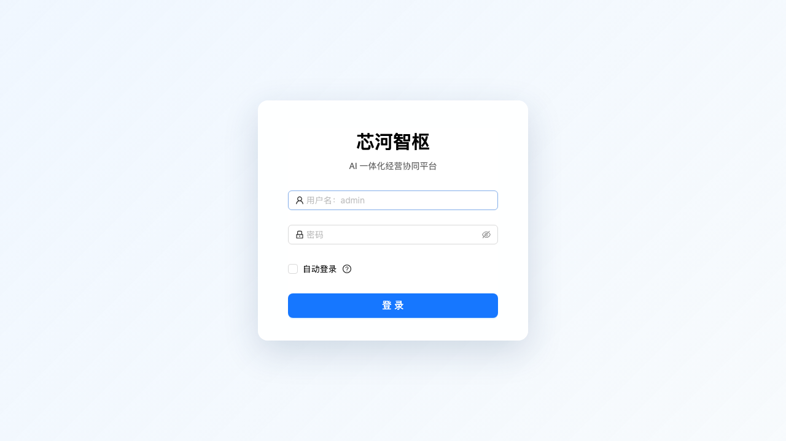
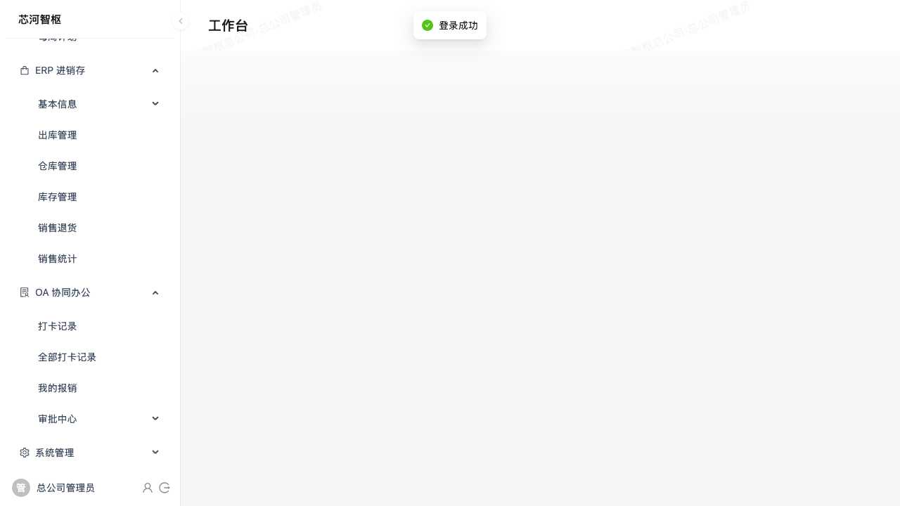
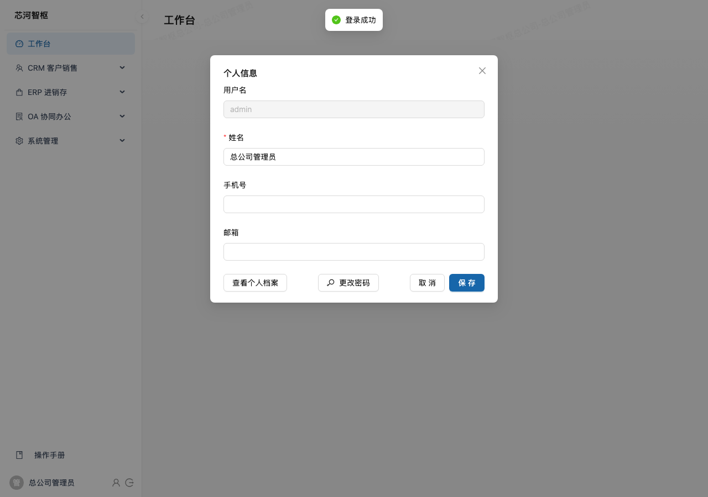
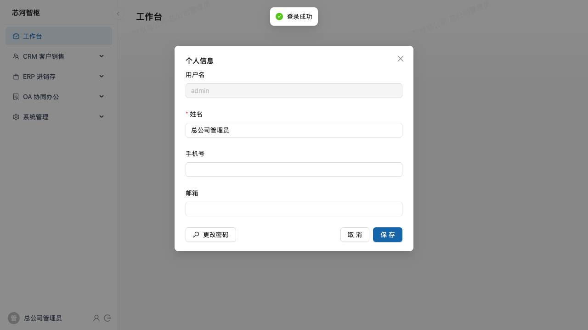
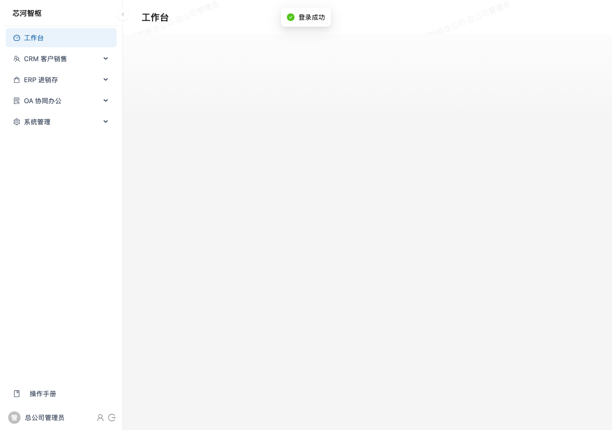
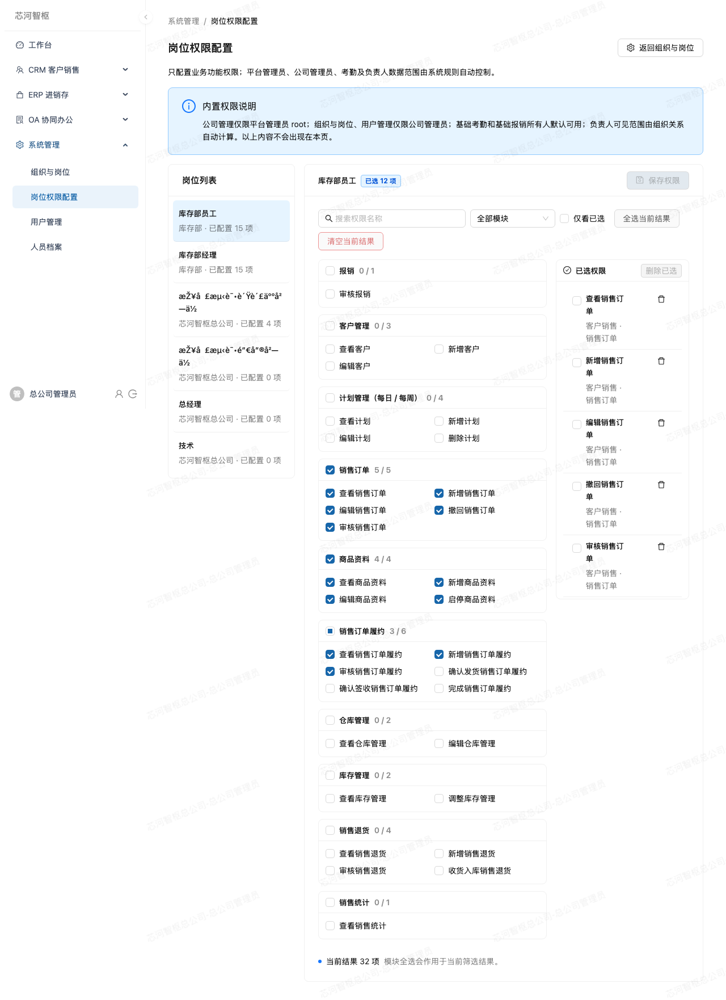
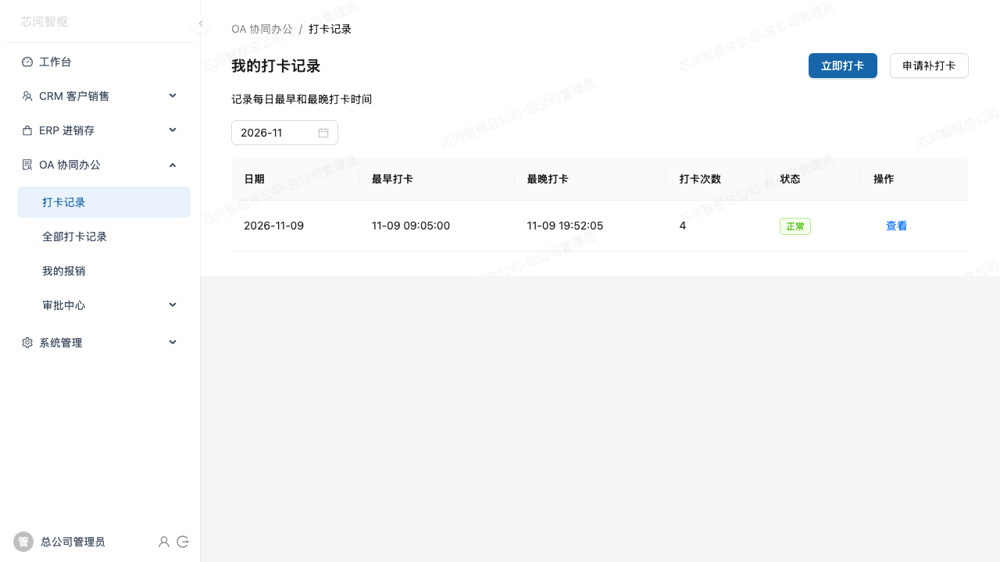
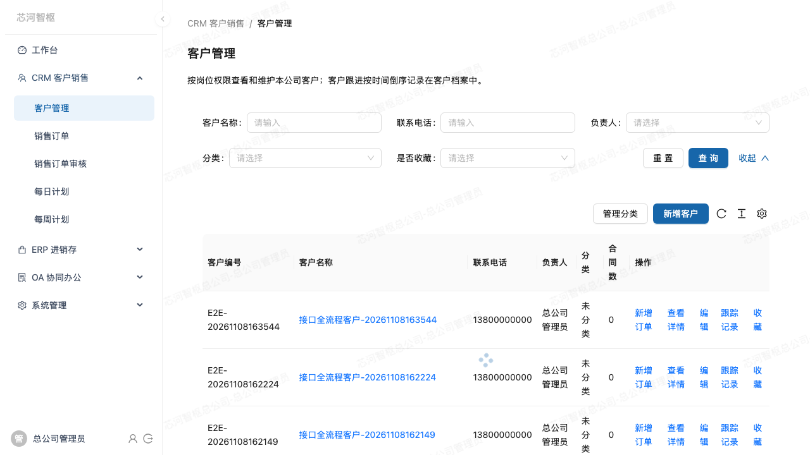

# 1. 系统简介

## 1.1 这套系统能解决什么问题

芯河智枢是一套面向企业日常经营管理的综合业务系统，主要把人员、组织、权限、考勤、报销、客户、计划和销售订单等工作集中到一个平台中完成。

对刚接触系统的用户来说，可以先记住三件事：

1. **先登录，再按角色使用功能。** 不同账号看到的菜单和可操作范围可能不同。
2. **系统管理决定“谁能做什么”，业务模块负责“具体怎么做”。** 例如，组织与岗位用于维护公司架构，权限配置用于控制岗位能否审核报销；客户管理则用于录入和跟进客户。
3. **数据范围和操作权限是两回事。** 有权限不代表能看到所有数据，负责人、部门负责人和公司管理员通常还会受到组织范围约束。

本手册的目标是帮助第一次使用系统的人完成一次完整的上手操作：登录系统、认识菜单、确认个人身份、进入对应业务模块，并按照实际工作场景完成第一项业务。

## 1.2 第一次使用的推荐路径

建议新用户按照下面的顺序熟悉系统：

| 顺序 | 要做的事 | 目的 |
| --- | --- | --- |
| 1 | 由管理员建立入职档案并生成填写链接 | 准备正式员工的入职信息 |
| 2 | 新员工打开链接填写资料、登录用户名和密码 | 完成个人资料和登录凭据设置 |
| 3 | 使用自己设置的账号登录 | 确认账号可用 |
| 4 | 查看左侧菜单并确认公司、岗位 | 判断菜单和数据范围是否正确 |
| 5 | 先完成一项日常工作 | 例如打卡、提交报销或新增客户 |
| 6 | 遇到“看不到”或“不能操作”时联系管理员 | 排查账号、权限、岗位和组织范围 |

> 建议：首次登录后不要直接修改组织、用户或权限配置。先确认自己是普通员工、部门负责人、公司管理员还是平台管理员，再进行对应操作。

## 1.3 登录系统

### 业务场景

正式员工的标准入口不是管理员直接发放一组固定账号密码，而是由公司管理员在“系统管理 > 人员档案”页面发起“入职信息采集”。管理员先创建一条入职人员记录，填写姓名、部门和岗位，系统随后生成一次性入职表单链接。新员工打开链接后填写个人入职信息，同时设置登录用户名和密码；表单提交后，系统自动创建人员档案和系统账号，员工再使用自己设置的账号登录系统。

管理员直接创建账号并提供初始密码，主要用于临时账号、测试账号或特殊情况下的账号开通。该方式提供的是临时登录入口，使用者登录后应按公司要求及时修改密码，并由管理员确认账号的有效期和使用范围。

### 操作步骤

### 正式员工首次使用：通过入职链接完成注册

1. 公司管理员进入“系统管理 > 人员档案”，打开“入职信息采集”页面。
2. 点击“新建入职人员”。
3. 在弹窗中填写新员工姓名，选择所属部门，再选择该部门下的岗位，并设置链接有效期（1–30 天，默认 7 天）。
4. 点击“生成表单”，系统创建一条“待填写”的入职记录，并弹出入职表单链接。
5. 点击“复制链接”，通过安全方式将链接发送给新员工；链接只应发送给本人，不要公开转发。
6. 新员工无需登录系统，直接打开链接；页面会显示截止时间和剩余时间。
7. 新员工按页面要求填写性别、出生日期、证件、联系方式、居住地址、紧急联系人等资料。
8. 新员工在“账号设置”中填写登录用户名、登录密码和确认密码，然后点击“确认提交并锁定”。
9. 提交成功后，表单会锁定，系统自动创建人员档案和登录账号；员工使用刚刚设置的用户名和密码打开系统登录页。
10. 管理员回到“人员档案”列表，确认采集状态变为“已提交”、账号状态变为“已开通”，必要时点击“查看档案”核对信息。

### 临时账号使用：管理员直接创建账号

1. 管理员在“系统管理 > 用户管理”中创建临时账号。
2. 管理员将用户名和初始密码通过安全方式提供给使用者。
3. 使用者打开系统登录页，填写管理员提供的临时账号信息。
4. 登录后按公司要求修改密码，并确认账号的使用期限和权限范围。

### 登录页操作

1. 打开系统地址，进入登录页。
2. 在“用户名”输入框填写入职表单中设置的用户名，或管理员提供的临时用户名。
3. 在“密码”输入框填写对应密码。
4. 根据需要勾选“自动登录”。公用电脑建议不要勾选。
5. 点击“登 录”。
6. 登录成功后进入系统首页或工作台。

图 1：登录页。用户名和密码均为必填项，自动登录适合个人设备，不建议在公共电脑上使用。

### 完成标志

- 页面从登录页跳转到系统内部页面。
- 页面右上角能看到当前登录用户。
- 左侧能看到与当前账号匹配的菜单。

### 登录失败怎么办

- 检查用户名和密码前后是否有空格。
- 正式员工确认是否已经完成入职链接中的表单提交；只打开链接但未提交，不能直接登录系统。
- 确认登录使用的是入职表单中自己设置的用户名和密码，而不是姓名、手机号或入职链接本身。
- 临时账号确认是否仍在有效期内，以及管理员是否已经启用账号。
- 确认是否使用了正确公司的账号。
- 如果账号被禁用、密码错误或登录后立即返回登录页，请联系公司管理员。
- 不要反复猜测他人密码；系统安全问题应由管理员通过用户管理或密码重置流程处理。

## 1.4 认识系统页面和导航

登录后，系统采用“左侧固定导航 + 右侧业务内容”的布局。需要特别注意：当前页面**不是把当前用户信息放在顶部**，当前用户的个人操作入口位于左侧导航底部。

### 1.4.1 左侧顶部：系统标识和收起按钮

左侧导航最上方显示系统名称“芯河智枢”。系统名称不是业务菜单，点击后不要把它当成返回首页的按钮。

系统名称右侧有一个圆形的导航收起按钮：

- 点击后收起左侧导航，只保留图标，右侧内容区域变宽。
- 再次点击后恢复完整菜单名称。
- 收起导航只改变显示方式，不会退出登录，也不会改变权限。

图 2：页面右侧顶部的实际显示区域。当前主要显示页面标题“工作台”和页面水印，不显示用户姓名或退出按钮。

### 1.4.2 左侧中部：一级菜单和二级菜单

左侧菜单会根据当前账号的公司、岗位和访问规则动态生成。当前系统的一级菜单包括：

- **工作台**：进入系统首页。当前工作台具体内容暂待开发。
- **CRM 客户销售**：公司业务人员使用，展开后进入客户管理、销售订单、销售订单审核、每日计划、每周计划等页面；平台管理员端默认隐藏。
- **ERP 进销存**：展开后包括基本信息、出库管理、仓库管理、库存管理、销售退货、销售统计等页面。ERP 操作手册暂待开发。
- **OA 协同办公**：公司员工使用，展开后进入打卡记录、全部打卡记录、个人档案、我的报销和审批中心；审批中心还可以继续展开补打卡申请、补打卡审批和人员档案审批；平台管理员端默认隐藏。
- **系统管理**：管理员使用的基础配置入口，包括公司管理、组织与岗位、岗位权限配置、用户管理和人员档案。公司管理只对平台管理员 root 显示；人员档案只对公司管理员显示。

一级菜单右侧的箭头表示该菜单可以展开或收起：

1. 点击“CRM 客户销售”“ERP 进销存”“OA 协同办公”或“系统管理”这一行，展开该模块的子菜单。
2. 再次点击同一行，收起子菜单。
3. 点击子菜单名称，进入对应业务页面。
4. 当前所在页面的菜单会以浅蓝色背景和蓝色文字标识，方便判断当前所在位置。
5. 如果某个一级菜单或子菜单完全看不到，不要通过直接输入地址绕过菜单；先确认账号的角色、公司和功能范围。

图 3：展开后的系统导航。父级菜单右侧箭头用于展开或收起，子菜单点击后进入具体业务页面。

### 1.4.3 左侧顶部：页面标题，而不是用户操作区

左侧顶部是当前业务内容区域的页头，主要用于显示当前页面标题，例如“工作台”“客户管理”“打卡记录”。根据页面不同，标题下方或右侧可能出现页面说明、筛选、新增、导出等业务操作。

右侧顶部当前不承担以下功能：

- 不显示当前登录用户的姓名。
- 不提供个人资料和修改密码入口。
- 不提供退出登录按钮。

当前用户相关操作统一在左侧导航底部完成。页面内容区域还可能显示浅色的公司和用户水印，这是页面标识，不是可点击的菜单。

### 1.4.4 右侧内容区：列表、表单、详情和审批

进入具体页面后，右侧内容区通常包含以下结构：

1. **页面标题和说明**：先确认当前页面是否是自己要操作的模块。
2. **筛选区**：按状态、日期、姓名、客户等条件缩小列表范围；清空筛选后可以恢复全部结果。
3. **工具栏**：常见有新增、新建、导出、批量操作等按钮，按钮是否出现取决于当前账号。
4. **数据列表**：查看记录；点击某一行的操作可进入详情、编辑、提交或审批。
5. **分页区**：数据较多时切换页码；切换筛选条件后应重新确认列表结果。

详情页、编辑页和新建页通常是由列表页中的按钮打开的，不一定单独出现在左侧菜单中。例如客户详情、客户跟进、报销编辑、销售订单详情和人员档案查看都属于从主列表进入的页面。

### 1.4.5 左侧底部：当前用户、个人信息和退出登录

左侧导航底部显示一个圆形头像、当前显示姓名，以及右侧的操作图标。以管理员账号为例，可能显示“管”和“总公司管理员”。这里是系统中最重要的个人交互区域。

#### 点击头像或姓名：打开“个人信息”

点击头像或当前用户姓名，会打开“个人信息”弹窗。弹窗包含：

- **用户名**：只读，不能在这里修改。
- **姓名**：必填，可以修改显示姓名。
- **手机号**：可以维护或修改。
- **邮箱**：可以维护或修改，系统会校验邮箱格式。
- **查看个人档案**：进入 OA 的“个人档案”页面，查看完整个人档案并按规则提交变更。
- **保存**：保存个人资料修改。
- **取消或右上角关闭**：放弃本次修改并关闭弹窗。
- **更改密码**：进入单独的密码修改弹窗。

图 4：左侧导航底部的用户操作区。头像和姓名用于打开个人信息；右侧两个图标所在区域用于退出当前账号。

图 5：点击左下角头像或姓名后打开的“个人信息”弹窗。用户名为只读字段，姓名、手机号和邮箱可以维护，并可通过“查看个人档案”进入 OA 个人档案。

#### 点击“更改密码”：修改密码并重新登录

在“个人信息”弹窗左下角点击“更改密码”后，需要依次填写：

1. 现有密码。
2. 新密码。
3. 再次输入新密码。

点击“确认更改”后，系统会提示密码修改成功，并结束当前登录会话，自动返回登录页。此时要使用新密码重新登录。若两次新密码不一致、现有密码错误或不满足密码规则，系统会保留在当前页面并提示原因。

图 6：修改密码时的实际弹窗。修改密码弹窗会叠加在个人信息弹窗上方，需要填写现有密码、新密码和确认密码。

#### 个人档案入口和变更规则

1. 在个人信息弹窗中点击“查看个人档案”，或展开“OA 协同办公”后直接点击“个人档案”。
2. 个人档案页面展示姓名、用户名、部门、岗位、性别、出生日期、证件类型、证件号码、联系方式、紧急联系人和教育经历。
3. 本人查看证件号码时显示完整号码；公司管理员查看他人档案时只显示脱敏号码或登记状态。
4. 姓名、手机号和邮箱可以直接保存，并同步更新个人信息、左下角姓名和页面水印。
5. 性别、出生日期、证件类型、证件号码、居住地址、紧急联系人和教育经历需要提交审批；部门和岗位不可由个人修改。
6. 变更申请支持“查看详情”，弹窗只展示实际变化字段，并把枚举转换为中文。
7. 公司管理员默认拥有人员档案审批权限，也可以通过岗位权限配置把 `hr:profile:approve` 分配给其他审批人。

平台管理员端默认隐藏 CRM 客户销售、OA 协同办公和人员档案，不承担公司业务数据或人员档案操作。

#### 点击底部右侧图标：退出登录

头像和姓名右侧的图标区域用于退出登录。点击后系统会退出当前账号并返回登录页。退出前请先保存正在编辑的表单，否则未保存内容可能丢失。

图 7：登录后的页面布局。左侧底部为当前用户和退出入口，右侧顶部是当前业务页面标题。

### 1.4.6 一个完整的导航操作示例

以普通员工提交报销为例：

1. 登录后观察左侧菜单，确认存在“OA 协同办公”。
2. 点击“OA 协同办公”右侧的箭头，展开子菜单。
3. 点击“我的报销”，进入报销列表。
4. 点击页面工具栏中的新增或新建按钮，进入报销填写页。
5. 完成填写后保存或提交，按页面提示返回列表查看状态。
6. 需要修改个人姓名或手机号时，点击左下角头像或姓名，不要在业务页面里寻找个人设置。
7. 使用完系统后，点击左下角用户区域右侧的退出图标退出账号。

### 菜单怎么看

- 菜单能看到但点进去没有数据：通常是数据范围、公司范围或组织关系没有配置完整。
- 菜单完全看不到：通常是账号不具备该功能的访问条件，或该功能属于内置规则。
- 页面有查看权限但没有新增、编辑或删除按钮：说明当前账号只拥有部分操作权限。
- 删除类操作通常会要求二次确认；涉及多条数据时会显示选中数量。

## 1.5 系统模块总览

### 1.5.1 系统管理

系统管理是管理员使用的基础模块，负责维护企业的组织与账号基础资料。

主要包括：

- **公司管理**：平台管理员维护公司信息。该能力仅面向平台管理员 root。
- **组织与岗位**：公司管理员维护部门、组织层级、岗位和负责人关系。
- **用户管理**：公司管理员维护登录账号、账号状态和公司归属。
- **人员档案**：公司管理员查看人员基础资料、入职信息、教育背景和档案状态；平台管理员不显示该入口。
- **权限配置**：按岗位配置可操作的业务权限，例如“审核报销”。

### 业务场景：公司管理员为新员工准备入职档案

1. 公司管理员进入“系统管理 > 人员档案”的“入职信息采集”页面。
2. 点击“新建入职人员”，填写姓名、部门和岗位，设置链接有效期后点击“生成表单”。
3. 在弹出的“入职表单链接”窗口中复制链接，并通过安全方式发送给新员工。
4. 新员工无需登录，通过链接查看截止时间，填写个人资料、教育背景和登录用户名、密码，点击“确认提交并锁定”。
5. 管理员回到列表查看“采集状态”：待填写、已提交、已过期或已撤销；提交后系统会显示账号“已开通”。
6. 如果链接泄露、过期或需要重新发送，点击“重新生成”，确认新有效期后复制新链接；旧链接会立即失效。
7. 如果不再办理入职，点击“撤销”；撤销后候选人只能看到失效提示，不能继续填写。
8. 提交完成后，管理员可在对应记录上点击“查看档案”，核对人员档案内容。
9. 新员工使用自己设置的登录凭据登录，管理员再验证菜单、按钮和数据范围是否符合岗位职责。

### 入职链接的后续处理

- **待填写**：可以复制当前链接，也可以点击“重新生成”；重新生成时可重新设置 1–30 天有效期，旧链接立即失效。
- **待填写且不再办理入职**：点击“撤销”，确认后原链接立即失效，撤销不可恢复。
- **已提交**：表单已经锁定，不能再次编辑；管理员可以查看已生成的人员档案。
- **已过期或已撤销**：员工打开链接时只会看到对应失效提示，不会展示填写表单；需要管理员重新生成链接或重新发起记录。

### 业务场景：管理员开通临时账号

1. 进入“系统管理 > 用户管理”。
2. 点击新增用户，创建临时用户名并确认所属公司。
3. 保存后确认账号处于启用状态，并记录使用期限和使用人。
4. 将初始密码通过安全方式提供给使用者。
5. 使用者登录后修改密码，管理员在使用期限结束后及时停用账号。

> 权限配置只处理可配置的业务权限。公司管理、组织与岗位、用户管理以及考勤基础能力有明确的内置规则，不应通过普通业务权限随意开放。

图 8：岗位权限配置页。配置前先确认岗位和公司，配置后应使用实际账号验证菜单、按钮和数据范围。

### 1.5.2 OA 协同办公

OA 用于处理员工日常办公事务，目前重点包括：

- **考勤**：打卡、查看自己的打卡记录、查看全部打卡记录、补卡申请和补卡审批。
- **报销**：新建报销、选择报销类型、填写明细、查看总金额及各类型金额、提交报销。
- **审批**：查看自己发起的申请，以及处理自己负责范围内的审批任务。
- **个人档案**：查看本人档案；姓名、手机号和邮箱直接同步，其他允许修改的字段提交审批。
- **入职协同**：通过入职邀请链接收集新员工入职资料。

### 业务场景：员工完成一次日常考勤

1. 进入“OA 协同办公 > 考勤”。
2. 在允许打卡的时间内点击打卡按钮。
3. 如系统请求定位权限，根据公司制度允许定位，或按页面要求选择位置来源。
4. 打卡后查看当天记录，确认上班或下班时间已显示。
5. 如果漏打卡，进入补卡申请，填写日期、时间和原因后提交。

图 9：OA 考勤页面。普通员工主要使用自己的打卡和补卡功能；公司管理员、部门负责人可按内置规则查看相应范围的数据。

### 业务场景：员工提交一笔报销

1. 进入“OA 协同办公 > 报销”。
2. 点击新建报销。
3. 在每条报销明细中选择报销类型，例如交通、餐饮等。
4. 填写金额、发生日期、事由，并按要求上传附件。
5. 检查页面底部的总金额，以及按报销类型汇总的金额。
6. 保存草稿，确认内容无误后提交报销。
7. 在“我的报销”中查看当前状态和审批进度。

> 提交前重点检查三项：金额是否正确、报销类型是否选择、附件是否对应本条明细。附件涉及公司内部资料时，不要把链接转发给无关人员。

### 1.5.3 CRM 客户销售

CRM 用于管理客户、销售计划和销售订单，适合销售人员、销售负责人和相关管理人员使用。

主要包括：

- **客户管理**：新增、查看、编辑和删除客户。
- **客户跟进**：记录电话、拜访、沟通结果和下一步动作。
- **每日计划**：安排当天需要完成的客户或销售任务。
- **每周计划**：按周规划销售目标和重点工作。
- **销售订单**：记录客户成交后的订单信息和订单状态。

### 业务场景：销售人员从线索跟进到订单

1. 进入“CRM 客户销售 > 客户管理”。
2. 点击新增客户，录入客户名称、联系人、联系方式和客户来源。
3. 打开客户详情，新增一次跟进记录，填写沟通内容和下一步计划。
4. 将下一步动作安排到每日计划或每周计划中。
5. 客户确认采购后，进入销售订单创建页面，选择客户并填写商品、数量、价格等信息。
6. 保存订单后检查订单状态，按系统流程继续处理。

图 10：CRM 客户管理页。负责人默认可以查看自己负责组织树内的客户，但仍应以实际岗位和数据范围为准。

### CRM 使用注意事项

- 客户名称、联系人和联系方式尽量填写完整，避免重复建档。
- 跟进记录要写清“发生了什么”和“下一步做什么”，不要只填写“已联系”。
- 计划是待办安排，跟进记录是实际发生情况，两者不要混用。
- 销售订单提交前要核对客户、商品、数量、价格和订单状态。
- 看到客户但不能编辑，通常表示当前账号不是负责人，或没有对应的编辑权限。

### 1.5.4 工作台

工作台是系统首页和待办聚合入口，后续将用于集中展示待处理审批、考勤提醒、销售任务和常用入口。

**当前手册暂不展开工作台的具体操作，相关内容待开发。**

### 1.5.5 ERP 进销存

ERP 进销存用于商品、采购、销售、库存和退货等业务管理。该部分会涉及商品资料、库存数量、销售出库、销售退货等较完整的业务流程。

**当前手册暂不展开 ERP 的具体操作，相关内容待开发。**

## 1.6 按角色理解系统

| 角色 | 主要关注内容 | 常见操作 |
| --- | --- | --- |
| 平台管理员 root | 平台和公司基础配置 | 公司管理、平台级账号维护；不进入 CRM、OA 和公司人员档案 |
| 公司管理员 | 本公司的组织、岗位、用户和人员档案 | 组织维护、用户管理、岗位权限配置、人员档案和档案审批 |
| 部门负责人 | 部门及下级组织的业务数据 | 查看团队考勤、审批下属补卡、查看负责范围的客户和计划 |
| 销售人员 | 客户和销售过程 | 客户建档、客户跟进、每日/每周计划、销售订单 |
| 普通员工 | 个人办公事务 | 打卡、补卡申请、个人报销、查看个人审批进度 |

> 同一个人可能同时承担多个职责。最终能否看到某个菜单或按钮，以当前账号的公司、岗位、负责人关系和权限配置为准。

## 1.7 新手第一次使用检查清单

- [ ] 正式员工已通过入职链接完成资料、用户名和密码填写。
- [ ] 临时账号已确认使用人、有效期和权限范围。
- [ ] 能使用自己的账号正常登录。
- [ ] 已确认所属公司、部门和岗位正确。
- [ ] 已确认左侧菜单与工作职责匹配。
- [ ] 已完成一次考勤打卡，或确认自己能看到考勤页面。
- [ ] 已知道如何发起补卡申请和查看申请状态。
- [ ] 需要报销时，知道如何选择报销类型并检查金额汇总。
- [ ] 销售人员已知道客户、跟进、计划和订单的基本入口。
- [ ] 管理员已知道用户、岗位和权限的配置入口。
- [ ] 知道遇到权限或数据范围问题时应联系谁。

## 1.8 常用术语

| 术语 | 含义 |
| --- | --- |
| 公司管理员 | 负责某个公司的组织、岗位和用户管理的账号 |
| 平台管理员 root | 负责平台级公司管理的最高权限账号 |
| 岗位 | 连接人员、组织职责和业务权限的基础对象 |
| 数据范围 | 当前账号可以查看或处理哪些组织、人员或业务数据 |
| 负责人 | 对客户、计划或订单承担业务责任的人 |
| 补卡 | 因漏打卡等原因提交的考勤修正申请 |
| 草稿 | 已保存但尚未正式提交的业务记录 |
| 审批 | 由指定负责人对申请或业务单据进行同意、驳回等处理 |

## 1.9 遇到问题的排查顺序

当用户反馈“没有菜单”“看不到数据”或“不能操作”时，建议按以下顺序排查：

1. 确认是否登录了正确账号。
2. 确认账号是否处于启用状态。
3. 确认账号所属公司是否正确。
4. 确认人员是否关联了正确组织和岗位。
5. 确认岗位是否配置了需要的业务权限。
6. 确认负责人关系和数据范围是否正确。
7. 退出后重新登录，再验证菜单和按钮。

如果仍然无法使用，反馈问题时请附上：账号用户名、所在公司、操作页面、具体操作步骤、页面提示，以及发生问题的大致时间。

