# 3. 系统管理

系统管理负责维护企业的公司、组织、岗位、用户、权限和人员档案，是业务模块正常使用的基础。系统管理中的修改会影响菜单显示、数据范围、审批关系和账号登录，操作前应先确认当前公司、岗位和目标对象。

## 3.1 使用前先确认角色

系统管理不是所有账号都能使用。当前规则如下：

| 功能 | 可使用角色 | 说明 |
| --- | --- | --- |
| 公司管理 | 平台管理员 root | 其他账号不显示该菜单，直接访问也会被拒绝 |
| 组织与岗位 | 公司管理员、平台管理员 | 维护公司内部组织层级和岗位 |
| 岗位权限配置 | 公司管理员、平台管理员 | 配置岗位可使用的业务功能 |
| 用户管理 | 公司管理员、平台管理员 | 维护账号、身份、岗位和状态 |
| 人员档案 | 公司管理员 | 发起入职信息采集并查看已提交档案；平台管理员不显示此菜单 |

如果看不到某个菜单，先确认账号角色，不要直接输入 URL 绕过访问控制。平台管理员可以在对公司的创建进行管理；公司管理员通常只操作当前所属公司。

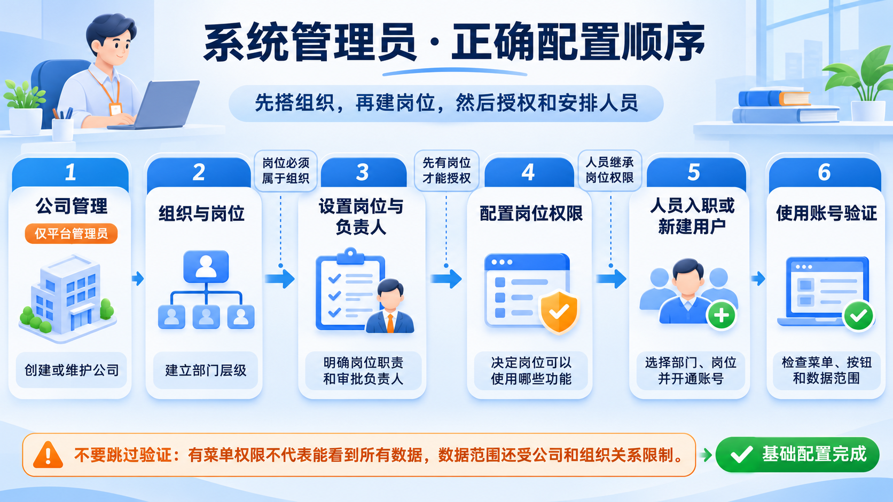

业务图：系统管理存在明确依赖关系。先建立公司和组织，再创建岗位、确定负责人并配置权限，然后安排人员或新建用户。公司员工开始考勤前，公司管理员还要配置并发布当年考勤规则。完成后必须使用实际账号验证菜单、按钮和数据范围。

## 3.2 公司管理

### 3.2.1 功能用途和访问限制

公司管理用于维护独立公司主体及渠道协作关系。它只对平台管理员 root 开放，普通用户、部门负责人和公司管理员不应使用此功能。

非平台管理员访问公司管理页面时，系统会显示“403，抱歉，你无权访问该页面”。这不是页面加载失败，而是权限控制生效。

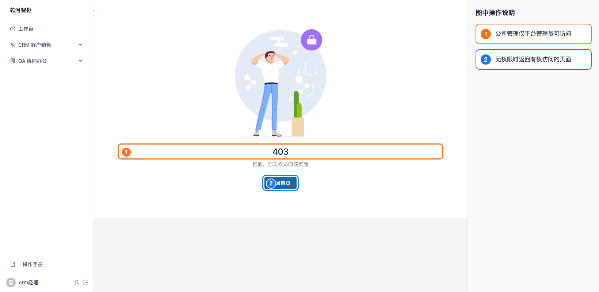

图 1：非平台账号访问公司管理时的 403 页面。公司管理仅允许平台管理员 root 使用。

### 3.2.2 查看公司列表

平台管理员进入“系统管理 > 公司管理”后，可以看到公司列表。列表主要展示：

- **公司编号**：由系统生成，可以使用复制按钮复制。
- **公司名称**：公司的主体名称。
- **渠道层级**：当前公司在渠道关系中的层级。
- **上级渠道公司**：当前公司关联的上级渠道主体。
- **联系人、联系电话**：公司基础联系信息。
- **状态**：显示“启用”或“停用”，页面不直接展示内部状态值。

公司编号和公司关系由系统维护，不要手工编造编号，也不要把不同公司的业务数据理解为共享数据。

### 3.2.3 创建公司

#### 业务场景

平台新增一个独立公司主体，需要同时生成该公司的管理员账号，交由公司管理员继续维护组织和用户。

#### 操作步骤

1. 进入“系统管理 > 公司管理”。
2. 点击“创建公司”。
3. 填写“公司名称”。
4. 如该公司属于渠道关系，选择“上级渠道公司”；没有上级公司可以留空。
5. 填写“联系人”和“联系电话”。
6. 点击“确定”。
7. 提交成功后，系统会在创建接口返回账号信息时打开“公司创建成功”提示框，显示公司编号、管理员账号和初始密码；如果接口调用失败，则不会进入成功提示步骤。
8. 在提示框中核对并安全保存这三项信息，再关闭提示框；同时提醒对应的公司管理员首次登录后及时修改初始密码。

创建公司时，公司编号由系统自动生成；上级渠道公司只能选择启用且未达到层级限制的公司。

### 3.2.4 公司创建成功后的重要信息

创建接口成功返回后，前端会打开“公司创建成功”提示框，并从接口返回结果中读取以下信息：

- 公司编号
- 管理员账号
- 初始密码

初始密码只在该提示框中展示，请通过安全方式交付给对应管理员，不要发布到公开群聊。关闭提示框后，公司列表只保留公司基础信息，不会再次展示这次创建返回的初始密码；如果没有及时保存，应通过“系统管理 > 用户管理”的重置密码功能处理。

### 3.2.5 编辑公司

1. 在公司列表中找到目标公司。
2. 点击“编辑”。
3. 核对只读的公司编号。
4. 修改公司名称、联系人、联系电话或状态。
5. 点击“确定”。
6. 看到“公司信息已更新”提示后，重新检查列表中的状态和联系信息。

编辑公司时不会重新生成公司编号。停用公司前，应先确认该公司下是否还有正在使用的账号和业务流程。

### 3.2.6 公司关系和数据边界

公司之间可以存在总公司、下属公司或渠道关系，但渠道关系本身不会产生跨公司数据权限。也就是说：

- 看到上级渠道公司，不代表可以查看上级公司的业务数据。
- 看到下级渠道公司，不代表可以代替下级公司操作业务。
- 业务数据仍以当前账号所属公司和系统固定的数据边界为准。

## 3.3 组织与岗位

### 3.3.1 页面结构

进入“系统管理 > 组织与岗位”后，页面分为两部分：

- **左侧“公司内部组织”**：以树形结构展示公司根组织和下级组织。
- **右侧“岗位列表”**：展示当前选中组织下的岗位。

平台管理员页面右上方还会出现公司选择器；切换公司后，左侧组织树和右侧岗位列表都会切换到所选公司。

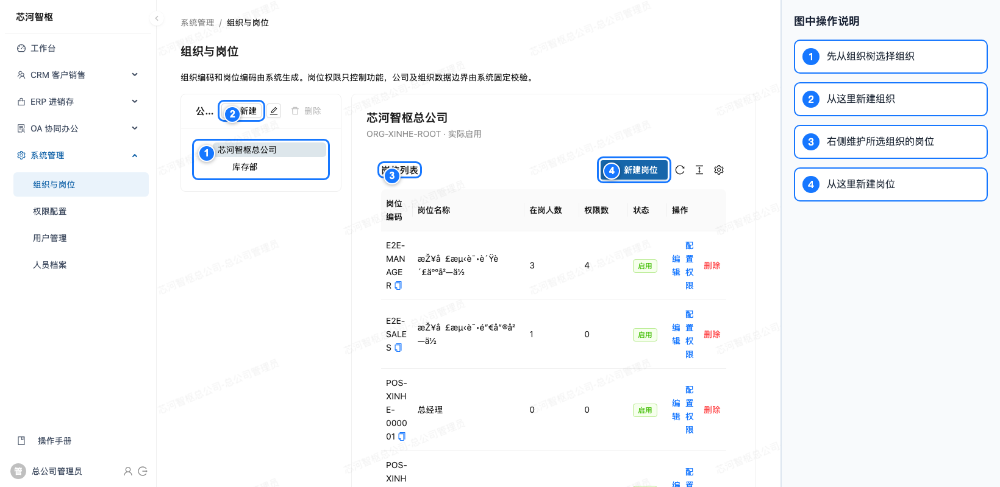

图 2：组织与岗位页面。左侧先选择组织，右侧再查看或维护该组织下的岗位。

### 3.3.2 选择组织和查看岗位

1. 进入“系统管理 > 组织与岗位”。
2. 在左侧组织树中点击一个组织。
3. 观察右侧标题，确认当前选中的组织名称、组织编码和实际状态。
4. 在右侧岗位列表查看岗位编码、岗位名称、在岗人数、权限数和状态。
5. 点击其他组织，右侧岗位列表会随之切换。

组织编码和岗位编码由系统生成，不要将编码当作可编辑名称使用。

### 3.3.3 新建组织

#### 业务场景

公司新增一个部门或业务团队，需要把它放到正确的组织层级，并设置启用状态和联系电话。

#### 操作步骤

1. 在左侧组织树中先选中目标上级组织。
2. 点击“新建”。
3. 填写“组织名称”。
4. 在“上级组织”中确认父级组织；系统会默认带入当前选中的组织。
5. 填写“联系电话”，可使用手机号、座机或国际号码格式。
6. 填写“说明”，补充组织职责或其他管理信息。
7. 选择状态：通常新组织选择“启用”。
8. 点击确定保存。
9. 看到“组织已创建，编码由系统自动生成”提示后，确认左侧树中出现新组织。

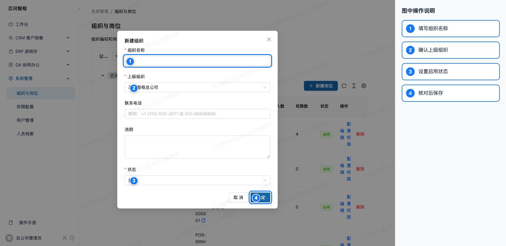

图 3：新建组织弹窗。先确认上级组织，再填写组织名称、联系电话、说明和状态。

### 3.3.4 编辑组织

1. 在左侧树中选中目标组织。
2. 点击组织树上方的编辑图标。
3. 修改组织名称、负责人、上级组织、联系电话、说明或状态。
4. 公司根组织的上级组织会显示为“公司根组织（不可移动）”，不能修改。
5. 点击确定保存。
6. 重新选择该组织，检查名称、状态和岗位列表是否正确。

负责人字段使用“负责人岗位”关联，不是直接填写任意姓名。修改负责人前，先确认目标岗位属于当前组织且处于启用状态。

#### 负责人配置与审批流转

普通员工申请时，系统从本人所属部门开始寻找有效负责人。申请人本人就是该部门负责人时，跳过本人负责的部门，沿上级部门寻找有效负责人；停用、已删除或不满足相应业务审批资格的负责人不会被选中。不能审批本人单据；本部门及上级部门均找不到有效负责人时，由公司管理员检查组织层级、负责人岗位、在岗账号和相应审批权限。

报销匹配到公司管理员或拥有“报销最终审批”权限的负责人时，一个审批节点即可完成；请假匹配到公司管理员时同样只需一人审批。补卡、销售订单按各自审批规则处理，不能将报销终审权限当成通用终审权限。

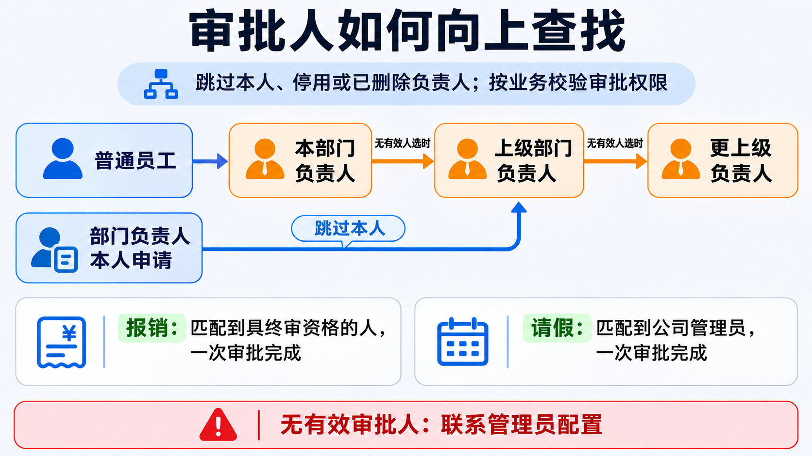

业务图：从申请人所在部门向上查找，跳过本人；是否需要后续终审，按具体业务判断。

### 3.3.5 删除组织

组织删除会影响岗位和用户关系，系统会先检查删除影响。

1. 在左侧组织树选中目标组织。
2. 点击“删除”。公司根组织没有可用的删除操作。
3. 等待系统检查下级组织、岗位和在岗用户。
4. 如果仍有下级组织、岗位或用户，系统会显示“当前组织不能删除”，并列出影响数量；此时需要先处理这些关联对象。
5. 如果可以删除，阅读确认弹窗中的组织名称和影响说明。
6. 点击“删除组织”确认。
7. 等待“组织已删除”提示，并确认组织树已刷新。

删除前至少检查：

- 是否存在下级组织。
- 是否存在岗位。
- 是否有用户关联岗位。
- 是否会影响后续权限配置和数据范围。

删除必须经过确认弹窗。取消确认不会删除组织。

### 3.3.6 新建岗位

#### 业务场景

组织中新增一个职责角色，例如销售主管、仓库管理员或部门负责人，需要先创建岗位，后续才能给用户分配岗位或配置权限。

#### 操作步骤

1. 在左侧组织树选择岗位所属组织。
2. 在右侧岗位列表点击“新建岗位”。
3. 填写“岗位名称”。
4. 选择“所属组织”。默认会带入当前组织，但保存前仍应检查。
5. 填写“岗位职责”，说明该岗位负责的工作。
6. 选择状态：新岗位通常选择“启用”。
7. 点击确定。
8. 确认岗位列表出现新岗位，并记录系统生成的岗位编码。

岗位编码由系统自动生成；岗位权限、用户岗位关系和负责人关系都依赖这个岗位对象。

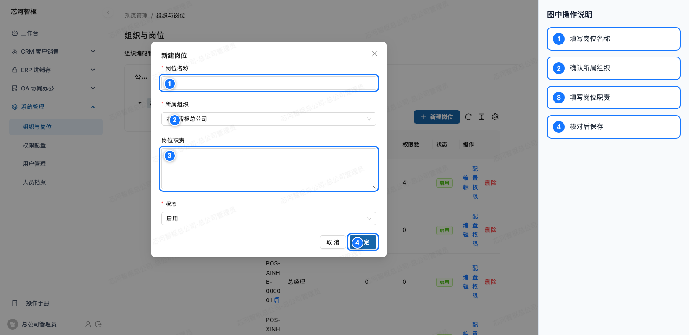

图：先确认所属组织，再填写岗位名称、岗位职责和状态。编号直接附着在对应字段边界上，保存前应逐项核对。

### 3.3.7 编辑岗位

1. 在岗位列表找到目标岗位。
2. 点击“编辑”。
3. 核对只读的岗位编码。
4. 修改岗位名称、所属组织、岗位职责或状态。
5. 点击确定保存。
6. 回到岗位列表检查在岗人数、权限数和状态。

停用岗位前，应确认该岗位下没有正在依赖它进行审批或数据范围判断的用户。

### 3.3.8 配置岗位权限

在岗位列表的操作列点击“配置权限”，系统会进入独立的“岗位权限配置”页面。具体操作见本章 3.4。

### 3.3.9 删除岗位

1. 在岗位列表中找到目标岗位。
2. 点击“删除”。
3. 系统先检查岗位下是否存在用户。
4. 如果仍有用户，页面提示岗位不能删除；先解除用户岗位关系或改派岗位。
5. 如果可以删除，阅读确认弹窗中的岗位名称和影响说明。
6. 点击“删除岗位”。
7. 看到“岗位已删除”后，确认岗位列表和权限配置入口已更新。

岗位删除必须经过确认弹窗。删除前要确认不会影响用户登录、审批负责人和业务数据范围。

## 3.4 岗位权限配置

### 3.4.1 进入权限配置

1. 进入“系统管理 > 组织与岗位”。
2. 在左侧组织树选择目标组织。
3. 在右侧岗位列表找到目标岗位。
4. 点击该岗位操作列中的“配置权限”。
5. 进入“岗位权限配置”页面后，确认页面标题和当前岗位名称。

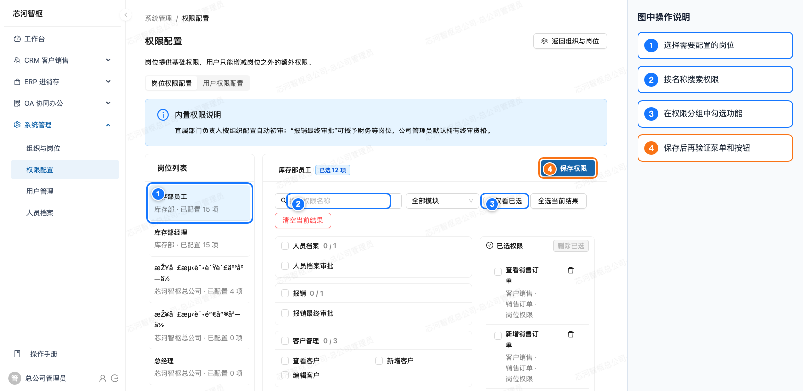

图 4：权限配置页面。页面顶部可在“岗位权限配置”和“用户权限配置”之间切换；岗位模式用于配置岗位基础权限。

### 3.4.2 页面结构

权限配置页面包含以下区域。进入页面后，先选择“岗位权限配置”或“用户权限配置”模式：

1. **岗位列表**：选择需要配置的岗位，并查看组织和已配置权限数量。
2. **公司选择器**：平台管理员可以切换公司；切换后岗位列表会刷新。
3. **内置权限说明**：说明哪些权限由系统规则控制，不会出现在本页。
4. **搜索权限名称**：按权限名称或业务分组搜索。
5. **模块筛选**：按全部模块、办公协同、客户销售或 ERP 进销存筛选。
6. **仅看已选**：只显示当前岗位已经选中的权限。
7. **全选当前结果**：选中当前筛选结果中的全部权限。
8. **清空当前结果**：取消当前筛选结果中的全部选择。
9. **可配置权限区域**：按报销、客户管理、计划管理、销售订单等分组展示。
10. **已选权限区域**：展示当前岗位已选的业务权限，可勾选后批量删除。
11. **保存权限**：把当前页面的选择正式提交到系统。

岗位模式下，岗位权限是用户权限的基础来源；用户模式下，只维护指定用户相对于其岗位权限之外的额外权限。

> “内置权限说明”和“用户额外权限说明”是不同含义：前者解释由角色、组织关系自动授予的能力，后者解释为某一用户单独增加的权限。两段说明在电脑端和移动端都应正常显示；如果只看到标题没有文案，请先刷新页面并联系管理员。

### 3.4.3 当前可配置权限

#### 办公协同

- 人员档案审批
- 报销最终审批

#### 客户销售

客户管理：

- 查看客户
- 新增客户
- 编辑客户

计划管理（每日 / 每周）：

- 查看计划
- 新增计划
- 编辑计划
- 删除计划

销售订单：

- 查看销售订单
- 新增销售订单
- 编辑销售订单
- 撤回销售订单
- 审核销售订单

#### ERP 进销存

当前权限配置页代码中已经包含商品资料、销售订单履约、仓库管理、库存管理、销售退货和销售统计等权限分组。ERP 具体业务暂待开发，配置 ERP 权限前应先确认相关业务模块已经启用并经过测试。

### 3.4.4 不需要手工配置的权限

以下能力由系统规则自动提供或控制，不会出现在岗位权限配置列表中：

- 公司管理：仅平台管理员 root。
- 组织与岗位：公司管理员和平台管理员。
- 用户管理：公司管理员和平台管理员。
- 基础考勤：所有人按规则使用。
- 年度考勤规则：公司管理员按内置角色使用，不作为普通计划权限分配。
- 查看我的报销、新建报销、提交报销：所有人默认可用。
- 报销直属部门负责人初审：由申请人所属直属部门的负责人自动承担，不需要配置“报销最终审批”。
- 报销公司管理员终审：公司管理员默认拥有，不需要重复配置。
- 负责人数据范围：由负责人和组织树关系自动计算。
- 部门负责人查看部门及下级部门打卡记录、审批下属补卡：由系统内置规则控制。

因此，在权限配置页面找不到上述项目是正常现象，不要把缺少列表项误认为系统故障。

### 3.4.5 搜索和筛选权限

1. 在“搜索权限名称”输入关键词，例如“客户”“报销”或“销售订单”。
2. 在模块下拉框选择“办公协同”“客户销售”“ERP 进销存”或“全部模块”。
3. 如只想检查已经分配的权限，勾选“仅看已选”。
4. 查看页面底部“当前结果”数量，确认筛选是否生效。
5. 清空搜索框或切换回“全部模块”，恢复完整权限列表。

### 3.4.6 单项选择、分组选择和全选

- 勾选单个权限，只改变这一项。
- 点击权限分组标题前的复选框，可以选择或清空该分组当前显示的权限。
- 点击“全选当前结果”，只作用于当前搜索和模块筛选结果，不会自动选中隐藏结果。
- 点击“清空当前结果”，只清空当前筛选结果，不会影响当前筛选条件之外的已选权限。
- 右侧“已选权限”标题会显示当前已经选择的数量。

建议配置时先搜索模块，再按分组选择，最后勾选“仅看已选”复核，避免误把不相关权限分配给岗位。

### 3.4.7 删除已选权限

删除权限分为“标记删除”和“正式保存”两个阶段：

1. 在右侧“已选权限”区域，勾选需要删除的权限。
2. 点击“删除已选（数量）”。
3. 阅读确认弹窗，核对待删除数量。
4. 点击“确认删除”。
5. 观察右侧列表，确认权限已经从已选列表移除。
6. 如果误删，且还没有保存，可以重新在左侧权限区域勾选回来。
7. 确认无误后点击“保存权限”。

单项权限右侧的垃圾桶按钮也会弹出确认弹窗。取消确认不会改变权限；**删除后不点击“保存权限”，后端权限不会正式变化**。

### 3.4.8 保存权限

1. 先勾选“仅看已选”。
2. 检查岗位名称、组织和已选权限数量。
3. 确认没有误删或误选。
4. 点击“保存权限”。
5. 等待“岗位权限已保存”提示。
6. 重新切换岗位再切回来，确认权限数量和选择结果仍然正确。
7. 使用一个实际用户账号验证菜单、按钮和数据范围。

权限保存后，岗位下的用户会按岗位规则获得相应功能；数据范围仍由公司、组织、负责人和系统内置规则共同决定。

### 3.4.9 配置报销最终审批权限

报销默认先由申请人的直属部门负责人初审，再由最终审批人终审。公司管理员默认是最终审批人；需要让财务或其他人员承担终审时，在本页授予“报销最终审批”。

岗位授权步骤：

1. 切换到“岗位权限配置”，选择财务等目标岗位。
2. 在“搜索权限名称”中输入“报销”。
3. 勾选“报销最终审批”。
4. 点击“保存权限”，确认出现保存成功提示。
5. 让目标用户重新登录，并进入“OA 协同办公 > 审批中心 > 报销审批”验证。

只需要给个别人员临时增加终审能力时，可以切换到“用户权限配置”，选择目标用户后增加同一权限。用户额外权限不会替代岗位权限，只作为增量叠加。

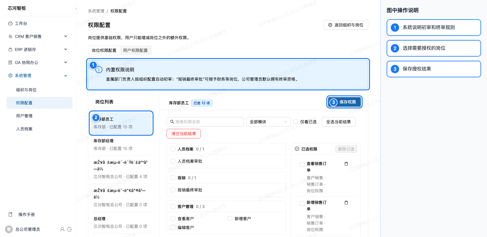

图 7：权限配置页的内置规则说明。直属部门负责人按组织配置自动初审，公司管理员默认拥有终审资格，财务等岗位可单独授权。

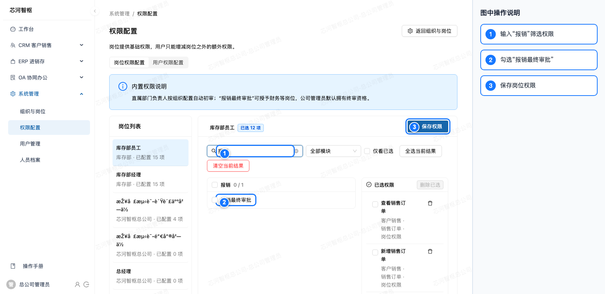

图 8：搜索“报销”后勾选“报销最终审批”的示例。截图仅演示勾选位置，实际授权对象应根据公司职责选择，并在核对后点击“保存权限”。

### 3.4.10 用户权限配置

用户权限配置用于给指定用户增加岗位未提供的额外权限。用户必须先有一个有效岗位，系统才会将该岗位权限作为用户权限的默认基础。

1. 进入“系统管理 > 权限配置”。
2. 点击页面顶部的“用户权限配置”。
3. 在用户列表中选择目标普通用户；公司管理员和平台管理员拥有系统内置的全部权限，不需要在此页单独配置。
4. 页面会默认勾选该用户当前岗位拥有的权限，并标记为“岗位权限”。
5. “岗位权限”处于只读状态，不能取消或删除；如需调整，应修改岗位权限或调整用户岗位。
6. 未被岗位继承的权限可以手工勾选，作为用户额外权限；已增加的额外权限也可以取消勾选。
7. 点击“保存权限”，等待“用户权限已保存”提示。
8. 重新选择该用户或刷新页面，确认岗位权限仍被勾选且额外权限保存成功。

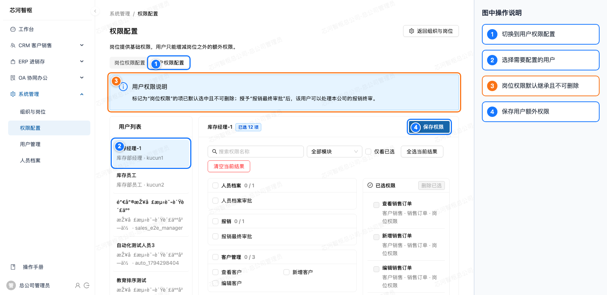

图 9：用户权限配置页面。岗位权限默认勾选且不可删除，用户只能增减岗位未拥有的额外权限。

用户最终生效权限为“当前岗位权限 + 用户额外权限”。用户岗位发生变化时，岗位继承权限会随新岗位自动变化；已经保存的用户额外权限继续保留。

### 3.4.11 用户权限配置注意事项

- 用户权限配置没有“拒绝”规则，不能用用户额外权限抵消岗位权限。
- 用户额外权限只保存岗位之外的增量权限，不要把岗位已有权限重复当作额外权限维护。
- 权限变更保存后，目标用户需要退出当前会话并重新登录，新的菜单、按钮和接口权限才会完整生效。
- 用户权限配置不改变负责人、部门负责人和数据范围规则；这些仍由组织关系和系统内置规则计算。
- 公司管理员和平台管理员的管理类权限由系统规则提供，不以用户额外权限的方式维护。

## 3.5 用户管理

### 3.5.1 查看用户列表

进入“系统管理 > 用户管理”，可以查看当前公司用户；平台管理员可以使用页面右上方的公司选择器查看不同公司。

列表主要展示：

- 用户名
- 用户姓名
- 公司（平台管理员视图）
- 岗位
- 手机号
- 身份：公司管理员或普通用户
- 状态：启用或停用
- 最后登录时间
- 操作：编辑、岗位、删除

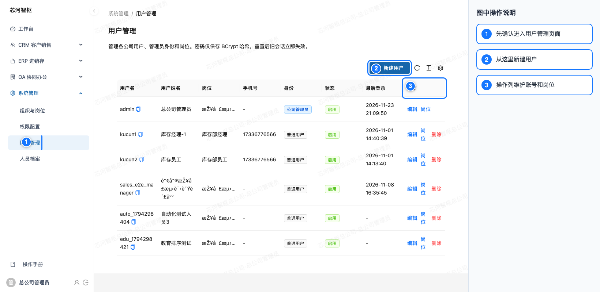

图 5：用户管理页面。管理员可以编辑用户、分配岗位、重置密码或删除用户；当前用户不能删除自己。

### 3.5.2 新建用户

#### 业务场景

临时账号、测试账号或特殊账号需要管理员直接创建时使用。正式员工通常优先走“人员档案 > 入职信息采集”流程。

#### 操作步骤

1. 进入“系统管理 > 用户管理”。
2. 点击“新建用户”。
3. 填写“用户名”。用户名创建后不能通过编辑修改。
4. 填写“用户姓名”。
5. 填写“手机号”；新建用户时为必填。
6. 按需要填写“邮箱”。
7. 在“岗位”中选择一个岗位。普通用户必须有且只能有一个有效岗位；公司管理员可以暂不分配岗位。
8. 只有确实需要时才打开“公司管理员”。
9. 确认账号状态和岗位关系。
10. 点击“确定”。
11. 通过安全方式把用户名和当前页面提示的初始密码交给使用者。

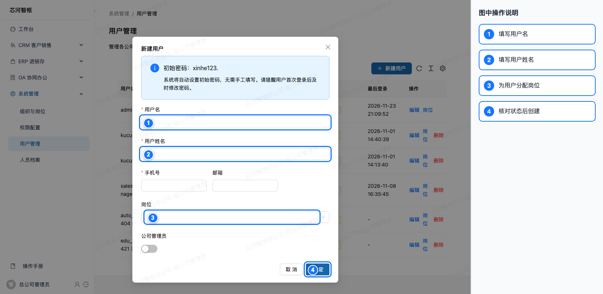

图 6：新建用户弹窗。系统自动设置初始密码，不需要管理员在表单中手工填写密码；新账号首次登录后应立即改密。

岗位为单选配置。一个用户如果需要更多业务能力，应在“权限配置 > 用户权限配置”中增加岗位之外的额外权限，不应通过绑定多个岗位实现。

手机号须填写 11 位大陆手机号，且不能与其他未删除账号重复。保存后的号码可直接配合密码登录，仍共用“用户名或手机号”登录框。修改手机号不会修改用户名。

### 3.5.3 编辑用户

1. 在用户列表找到目标用户。
2. 点击“编辑”。
3. 用户名为只读字段，不能修改。
4. 修改用户姓名、手机号或邮箱。
5. 在“公司管理员”开关中确认管理员身份是否正确。
6. 修改状态为“启用”或“停用”。
7. 点击“确定”。

停用保留账号和历史关系，删除会解除当前公司的用户成员和岗位关系。

### 3.5.4 分配用户岗位

1. 在用户列表找到目标用户。
2. 点击操作列中的“岗位”。
3. 在“分配岗位”弹窗中选择一个岗位；普通用户不能同时绑定多个岗位。
4. 确认岗位所属组织和岗位名称。
5. 点击确定保存。
6. 回到用户列表，检查岗位列是否更新。
7. 让用户重新登录，验证菜单和功能按钮是否符合岗位职责。

岗位关系会影响权限和数据范围。只配置岗位权限但没有把用户分配到该岗位，用户不会获得该岗位的功能。

### 3.5.5 配置用户额外权限

用户已有岗位但仍需要少量岗位未提供的功能时，使用用户额外权限，不新增第二个岗位。

1. 在“系统管理 > 权限配置”中切换到“用户权限配置”。
2. 选择目标普通用户。
3. 核对默认勾选的“岗位权限”；这些权限不可取消。
4. 勾选需要增加的岗位之外权限，或取消已经配置的用户额外权限。
5. 点击“保存权限”。
6. 通知用户退出当前会话并重新登录。
7. 使用用户账号验证菜单、按钮和接口权限；同时确认数据范围未被错误扩大。

图 8：给指定用户增加额外权限时，岗位权限默认勾选且不可删除。

### 3.5.6 停用用户

1. 点击目标用户的“编辑”。
2. 在“状态”中选择“停用”。
3. 点击“确定”提交状态修改。
4. 通知用户退出当前会话。
5. 使用该账号再次登录验证停用结果。

停用前要确认用户是否还有待处理审批、客户负责人关系、计划或其他业务责任。必要时先完成岗位交接。

### 3.5.7 重置密码

1. 在用户列表找到目标用户。
2. 点击“编辑”。
3. 在“账号安全”区域点击“重置密码”。
4. 输入符合密码规则的新密码。
5. 点击确认重置。
6. 通过安全方式把新密码交给用户。
7. 告知用户原有登录会话会失效，需要使用新密码重新登录。

重置密码不是查看原密码，系统不会展示旧密码。密码修改后，用户应再自行设置一个只有本人知道的密码。

### 3.5.8 删除用户

删除用户会解除该用户在当前公司的成员和岗位关系，移除当前公司额外权限及直接负责人关联。没有其他有效公司关系时才删除账号；仍属于其他有效公司时保留账号。历史业务记录和人员档案继续保留。需要删除人员档案时，请在“人员档案”列表另行操作。

1. 确认目标用户不是当前登录账号。
2. 检查用户是否还有岗位、审批、客户负责人或其他业务关系。
3. 点击用户列表中的“删除”。
4. 阅读删除确认弹窗，确认影响范围。
5. 点击“删除用户”。
6. 等待“用户已删除”提示并刷新列表。

删除必须经过确认弹窗。不能删除当前登录用户、平台管理员或公司最后一位有效管理员。旧账号彻底删除后，原用户名可用于重新注册；仍在其他公司使用的账号不会释放用户名。新账号不会继承旧账号的历史单据。

## 3.6 人员档案与入职信息采集

### 3.6.1 页面和状态

进入“系统管理 > 人员档案”后，页面标题为“入职信息采集”。管理员可以看到：

- 姓名
- 部门
- 岗位
- 采集状态：待填写、已提交、已过期、已撤销
- 账号状态：已开通或未开通
- 提交时间
- 截止时间（北京时间）
- 操作入口

采集状态的含义如下：

- **待填写**：链接仍然有效，候选人可以打开并提交资料。
- **已提交**：资料已锁定，系统已创建人员档案和账号，不能再次填写。
- **已过期**：超过截止时间，链接不能继续使用。
- **已撤销**：管理员主动撤销，原链接立即失效，不能继续使用。

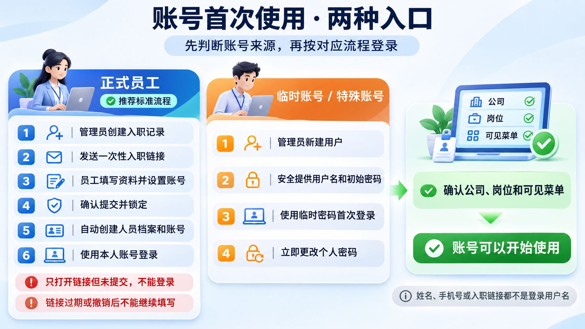

业务图：人员档案对应左侧“正式员工”路径。管理员创建入职记录并发送一次性链接，员工提交并锁定资料后，系统才会自动创建人员档案和账号。右侧临时账号路径不代替正式员工的档案采集。

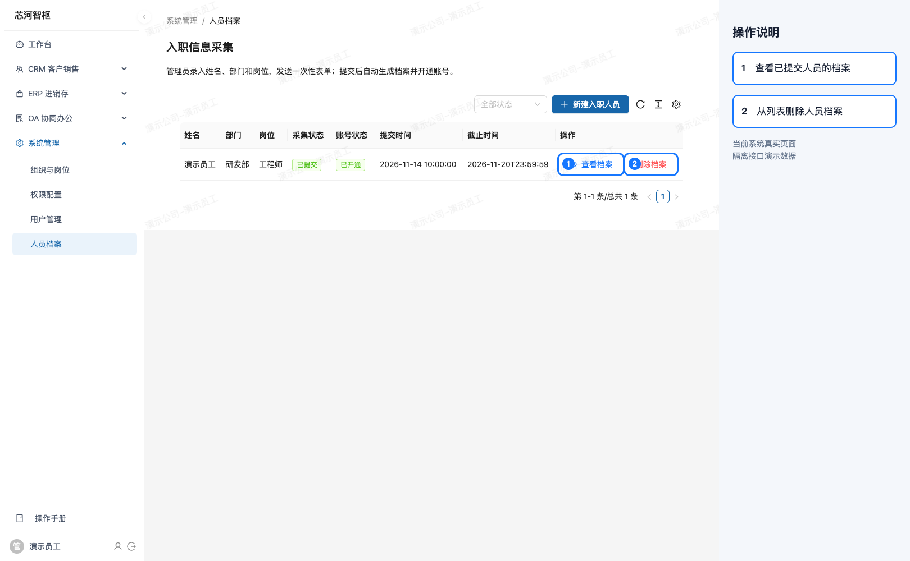

图 7：人员档案脱敏演示列表，按状态展示操作入口；“删除档案”位于列表操作栏。

### 3.6.2 新建入职人员

1. 进入“系统管理 > 人员档案”。
2. 点击“新建入职人员”。
3. 填写候选人“姓名”。
4. 选择“部门”。
5. 选择该部门下的“岗位”。没有选择部门时，岗位下拉框不可用。
6. 设置“链接有效期（天）”，可填写 1–30 天，默认 7 天。
7. 点击“生成表单”。
8. 系统生成一条“待填写”记录，并打开“入职表单链接”弹窗，显示有效期。

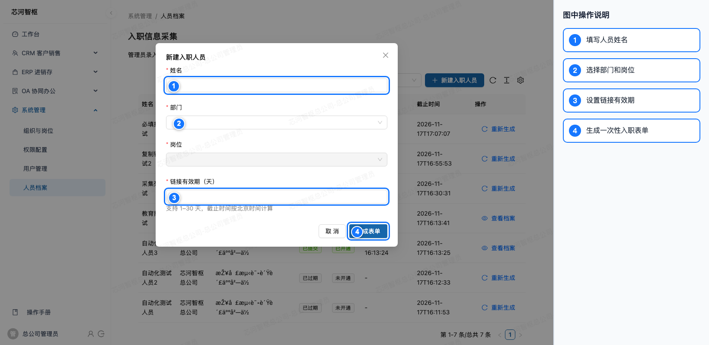

图 8：新建入职人员弹窗示意图；当前版本还可设置链接有效期（1–30 天，默认 7 天）。

### 3.6.3 复制和发送入职链接

1. 在“入职表单链接”弹窗中检查链接内容。
2. 点击“复制链接”或输入框右侧的复制图标。
3. 通过安全方式发送给对应员工。
4. 不要把链接发到公开群聊或无关人员手中。
5. 关闭弹窗后，如果需要再次复制，在列表中点击“复制链接”。

链接是员工填写资料的公开入口，不是管理员登录入口；候选人无需先登录系统即可打开。链接页面会显示截止时间和剩余时间，候选人应在截止时间前完成提交。员工提交后表单会锁定，并自动创建人员档案和账号。

### 3.6.4 重新生成入职链接

适用场景包括链接泄露、链接失效或需要重新发送链接。

1. 在未提交的入职记录操作列点击“重新生成”。
2. 在确认窗口核对影响范围，并设置新链接有效期（1–30 天，默认 7 天）。
3. 点击“确认生成”；系统会立即使旧链接失效。
4. 复制新链接。
5. 将新链接发送给员工，并明确告知旧链接不可继续使用。

已提交的记录不会显示“重新生成”操作，因为表单已经锁定。

### 3.6.5 撤销入职表单

1. 在“待填写”的记录操作列点击“撤销”。
2. 阅读“撤销后原链接立即失效，提交后不可撤销”的确认提示。
3. 确认候选人姓名和记录无误。
4. 点击“撤销”。
5. 看到“已撤销”提示后，确认状态已更新。

撤销是不可恢复的操作。如果只是链接暂时失效，优先考虑“重新生成”而不是撤销。

撤销后，候选人即使持有原链接，也只能看到“表单已撤销”的提示，不能继续看到或填写入职信息。

### 3.6.6 查看人员档案

当采集状态为“已提交”且档案已经生成时，操作列会出现“查看档案”。打开后可以查看：

- 姓名
- 用户名
- 部门
- 岗位
- 性别
- 出生日期
- 证件类型
- 证件号码（脱敏）或证件登记状态
- 手机号
- 邮箱
- 居住地址
- 紧急联系人、联系人关系、联系人电话
- 档案状态
- 提交时间
- 教育背景

证件号码不会在公司管理员的人员档案查看弹窗中原样返回，页面只显示脱敏号码或登记状态。员工本人在“OA 协同办公 > 个人档案”中可以查看完整证件号码；管理员如需核对证件号，应按公司敏感信息管理流程处理，不要从接口或日志中获取明文。

平台管理员不显示“人员档案”菜单，也不能通过直接输入地址查看公司人员档案；平台管理员只负责平台级公司和账号基础管理。

### 3.6.7 人员档案审批权限

人员档案审批默认由公司管理员处理，也可以把 审批权限 配置给其他公司人员：

1. 进入“系统管理 > 组织与岗位”。
2. 找到需要承担审批职责的岗位。
3. 进入“配置权限”，搜索“人员档案审批”。
4. 勾选并保存权限。
5. 确认该人员已关联目标岗位，并重新登录验证“OA 协同办公 > 审批中心 > 人员档案审批”入口。

公司管理员可以直接修改其他人员档案，无需提交审批；其他审批人只能处理分配给自己的待审批申请。平台管理员不参与公司人员档案查看和审批。

### 3.6.8 复制档案信息

带复制按钮的字段可以直接复制，例如：

- 姓名
- 用户名
- 部门
- 岗位
- 出生日期
- 手机号
- 邮箱
- 居住地址
- 紧急联系人
- 紧急联系人电话
- 教育背景组合信息

证件号码不提供管理员复制入口；管理员查看时仅显示脱敏号码或登记状态。

操作步骤：

1. 打开“人员档案”弹窗。
2. 找到需要复制的字段。
3. 点击字段右侧的复制图标。
4. 看到“某字段已复制”提示后，粘贴到目标系统或文档。

复制证件、手机号、地址和紧急联系人信息前，应确认目标位置有权限保存这些敏感信息。

### 3.6.9 删除人员档案与关联账号

**使用场景**：重复录入、人员资料需要重新采集，或确认需要从当前公司移除人员档案时，由公司管理员操作。停用账号、撤销入职链接和删除人员档案的影响不同，应先确认目标。

1. 进入“系统管理 > 人员档案”，找到需要删除的人员。
2. 对“已提交”且人员档案已建立的条目，在列表操作栏点击“删除档案”，不需要进入详情页。待填写、已过期、已撤销等尚未建立档案的入职记录不提供此操作，应按链接撤销或重新生成流程处理。
3. 阅读确认弹窗，核对人员姓名以及关联账号的处理说明。
4. 确认删除后，返回列表确认该档案已移除；有对应账号时，再到用户管理核对当前公司账号关系。

图：公司管理员使用的脱敏演示列表，已提交且档案已建立的记录，在操作栏提供删除入口。

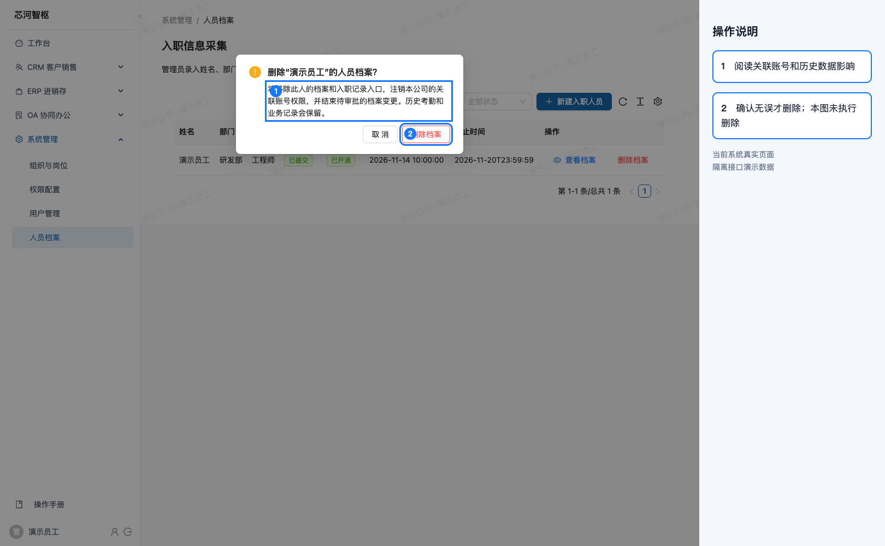

图：确认前核对目标人员及账号影响。取消不会删除数据。

删除后的处理如下：

| 对象 | 处理结果 |
| --- | --- |
| 人员档案 | 从有效档案列表移除 |
| 当前公司关联账号关系 | 有对应账号时解除当前公司的成员、岗位、额外权限及直接负责人关联 |
| 账号在其他公司的关系 | 仍有其他有效公司关系时保留账号；没有时删除账号 |
| 待审批的档案变更 | 取消，记录“人员档案已删除” |
| 历史考勤、请假、报销等业务 | 保留历史归属与记录，不随档案清空 |

不能通过删除档案绕过账号保护，关联当前登录用户或公司最后一位有效管理员时，删除会被阻止。重新采集时需新建入职记录、发送新链接；旧账号已彻底删除后才能复用原用户名，且不能与其他未删除账号重复使用手机号。新注册不会恢复或继承旧账号的历史单据。

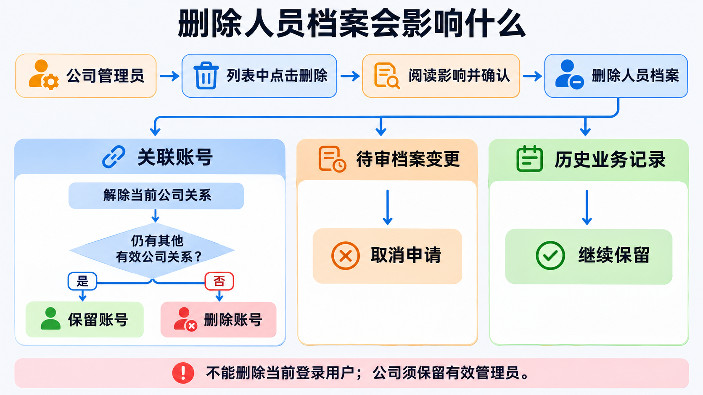

业务图：删除档案时按当前公司处理关联账号，待审档案变更取消，历史业务保留。

## 3.7 系统管理常见问题

### 为什么看不到公司管理

公司管理只对平台管理员 root 开放。公司管理员可以使用组织、岗位、用户和人员档案，但不应看到公司管理。

### 为什么岗位权限配置里没有考勤或我的报销

这些属于系统内置规则，不需要按岗位单独配置。权限页面只展示需要单独配置的业务功能。

### 为什么给岗位配置了权限，用户仍然看不到菜单

依次检查：

1. 用户是否已经分配到目标岗位。
2. 岗位是否处于启用状态。
3. 用户是否属于正确公司。
4. 用户是否重新登录。
5. 该功能是否还受到负责人、部门负责人或数据范围规则限制。

### 为什么普通用户只能选择一个岗位

现在一个普通用户只允许配置一个有效岗位，避免多个部门岗位同时存在时无法确定所在部门和部门负责人的问题。若用户只需要额外业务能力，应使用“用户权限配置”增加岗位之外的权限。

### 为什么用户权限页面中的部分权限不能取消

这些权限来自用户当前岗位，属于岗位继承权限，系统会默认勾选并锁定，不能从用户侧删除。需要调整时，应修改岗位权限或调整用户的单一岗位。

### 用户额外权限保存后为什么没有立即生效

权限变更会使旧登录会话失效或不再刷新权限。请让用户退出当前账号后重新登录，再检查菜单、按钮和接口权限；同时确认目标用户不是公司管理员或平台管理员。

### 用户换岗位后，原来的额外权限是否保留

会保留。岗位继承权限会按新岗位重新计算，用户额外权限仍作为用户级增量权限保留；如不再需要，需在“用户权限配置”中单独取消。

### 为什么组织不能删除

系统会阻止删除仍有下级组织、岗位或在岗用户的组织。先处理关联关系，再重新尝试删除。

### 为什么岗位不能删除

岗位下仍有用户时不能删除。先通过用户管理的“岗位”操作解除或改派用户岗位。

### 入职链接为什么打不开

检查链接是否完整、是否已过期、是否已撤销，或者是否已经提交过。已过期或已撤销的链接不会展示填写表单；待填写记录可以重新生成新链接，已提交记录不能再次编辑。候选人打开有效入职链接不需要登录系统。

### 删除后历史数据是否还在

用户删除会解除当前公司的成员和岗位关系，历史业务记录会保留。删除组织、岗位或用户前仍然要先检查业务影响。

### 手机号重复或原用户名无法重新使用怎么办

手机号不能与其他未删除账号重复，先核对账号归属。删除用户不会删除档案，需要清理档案时使用列表中的“删除档案”。旧账号仍在其他公司有效时，原用户名继续占用；只有账号彻底删除后才可复用。

## 3.8 系统管理员操作检查清单

- [ ] 手机号已核对唯一性，员工知道可使用用户名或手机号登录。
- [ ] 部门负责人和上级负责人配置有效，负责人本人申请时有可处理的上级。
- [ ] 删除档案前已核对关联账号和其他公司关系。
- [ ] 已知晓删除不会清空历史业务，新账号不会继承旧单据。

- [ ] 已确认当前账号是平台管理员还是公司管理员。
- [ ] 创建公司后已安全保存管理员账号和初始密码。
- [ ] 新建组织时已确认上级组织和组织状态。
- [ ] 新建岗位时已确认所属组织、岗位职责和状态。
- [ ] 删除组织或岗位前已检查下级对象和用户关系。
- [ ] 配置权限时已确认目标公司和目标岗位。
- [ ] 删除权限时已完成确认弹窗，并点击“保存权限”。
- [ ] 每个普通用户都已配置且只配置一个有效岗位。
- [ ] 新建用户时已确认用户名、单一岗位和公司管理员开关。
- [ ] 配置用户额外权限时已确认岗位权限默认继承且不可删除。
- [ ] 用户额外权限保存后已安排目标用户重新登录验证。
- [ ] 重置密码后已通知用户旧会话会失效。
- [ ] 删除用户前已检查审批、负责人和历史业务影响。
- [ ] 发起入职信息采集时已填写正确的姓名、部门和岗位。
- [ ] 已确认链接有效期、截止时间和候选人是否能正常打开公共填写入口。
- [ ] 入职链接只发送给对应员工。
- [ ] 重新生成或撤销后已通知候选人使用新链接或停止填写。
- [ ] 已提交的人员档案已核对关键字段和账号状态。
- [ ] 复制敏感档案信息前已确认目标位置具备访问权限。

